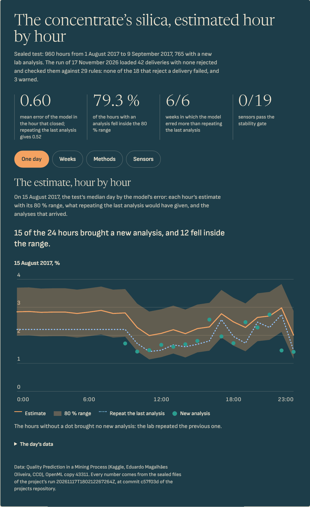
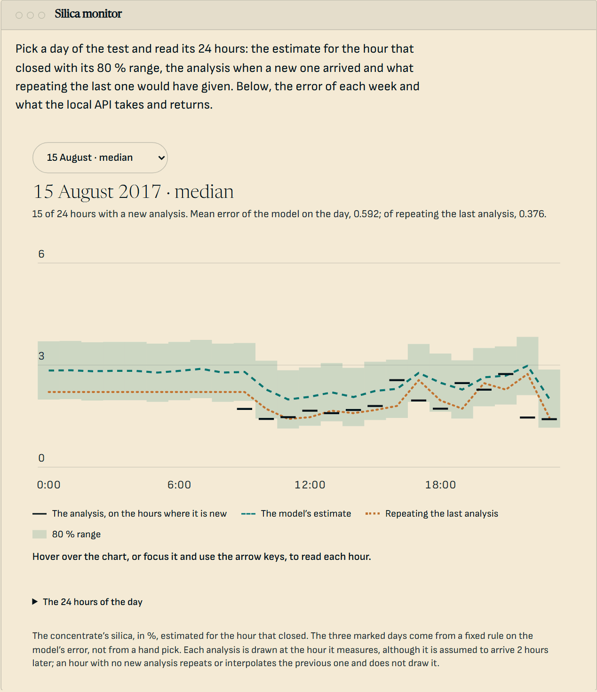
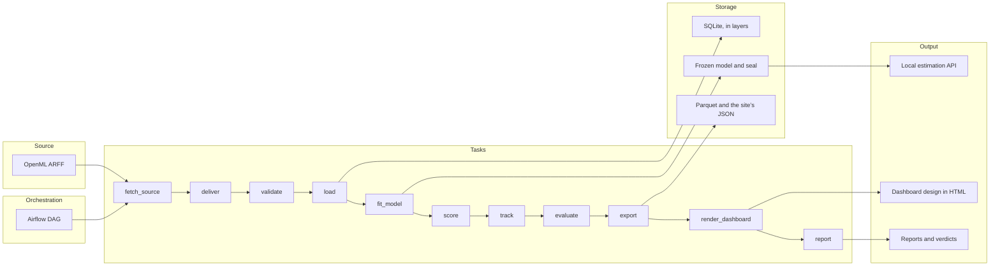

# Random forest and conformal prediction to estimate flotation silica

**English** · [Español](README.es.md)

A soft sensor for the concentrate’s silica, hour by hour, with an 80 % range.



|  |  |
| --- | --- |
| **Result** | 2 of 9 success criteria met |
| **Tech stack** | Python, pandas, NumPy, scikit-learn, SQLite, Parquet, FastAPI, Apache Airflow, Docker |
| **Techniques** | Soft sensor, Random forest, Gradient boosting, Conformal prediction, Day bootstrap, Permutation importance |
| **To audit** (in Spanish) | [Model card](docs/model-card.md) · [Independent evaluation](docs/evaluation.md) · [Latest run: validation](reports/validation/latest.md) · [Latest run: results](reports/evaluation_summary.md) · [Decision log](docs/decisions.md) |

## 1. Executive summary

### 1.1 Business problem and solution

**Business problem and target audience.** Built for the control room and the process and quality teams of an iron ore flotation plant. The concentrate’s silica, the impurity that sets the product’s quality, is measured in the laboratory once an hour, and the result arrives when the process has already moved on: about 2 hours later, an assumption, because the file does not say. Meanwhile, whoever runs the plant adjusts the air and the reagents looking at an old analysis, without knowing whether the sensors say anything the last analysis does not already say.

**Proposed solution.** A flow that loads the plant’s readings every day, checks them against 29 rules, rebuilds which analysis had arrived at each moment and, at the close of each hour, estimates the silica with an 80 % range at three horizons, which a local API also gives:

- **The hour that closed (H0):** the hour whose analysis has not arrived yet.
- **The next hour (H1):** one hour further ahead.
- **In two hours (H2):** two hours further ahead.

### 1.2 Success criteria and impact

**Criteria set before measuring.** Before the code was written, ten criteria were fixed in docs/requirements.md and committed to Git: beat repeating the last analysis for the hour that closed and, out of the noise, the strongest rule at each horizon; an 80 % range that covers between 0.75 and 0.85 of the hours; a bias of 0.10 points at most; sensors that beat the mean and add something to the laboratory’s history; and at least one stable sensor. The tenth is informative. With them, what was expected was written down: that the model would not beat persistence.

**Impact and main result.** On the test, evaluated once, the model does not beat repeating the last analysis: for the hour that closed it errs by 0.597 points of silica on average (MAE), against 0.519 for persistence. What it does deliver is a range that holds, with the analysis inside the 80 % range in 0.793 of the hours, and an estimate of the next two hours. Of the 9 criteria with a threshold, 2 are met.



## 2. Datasets and preparation

### 2.1 Sources, scope and granularity

- Quality Prediction in a Mining Process. Eduardo Magalhães Oliveira, on Kaggle. https://www.kaggle.com/datasets/edumagalhaes/quality-prediction-in-a-mining-process (CC0)
- Quality Prediction in a Mining Process, OpenML copy. OpenML, dataset 43311. https://www.openml.org/d/43311 (CC0)

| Attribute | Specification |
| --- | --- |
| Original volume (M × N) | 737,453 rows × 24 columns (a 185,243,565-byte ARFF, every one declared as text) |
| Period covered | From 10 March 2017 to 9 September 2017: 4,097 hours with data |
| Granularity | One row every 20 seconds, 180 an hour; the laboratory, one analysis an hour |
| Unit of analysis | The hour: its 19 sensors summarized as mean, deviation and last value, and its analysis |
| New analyses | 83.6 % of the hours; in the test, 765 of 960 |

<details>
<summary>Fields available in the dataset (24)</summary>

| Column | Content | Unit | Data type |
| --- | --- | --- | --- |
| `date` | Start of the row’s hour | date and time | Date and time |
| `%_Iron_Feed` | Iron in the feed | % iron | Decimal |
| `%_Silica_Feed` | Silica in the feed | % silica | Decimal |
| `Starch_Flow` | Starch flow (reagent) | not declared by the source | Decimal |
| `Amina_Flow` | Amine flow (reagent) | not declared by the source | Decimal |
| `Ore_Pulp_Flow` | Ore pulp flow | not declared by the source | Decimal |
| `Ore_Pulp_pH` | Pulp pH | not declared by the source | Decimal |
| `Ore_Pulp_Density` | Pulp density | not declared by the source | Decimal |
| `Flotation_Column_01_Air_Flow` | Air flow of column 1 | not declared by the source | Decimal |
| `Flotation_Column_02_Air_Flow` | Air flow of column 2 | not declared by the source | Decimal |
| `Flotation_Column_03_Air_Flow` | Air flow of column 3 | not declared by the source | Decimal |
| `Flotation_Column_04_Air_Flow` | Air flow of column 4 | not declared by the source | Decimal |
| `Flotation_Column_05_Air_Flow` | Air flow of column 5 | not declared by the source | Decimal |
| `Flotation_Column_06_Air_Flow` | Air flow of column 6 | not declared by the source | Decimal |
| `Flotation_Column_07_Air_Flow` | Air flow of column 7 | not declared by the source | Decimal |
| `Flotation_Column_01_Level` | Level of column 1 | not declared by the source | Decimal |
| `Flotation_Column_02_Level` | Level of column 2 | not declared by the source | Decimal |
| `Flotation_Column_03_Level` | Level of column 3 | not declared by the source | Decimal |
| `Flotation_Column_04_Level` | Level of column 4 | not declared by the source | Decimal |
| `Flotation_Column_05_Level` | Level of column 5 | not declared by the source | Decimal |
| `Flotation_Column_06_Level` | Level of column 6 | not declared by the source | Decimal |
| `Flotation_Column_07_Level` | Level of column 7 | not declared by the source | Decimal |
| `%_Iron_Concentrate` | Iron in the concentrate, kept out of the model | % iron | Decimal |
| `%_Silica_Concentrate` | Silica in the concentrate, the target | % silica | Decimal |

</details>

Of the 24 columns, the model reads the 19 sensors, the feed and the silica that has already arrived; the date orders the hours, and the concentrate’s iron stays out, because it is measured in the same hour as the target and gives the answer away.

### 2.2 Cleaning and quality rules

- **The freshness of each hour.** Each hour is flagged as new, repeated, interpolated or missing, and only the new ones are a target or an input. 16.4 % of the 4,097 hours carry no analysis of their own: in 446 the file repeats the previous one and 226 are interpolated between two analyses; in the test it is 195 of 960, 20.3 %.
- **Ramps that are not measurements.** An interpolated hour is part of a straight line: a stretch of 16 hours from 19 April 2017 starts at 3.65 and ends at 3.57 with not one measurement in between. The independent evaluation also found 84 hours that the rule counts as new and that open a ramp; without them no verdict changes.
- **Gaps flagged, never filled.** The gap of 318 hours in March 2017, the 2 incomplete hours, the unchanged feed (a median of 7 hours, one stretch of 791) and the stuck sensors are flagged and left as they are.
- **Read as an untrusted file.** The project’s own reader, with caps on bytes, rows and line length, requires the exact header, 24 fields per row and numbers with a decimal comma; the file is accepted only with the size and the SHA-256 fingerprint fixed.
- **A split in time.** Training (1,673 hours), V1 and V2 (696 each) and the test (960), in that order and with 24 hours of purge between blocks, so that the neighbours of a measured hour do not stay in the training.

## 3. Architecture and methodology

The system runs as a flow of eleven tasks, the same from the command line and from Apache Airflow’s flotsilica_daily DAG in Docker: fetch_source → deliver → validate → load → fit_model → score → track → evaluate → export → render_dashboard → report. Since the file is historical, the second task stands in for the source system.

### 3.1 Source and ingestion

- **A fixed source (fetch_source).** The flow downloads nothing: whoever runs the project places OpenML’s ARFF, and it is accepted only if its size and its SHA-256 fingerprint are the fixed ones. The project’s own reader treats it as an untrusted file, with caps on bytes, rows and line length, and requires the exact header, 24 fields per row and numbers with a decimal comma.
- **Deliveries from a historical file (deliver).** It stands in for the source system: it splits the file into a launch with everything before the test, 40 daily deliveries and a close with no rows that lets the last two analyses arrive, 42 runs in all.
- **Quality gate (validate).** It applies 29 rules: 18 reject the delivery without touching anything if they fail, 6 flag, set aside or warn, and 5 only report. In the real run all 42 deliveries loaded without a rejection.

### 3.2 Orchestration and transformation

- **Flow control (Apache Airflow).** The flotsilica_daily DAG runs once a day, with one run and one task active at a time, on Docker Compose with the four keys required from the environment and no default value. One process writes at a time: a second one is refused without writing anything.
- **All-or-nothing load and hourly issue.** The load task loads each validated delivery into SQLite in a single transaction; fit_model chooses and seals the model at the launch, score issues one estimate per hour and horizon, track compares it with the analysis when it arrives and evaluate computes the criteria once, at the close.
- **How it was run.** The real run was made from the command line: 42 runs, all without an error, in 444.0 seconds. The DAG was tested in Docker in quick mode, on synthetic data, and passed in 99.95 seconds; it did not run on the real file or on a plant.



### 3.3 Storage and data modelling

- **Transactional and audit store (SQLite).** It keeps the readings, each hour’s analysis with the moment it arrives, the hourly summaries, the estimates and the state of each run. The estimates go into insert-only tables, with triggers that also stop INSERT OR REPLACE and ON CONFLICT DO UPDATE: each estimate is issued once and never changed.
- **Frozen model and seal.** The model is trained once, at the launch, and its artefact is loaded only if its size and its SHA-256 match the registered ones. The seal keeps the configuration’s fingerprint and the evaluated test, and is never rewritten.
- **Star-schema analytical layer (Parquet).** The export task writes the tables of a star schema for Power BI, with a manifest that carries each file’s fingerprint, and the five small files this site reads.

<details>
<summary>Data model (20 tables)</summary>

| Table | Kind | Columns | Joins |
| --- | --- | --- | --- |
| `Calendar` | dimension | 7 | — |
| `Hour` | dimension | 10 | — |
| `Horizon` | dimension | 3 | — |
| `Method` | dimension | 3 | — |
| `Sensor` | dimension | 5 | — |
| `Frozen model` | dimension | 13 | — |
| `Run` | dimension | 14 | — |
| `Sensors per hour` | fact | 5 | Hour (`hour_key`); Sensor (`sensor_key`) |
| `Analysis per hour` | fact | 9 | Hour (`hour_key`) |
| `Estimates` | fact | 17 | Hour (`hour_key`); Horizon (`horizon_key`); Frozen model (`model_key`) |
| `Metrics per method` | fact | 12 | Horizon (`horizon_key`); Method (`method_key`) |
| `Error per week` | fact | 6 | Horizon (`horizon_key`); Method (`method_key`) |
| `Criteria and verdicts` | fact | 12 | — |
| `Candidates on V1` | fact | 7 | Horizon (`horizon_key`) |
| `Sensitivities` | fact | 10 | Sensor (`sensor_key`) |
| `Partial dependence` | fact | 4 | Sensor (`sensor_key`) |
| `Variants` | fact | 8 | — |
| `The leak shown` | fact | 5 | — |
| `Quality per day` | fact | 9 | Calendar (`date_key`) |
| `Validation rules` | fact | 9 | Run (`run_key`) |

</details>

### 3.4 Experimentation and machine learning

- **Rigour and traceability protocol.** The ten criteria and what was expected of each were written in docs/requirements.md and committed to Git before the first line of code, and what was expected was that the model would not beat persistence. The seeds are fixed in the configuration (random_state = 0 and the bootstrap with seed 0), each decision is in docs/decisions.md with its options and its reason, and the test is evaluated once, under a seal that keeps the fingerprint of every configuration key that changes a sealed value.

#### 3.4.1 Feature engineering and baseline

At the moment of issue the model reads only what has already arrived: the mean, the deviation and the last value of the 19 sensors in the previous hour (57 columns), the last three new analyses, their means over 6 and over 24 and the age of the last one (6), and the feed (4). Four sets combine those columns: sensors only (57), laboratory only (6), both (63) and both with the feed (67). A list of forbidden columns and an error of its own keep out the concentrate’s iron, a flag of the target’s hour or a calendar variable, and a tripwire stops the launch if the chosen model errs on V1 by less than half as much as persistence.

**Which rule the model must beat** (D13)

- **Selected alternative:** The strongest rule at each horizon (B*), chosen on V1 between repeating the last analysis (B1) and the mean of the last 3 new analyses (B2). They are the rules of an operator without a model; the training mean (B0) and a ridge regression on the sensors (B3) give the floor and the reference of sensors without the laboratory. Persistence came out for the hour that closed and the mean of the last ones for the next two.
- **Rejected alternatives:** Persistence alone: would leave unmeasured the mean of the last analyses, which is an operator’s rule too.
- **Rejected alternatives:** A linear model with the laboratory’s history as a candidate for B*: would be another model, not a rule.

#### 3.4.2 Modelling decisions and ablation (ADR)

<details>
<summary>5 decisions, each with what was rejected</summary>

**Which model estimates the silica** (D14)

- **Selected alternative:** Random forest and gradient boosting from scikit-learn, with the target as a level or as a change, on the four sets: 28 candidates per horizon on a fixed grid, chosen by their MAE on V1. It measures the two families the project promised with the same rules and no new libraries. Three random forests came out, one per horizon.
- **Rejected alternatives:** HistGradientBoostingRegressor alone: in the earlier check, the random forest was the best on V1 at all three horizons.
- **Rejected alternatives:** LightGBM, XGBoost or a neural network: would add libraries with no need for 1,345 training rows.

**Which hours count as a measurement** (D05)

- **Selected alternative:** Only those with a new analysis; the repeated and interpolated ones are flagged and left out of the target and of the inputs. In real time an interpolated value does not exist, because it needs the next analysis, and a repeated one is not a new analysis: evaluating them rewards persistence, and using them as an input is a leak.
- **Rejected alternatives:** Using every hour: the error of persistence on the validation fell from 0.505 to 0.452 by getting repetitions right.
- **Rejected alternatives:** Dropping only the interpolated ones: would keep the repetitions, which make persistence win without measuring anything.
- **Rejected alternatives:** Dropping the ramp stretches whole: would also drop the new analysis that opens each stretch.

**What to do with the concentrate’s iron** (D09)

- **Selected alternative:** Keep it out, with a guard that rejects it by name, a tripwire that stops the launch if the model comes out suspiciously good, and the leak shown in numbers. It is measured in the same hour as the silica and has a correlation of −0.80 with it: with it, the MAE on V2 falls to 0.445, against 0.542 for the sealed model.
- **Rejected alternatives:** Just keep it out: would not show the leak, the most common mistake with this dataset.

**How to give the 80 % range** (D15)

- **Selected alternative:** Split conformal: the half-width of each horizon is a quantile of the model’s absolute errors on V2, a block used neither to choose nor to fit. It is simple, assumes no distribution and its errors come from an independent block. The half-widths are 0.854, 0.970 and 0.973 points of silica.
- **Rejected alternatives:** No range: an estimate without its error misleads whoever runs the plant.
- **Rejected alternatives:** Quantile regression: would double the fits and does not guarantee the coverage.

**How to show which sensors move the estimate** (D20)

- **Selected alternative:** As associations of the model, and only if they pass a gate fixed beforehand: the MAE must rise by at least 0.01 when the sensor is permuted on V1 and on V2, and its partial dependence must keep its sign. It answers the question without claiming causes the data do not support. None of the 19 passed: on V1 the importance is measured inside the sample, and on V2 none reaches it.
- **Rejected alternatives:** Publishing the importance ranking as it comes: would show as a signal an order that changes between models.
- **Rejected alternatives:** Withdrawing the sensitivities: would leave unanswered the question of which sensors move the estimate.

</details>

#### 3.4.3 Validation protocol (time split)

A split in time by the target’s hour: the model is fitted on the training, chosen on V1, refitted on the training and V1 and has its range calibrated on V2; the test, from 1 August 2017 to 9 September 2017, is evaluated once. On it the flow replays the operation hour by hour, in a launch, 40 daily deliveries and a close, and each estimate uses only the analyses that would already have arrived, with the assumed wait of 2 hours. Each comparison carries a 95 % interval from a bootstrap of whole days (2,000 resamples), with the same days for both methods. There was no cross-validation: with 1,345 training rows, each fold would train on fewer than 700 hours.

### 3.5 Consumption and governance

- **Consumption interfaces.** The tables feed the design of a five-page dashboard, written in HTML with the real numbers, and the five small files draw the dashboard on the project page. The local, read-only API gives the same estimate as the flow, with the same function.
- **Governance artefacts.** Each run writes the evaluation summary, the seal and the latest validation; the model card says what it is for and what it is not for, and the decision log keeps each decision with its options and its reason. An independent evaluation reproduced every published figure, the 2,880 estimates of the test included.
- **Full lineage.** Every published figure keeps its run’s key, the sealed configuration’s fingerprint and the SHA-256 of the source file.

## 4. Final product

### 4.1 Operational deliverables

- **Automation.** A daily flow was set up that loads the readings of each delivery and checks them against 29 rules: 18 reject the delivery if they fail, 6 flag, set aside or warn, and 5 only report. Then it rebuilds which analysis had arrived at each hour, flags the incomplete hours and the repeated and interpolated analyses, and estimates with the model, which was trained once and sealed. Since the file is historical, the flow splits it into 42 deliveries: the launch, 40 daily ones and the close, and all 42 loaded without a rejection. It is built for Airflow, where it was tested in Docker.
- **Model in use.** At the close of each hour, a local API takes the readings of the last hour and the latest analyses that have arrived, and returns the estimated silica of the hour that closed and of the next two, with an 80 % range. It is the monitor in the executive summary, which shows each of the 40 days of the test: the estimate with its range, the analyses and what repeating the last one would have given. Three days are marked by a fixed rule on the model’s error, the lowest, the median and the highest; the lowest, 17 August 2017, had barely 2 hours with a new analysis. The range covers 0.793 of the test hours and the model estimates 0.148 points too high on average. Week by week, for the hour that closed the model does not beat repeating the last analysis in any of the six.
- **Dashboard.** Everything ends in the tables of a star schema and in the dashboard shown at the top, drawn from the run’s sealed files: one day’s estimate, the error week by week against repeating the last analysis, the seven methods and the sensors, none of which passes the stability gate. The project also writes the design of a five-page dashboard in HTML, delivered with the tables.

### 4.2 Reading the current results

Run 20261117T180212267264Z, the close, with data up to 10 September 2017, 01:00:

- **Deliveries.** 42 of 42 loaded, 0 rejected, with 737,453 readings in all.
- **Test.** 960 hours evaluated once, 765 with a new analysis.
- **The hour that closed.** MAE 0.597 for the model against 0.519 for repeating the last analysis; the analysis fell inside the 80 % range in 0.793 of the hours, with a bias of +0.148 points.
- **Week by week.** For the hour that closed, the model erred more than repeating the last analysis in 6 of the 6 weeks.
- **The last hour with a new analysis.** 9 September 2017, 23:00: estimate 2.40, with a range of 1.55 to 3.26; repeating the last analysis gave 1.96, and the analysis was 1.71.

## 5. Conclusion

### 5.1 Evaluation against the success criteria

**Status:** 2 of 9 success criteria met.

**Not met:**

- C01: beat repeating the last analysis for the hour that closed.
- C02: beat the strongest rule out of the noise for the hour that closed.
- C03: the same for the next hour.
- C04: the same in two hours.
- C06: a bias of 0.10 points at most.
- C08: sensors that add something to the laboratory’s history.
- C09: at least one sensor with a stable association.

The verdict against the criteria set before measuring, in the executive summary; the tenth is informative:

- **Against repeating the last analysis (C01-C04).** For the hour that closed the model errs more than persistence, 0.597 against 0.519, and the difference with the strongest rule goes from 0.048 to 0.109 at 95 %: it is not noise. For the next hour it ties with the strongest rule, 0.703, with a difference of −0.053 to 0.055, and repeating the last analysis gives 0.675. In two hours its MAE is lower, 0.753 against 0.788, but the difference goes from −0.097 to 0.035 and does not come out of the noise.
- **Range and bias (C05, C06).** The 80 % range covers 0.793 of the hours for the hour that closed, within what was asked, between 0.75 and 0.85. The bias fails: the model estimates 0.148 points too high on average, and 0.10 at most was asked.
- **Sensors (C07, C08).** The sensors alone estimate better than the training mean, 0.819 against 0.924, but add nothing to the laboratory’s history: with them the model does not beat the best one that uses only the analyses, 0.597 against 0.518.
- **Sensitivity (C09).** No sensor passes the stability gate. On V1 all 19 raise the MAE by more than 0.01 when permuted, but that importance is measured inside the sample; on V2 none reaches it, and the gate asks for both.
- **Per week and variants (C10, informative).** For the hour that closed the model does not beat repeating the last analysis in any of the six weeks. If the laboratory took 3 or 4 hours, it would give 0.696 and 0.744 against 0.675 and 0.780 for persistence, with differences that include zero.

**Comparison on the test, the hour that closed**

| Method evaluated | MAE in points of silica | Role in the system |
| --- | --- | --- |
| Random forest, the model | 0.597 | Estimate with its 80 % range, sealed |
| Repeat the last analysis (B1) | 0.519 | Strongest rule for the hour that closed |
| The best with the laboratory only | 0.518 | Comparison: the analyses’ history, without sensors |
| Mean of the last 3 analyses (B2) | 0.573 | Strongest rule for the next two hours |
| The best with sensors only | 0.819 | Comparison: the sensors, without the laboratory |
| Training mean (B0) | 0.924 | Floor: it looks at nothing recent |
| Ridge on the sensors (B3) | 1.183 | Linear reference without the laboratory |

### 5.2 Methodological limits

The project measures, with criteria set beforehand, that over six months of a single plant a model does not estimate the silica better than repeating the last analysis, and what it says holds for that plant and those months. The laboratory’s wait of 2 hours is an assumption taken from another plant, and with 3 or 4 hours the figures change. The file is an OpenML copy that was not compared byte for byte with Kaggle’s. The source does not declare the sensors’ units, so no sensitivity reads in a physical unit, and the data do not say what was changed in the plant, so no figure measures the effect of moving a sensor. 84 hours that the rule counts as new carry no analysis of their own and stay in the sealed figures. And all of it is a simulated operation over a historical file, never a live plant.

### 5.3 Future work

- **The laboratory’s real wait.** Measure it at the plant and repeat the evaluation with it: today it is 2 assumed hours, pending with the project’s owner.
- **The ramp rule.** Stop counting as new the 84 hours that open a ramp, in a later version, because the test has already been read once and nothing is chosen on it again.
- **A live plant.** Publish the API, local and read-only today, and run the daily DAG on a plant’s real readings instead of the replay of a historical file.

## Run it

Python 3.11, on PowerShell, from the repository folder:

```powershell
py -3.11 -m venv .venv
.venv\Scripts\python -m pip install -r requirements-dev.txt
$env:PYTHONPATH = "src"

# Tests, without the ones that need the real file or Docker
.venv\Scripts\python -m pytest

# Quick end-to-end run on synthetic data; everything stays in data\quick\, which is not versioned
.venv\Scripts\python -m flotsilica make-fixture data\quick\flotation_fixture.arff
.venv\Scripts\python -m flotsilica replay --config config\pipeline.quick.toml

# Real run, with the file in place: the launch, 40 daily deliveries and the close; then the next pending one
.venv\Scripts\python -m flotsilica replay
.venv\Scripts\python -m flotsilica run

# Tests with the real file
.venv\Scripts\python -m pytest -m real_data

# The API, after the real run, on 127.0.0.1:8000 only
.venv\Scripts\python -m flotsilica serve

# Documentation figures and the results block of README.es.md
.venv\Scripts\python -m flotsilica figures
.venv\Scripts\python -m flotsilica docs-sync
```

The flow does not download the file: get OpenML dataset 43311 (https://www.openml.org/search?type=data&id=43311) and save it as `data\raw\openml-43311-quality-prediction-mining-process.arff`; its size and SHA-256 are checked before it is read. Every operation is in the [runbook](docs/runbook.md) (in Spanish).

## Source and licence

Data source: Eduardo Magalhães Oliveira, «Quality Prediction in a Mining Process» [Dataset]. Kaggle, CC0 (https://creativecommons.org/publicdomain/zero/1.0/). Copy used: OpenML, dataset 43311 (https://www.openml.org/search?type=data&id=43311), an ARFF file converted from the source, 185,243,565 bytes, SHA-256 `a25122979ba8c5fb9c12e361db61032efc6892a24b5746cc8309da601d9639b2`, not compared byte by byte with the Kaggle CSV. Changes: read as an untrusted file, readings added up by hour, the freshness of each analysis flagged, the history split into a launch, 40 daily deliveries and a close, and variables, baselines, estimates, ranges, metrics and criteria calculated.

The 2-hour laboratory delay is an assumption taken from another plant: Moraes et al. (2018), https://doi.org/10.5151/2237-0234-31915. The raw data is not versioned.
