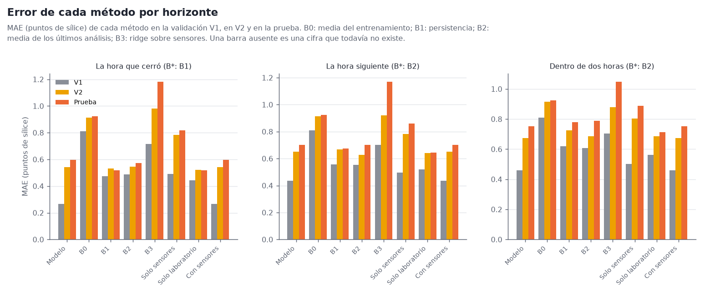
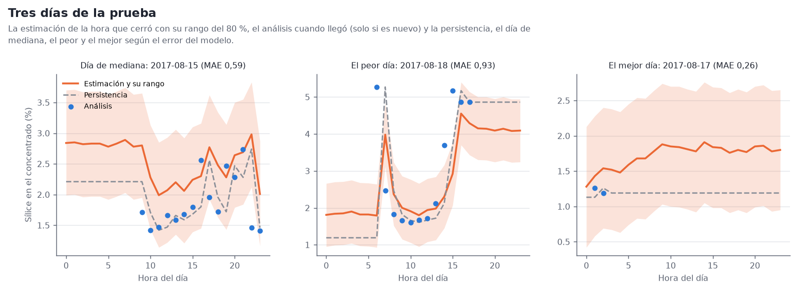
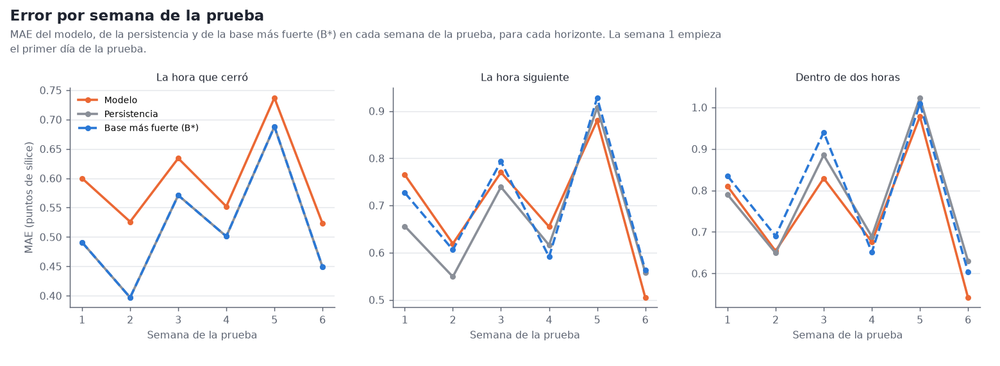
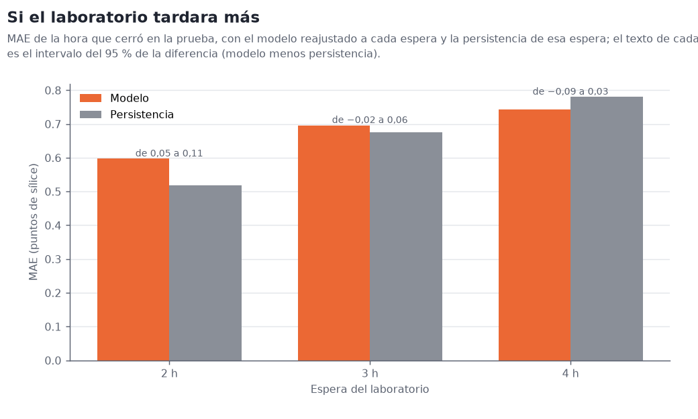
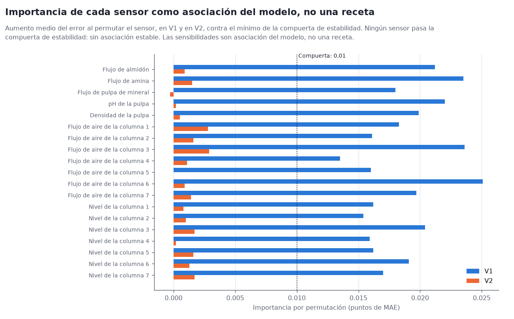
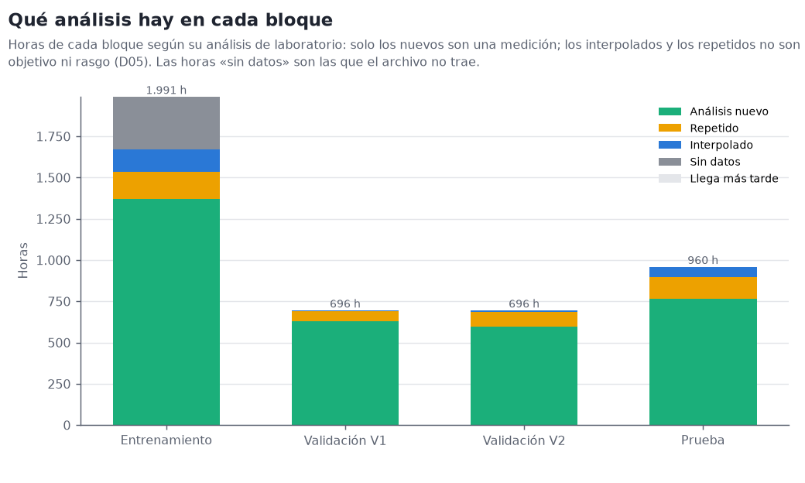
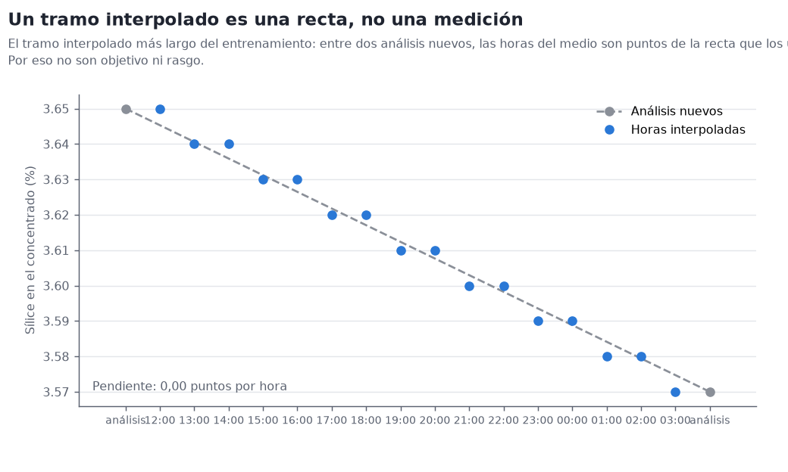

# Sílice en el concentrado, sin esperar al laboratorio

Un flujo que carga cada día de lecturas de una planta de flotación de mineral de hierro, las valida y, al cierre de cada hora, estima la sílice del concentrado de la hora que cerró y de las dos siguientes, con un rango del 80 %, antes de que llegue el análisis del laboratorio. Y mide, contra criterios fijados antes de escribir el código, si ese modelo estima mejor que repetir el último análisis conocido: no lo supera.

## El problema

En una planta de flotación, la sílice del concentrado es la impureza que define la calidad del producto. Se mide en el laboratorio una vez por hora y el resultado llega horas después de tomada la muestra. Mientras tanto, el aire, la pulpa y los reactivos cambian cada pocos segundos. Operación ajusta mirando un análisis viejo, calidad se entera tarde de un concentrado fuera de especificación e ingeniería de procesos no sabe si los sensores dicen algo sobre la sílice que el último análisis no diga ya.

El dato de este proyecto es el conjunto público «Quality Prediction in a Mining Process» de Kaggle (CC0), en la copia convertida que publica OpenML (dataset 43311): 737.453 filas, una cada 20 segundos, del 2017-03-10 al 2017-09-09, con 19 variables de proceso y cuatro columnas de laboratorio. El archivo no trae cuánto tarda el laboratorio (el proyecto supone 2 horas, tomadas de otra planta) y esconde dos cosas: el 15,3 % de las horas anteriores a la prueba no trae un análisis nuevo, porque su valor está repetido de la hora anterior o interpolado entre dos análisis, y la partición al azar que se usa por costumbre deja las horas vecinas de cada hora medida en el entrenamiento.

Lo que el proyecto encontró es la respuesta honesta a la pregunta de operación: **el modelo no supera a la persistencia.** En la prueba, repetir el último análisis conocido se equivoca menos que el modelo en la hora que cerró (error absoluto medio, MAE, de 0,519 frente a 0,597 puntos de sílice) y en la que empieza (0,675 frente a 0,703); en la hora siguiente a esa (H2) el modelo tiene un MAE menor (0,753 frente a 0,780), pero la diferencia con la base más fuerte no queda fuera del ruido. Los sensores, además, no agregan nada a la historia del laboratorio.

## La solución

Un flujo de once tareas que simula la operación sobre el archivo histórico: un lanzamiento con todo lo anterior a la prueba, 40 entregas diarias (2017-08-01 a 2017-09-09) y un cierre que deja llegar los dos últimos análisis, 42 corridas en total. En cada una carga las lecturas de la entrega en SQLite, las valida con 29 reglas, reconstruye qué análisis de laboratorio había llegado en cada instante, y emite hora por hora tres estimaciones (la hora que cerró, H0, y las dos siguientes, H1 y H2), cada una con su rango del 80 %. Cada estimación se emite una vez y no se cambia. El modelo se elige y se calibra con datos anteriores a la prueba, se congela en el lanzamiento y se sella con una huella de cada clave de la configuración; la prueba se evalúa una sola vez. Cuando llega el análisis de una hora, el flujo lo compara con lo que se había estimado. Escribe las tablas de un tablero de Power BI en modelo estrella, el diseño del tablero en HTML, cinco archivos pequeños para el sitio y una API local de estimación.

El resultado central no es el modelo sino una medición: el modelo se compara con cuatro líneas base (la media del entrenamiento, la persistencia, la media de los últimos análisis y una regresión ridge sobre los sensores), con diez criterios fijados antes de construir y con lo esperado dicho por adelantado. **El modelo no supera a la persistencia en H0 ni en H1 (C01, C03), no queda fuera del ruido frente a la base más fuerte en ningún horizonte (C02, C03, C04), tiene un sesgo de 0,148 (C06), los sensores no agregan a la historia del laboratorio (C08) y ningún sensor pasa la compuerta de estabilidad (C09); cumple C05 (el rango del 80 % cubre 0,793 de las horas de H0) y C07 (los sensores solos superan a la media del entrenamiento).** Lo que el proyecto deja, aunque el modelo no gane:

- **La medición honesta del punto de partida**: repetir el último análisis, o promediar los tres últimos en las horas siguientes, estima tan bien como el modelo.
- **La frescura de cada hora**: cada hora se marca como análisis nuevo, interpolado, repetido o faltante, y solo las nuevas son objetivo o variable.
- **La fuga mostrada a propósito**: una partición al azar y el hierro del concentrado de la misma hora dan cifras que parecen buenas y no lo son.
- **El flujo y el sello**: 42 corridas validadas y cargadas todo o nada, un modelo congelado y una prueba evaluada una vez bajo un sello que no se reescribe.
- **El tablero y la API**: las 20 tablas en estrella, el diseño de cinco páginas y un servicio local de solo lectura que da lo mismo que el flujo.

## Los resultados

Corrida real del 2026-11-17 sobre el archivo de OpenML (SHA-256 `a2512297…39b2`): el lanzamiento al 2017-08-01 00:00, 40 entregas diarias y el cierre al 2017-09-10 01:00. El modelo se entrenó con las horas del 2017-03-10 al 2017-05-31, se eligió con V1 (junio), se reajustó con entrenamiento y V1 y calibró su rango con V2 (julio); la prueba, del 2017-08-01 al 2017-09-09 (960 horas, 765 con análisis nuevo), se evaluó una sola vez y quedó en el sello `reports/model_seal.json`, que no se reescribe. Los criterios se fijaron y se confirmaron en Git antes del primer código (`docs/requirements.md`, sección 8.1; `docs/decisions.md`, D16), junto con lo que se esperaba: que el modelo no cumpliera C01-C04, C08 ni C09, que C06 quedara en el borde, que C07 se cumpliera y que C05 fuera incierto. **Así salió: el modelo no supera a la persistencia en H0 ni en H1; C01-C04, C06, C08 y C09 no se cumplen; C05 y C07 se cumplen; C10 es informativo.** El bloque siguiente no se escribe a mano: lo copia `python -m flotsilica docs-sync` de `reports/evaluation_summary.md`, que escribe el propio flujo, con su propio título de segundo nivel.

<!-- results:start -->
## Resultados

Criterios fijados antes de construir, evaluados una vez sobre la prueba.

| Criterio | Umbral | Valor | Cumple | Veredicto |
| --- | --- | ---: | --- | --- |
| C01 H0 frente a la persistencia | MAE(modelo) < MAE(persistencia) | 0,597 | no | El modelo no supera a la persistencia en la hora que cerró: MAE 0,60 frente a 0,52. |
| C02 H0 fuera del ruido frente a la base más fuerte | límite superior del intervalo del 95 % de MAE(modelo) − MAE(B*) < 0 | 0,597 | no | El modelo no supera a la base más fuerte en la hora que cerró fuera del ruido: MAE 0,60 frente a 0,52; la diferencia va de 0,05 a 0,11. |
| C03 H1 fuera del ruido frente a la base más fuerte | límite superior del intervalo del 95 % de MAE(modelo) − MAE(B*) < 0 | 0,703 | no | El modelo no supera a la base más fuerte en la hora que empieza fuera del ruido: MAE 0,70 frente a 0,70; la diferencia va de −0,05 a 0,05. |
| C04 H2 fuera del ruido frente a la base más fuerte | límite superior del intervalo del 95 % de MAE(modelo) − MAE(B*) < 0 | 0,753 | no | El modelo no supera a la base más fuerte en la hora siguiente fuera del ruido: MAE 0,75 frente a 0,79; la diferencia va de −0,10 a 0,03. |
| C05 Cobertura del rango de H0 | proporción de horas con el análisis dentro del rango del 80 % entre 0,75 y 0,85 | 0,793 | sí | El rango del 80 % cumple en la hora que cerró: cubre 0,793 de las horas, y se pedía entre 0,75 y 0,85. |
| C06 Sesgo de H0 | \|media(modelo − análisis)\| ≤ 0,10 | 0,148 | no | El sesgo en la hora que cerró no cumple: el modelo estima 0,148 de más en promedio, y se pedía a lo sumo 0,10. |
| C07 Los sensores solos frente a la media | límite superior del intervalo del 95 % de MAE(mejor solo con sensores) − MAE(B0) < 0 | 0,819 | sí | Los sensores solos superan a la media del entrenamiento: MAE 0,82 frente a 0,92; la diferencia va de −0,16 a −0,06. |
| C08 Los sensores agregan a la historia del laboratorio | límite superior del intervalo del 95 % de MAE(mejor con sensores) − MAE(mejor solo con laboratorio) < 0 | 0,597 | no | Con sensores, el modelo no agrega a la historia del laboratorio: MAE 0,60 frente a 0,52; la diferencia va de 0,06 a 0,10. |
| C09 Sensibilidad estable | al menos un sensor pasa la compuerta y conserva el signo de su dependencia parcial en la prueba | 0,000 | no | Ningún sensor pasa la compuerta de estabilidad: sin asociación estable. |
| C10 Por semana y variantes (informativo) | sin umbral: que esté escrito y sea consistente | sin dato | informativo | Informativo, sin umbral: el MAE del modelo, de la persistencia y de la base más fuerte por semana y las variantes de latencia y de reajuste, escritos en el sello (2295 horas evaluadas). |

Validación (V2, no la prueba): MAE de cada método por horizonte.

| Método | H0 | H1 | H2 |
| --- | ---: | ---: | ---: |
| Modelo | 0,542 | 0,651 | 0,673 |
| Base más fuerte (B*) | 0,533 | 0,628 | 0,687 |
| Media del entrenamiento (B0) | 0,914 | 0,914 | 0,914 |
| Persistencia (B1) | 0,533 | 0,669 | 0,724 |
| Media de los últimos análisis (B2) | 0,547 | 0,628 | 0,687 |
| Ridge sobre sensores (B3) | 0,981 | 0,922 | 0,878 |
| Mejor solo con sensores | 0,782 | 0,784 | 0,803 |
| Mejor solo con laboratorio | 0,521 | 0,641 | 0,687 |
| Mejor con sensores y laboratorio | 0,542 | 0,651 | 0,673 |

Estado: sealed. Corrida 20261117T180212267264Z del 2017-09-10 01:00:00.
<!-- results:end -->

Cómo se lee, con las cifras de la prueba (MAE en puntos de sílice, sobre las 765 horas con análisis nuevo):

| Horizonte | Modelo | Persistencia | Base más fuerte (B*) |
| --- | ---: | ---: | --- |
| H0, la hora que cerró | 0,597 | 0,519 | 0,519, la persistencia |
| H1, la hora que empieza | 0,703 | 0,675 | 0,703, la media de los últimos análisis |
| H2, la hora siguiente | 0,753 | 0,780 | 0,788, la media de los últimos análisis |

- **No supera a la persistencia en H0 ni en H1** (C01 y C03). En H0 el modelo se equivoca más y la diferencia no es ruido (C02: de 0,05 a 0,11 puntos). En H1 empata con la base más fuerte (C03: de −0,05 a 0,05). En H2 su MAE es menor que el de las dos, pero el intervalo de la diferencia con B* incluye el cero (C04: de −0,10 a 0,03), y el criterio pide que no lo incluya.
- **El rango del 80 % cumple (C05):** cubre 0,793 de las horas de H0. Sus semianchos, calibrados en V2, son 0,854, 0,970 y 0,973 puntos de sílice para H0, H1 y H2.
- **El sesgo no cumple (C06):** el modelo estima 0,148 puntos de más en promedio en H0, contra un tope de 0,10. La investigación midió un cambio de nivel entre el entrenamiento (media de 2,56) y la validación (2,04), y por eso el modelo se reajusta con V1 (research.md, D11).
- **Los sensores solos sirven más que la media (C07) y no más que el laboratorio (C08):** el mejor modelo solo con sensores tiene un MAE de 0,819 contra 0,924 de la media; el mejor solo con la historia del laboratorio, 0,518; con los dos, 0,597.
- **Ninguno de los 19 sensores pasa la compuerta (C09).** El aumento del MAE al permutar un sensor va de 0,0135 a 0,0251 en V1 y de −0,0003 a 0,0029 en V2; la compuerta pide al menos 0,01 en las dos.
- **Si el laboratorio tardara 3 o 4 horas (informativo):** el MAE del modelo en H0 es 0,696 y 0,744 contra 0,675 y 0,780 de la persistencia; con 4 horas el modelo tiene el MAE menor, pero la diferencia va de −0,094 a 0,025 y no queda fuera del ruido.











## En qué consiste

Once tareas que corren siempre en este orden, las mismas desde la línea de comandos (`python -m flotsilica run`) y desde el DAG de Apache Airflow (`flotsilica_daily`):

```mermaid
flowchart LR
  A[fetch_source<br/>ARFF con tamaño y huella fijados] --> B[deliver<br/>la siguiente entrega]
  B --> C[validate<br/>29 reglas]
  C --> D[load<br/>SQLite, todo o nada]
  D --> E[fit_model<br/>elige, congela y sella en el lanzamiento]
  E --> F[score<br/>una estimación por hora y horizonte]
  F --> G[track<br/>la compara con el análisis al llegar]
  G --> H[evaluate<br/>V2 y, una vez, la prueba]
  H --> I[export<br/>20 Parquet y 5 JSON]
  I --> J[render_dashboard<br/>HTML]
  J --> K[report<br/>cierra la corrida]
```



La segunda tarea hace de sistema de origen: como el archivo es histórico, el flujo lo reparte en un lanzamiento con las filas hasta el 2017-07-31 23:00, 40 entregas diarias (2017-08-01 a 2017-09-09) y un cierre sin filas que deja llegar los dos últimos análisis. La tercera tarea corta el flujo, sin tocar nada, si la entrega no cumple el contrato. Con el análisis de cada hora llegando 2 horas después de su hora (un supuesto, no un dato del archivo), en el cierre de la hora `h` se conoce hasta el análisis de la hora `h − 1`; la regla de llegada es la misma en el flujo y en la API.

El modelo se entrena una sola vez, en el lanzamiento, y queda congelado: su artefacto se carga solo si su tamaño y su SHA-256 coinciden con los registrados. Las estimaciones se escriben en tablas de solo inserción, con disparadores de SQLite que también detienen `INSERT OR REPLACE` y `ON CONFLICT DO UPDATE`. El sello guarda la huella de cada clave de la configuración que cambia un valor sellado: una evaluación de la prueba con otra configuración se rechaza antes de escribir, y lo que se calcule después con otra configuración se informa aparte, como posterior al sello. Un solo proceso escribe la carpeta de datos a la vez: cada tarea toma un bloqueo y un segundo proceso se rechaza con salida 2 sin escribir nada.

Sobre la fuente: el archivo se trata como no confiable. Lo lee un lector propio, con tope de bytes, de filas y de largo de línea, que exige la cabecera exacta, 24 campos por fila, fechas y números con coma decimal en el formato esperado, y se acepta solo si su tamaño y su SHA-256 son los fijados. El flujo no descarga nada: el archivo lo coloca quien corre el proyecto (ver «Cómo correrlo de punta a punta»).

## Los datos

| | |
| --- | --- |
| Fuente | «Quality Prediction in a Mining Process» (Kaggle, Eduardo Magalhães Oliveira, CC0), en la copia de OpenML, dataset 43311 |
| Archivo | `openml-43311-quality-prediction-mining-process.arff`, 185.243.565 bytes, SHA-256 `a25122979ba8c5fb9c12e361db61032efc6892a24b5746cc8309da601d9639b2`; no se comparó byte a byte con el CSV de Kaggle |
| Columnas | 24, todas declaradas como texto: la fecha, el hierro y la sílice de la alimentación, 19 variables de proceso (flujos de almidón, amina y pulpa, pH y densidad de la pulpa, siete flujos de aire y siete niveles de columna) y el hierro y la sílice del concentrado |
| Período | Del 2017-03-10 01:00 al 2017-09-09 23:00 |
| Filas | 737.453, una cada 20 segundos; 180 por hora en 4.095 de las 4.097 horas con datos (las otras dos tienen 174 y 179) |
| Hueco | 318 horas sin datos, del 2017-03-16 06:00 al 2017-03-29 11:00 |
| Objetivo | La sílice del concentrado, en %: el análisis de cada hora es el de su primera fila |
| Frescura | De las 960 horas de la prueba, 765 traen un análisis nuevo, 130 lo repiten de la hora anterior y 65 son interpoladas; en todo el archivo, la parte nueva es 0,836 |

El archivo trae un análisis por hora, pero no siempre es nuevo. En 310 horas de sílice (7,6 %) las filas de la hora son una recta que termina en el primer valor de la hora siguiente, una fuga a nivel de fila (research.md); y la alimentación del laboratorio se mantiene sin cambios hasta 791 horas seguidas (mediana de 7). El proyecto marca cada hora (D05): **nueva** (hay un análisis), **interpolada** (está en una rampa), **repetida** (su valor es el de la hora anterior) o **faltante**; solo las nuevas son objetivo o variable. En las horas anteriores a la prueba, el 15,3 % no trae un análisis nuevo.





La partición en el tiempo, por la hora del objetivo, con 24 horas de purga entre bloques:

| Bloque | Horas | Con análisis nuevo | Para qué |
| --- | --- | ---: | --- |
| Entrenamiento | 2017-03-10 01:00 a 2017-05-31 23:00 | 1.369 de 1.673 | Ajustar los modelos y las líneas base |
| Purga | 2017-06-01 | | Ninguno |
| V1 | 2017-06-02 a 2017-06-30 | 630 de 696 | Elegir el modelo y la base más fuerte, y reajustar |
| Purga | 2017-07-01 | | Ninguno |
| V2 | 2017-07-02 a 2017-07-30 | 597 de 696 | Calibrar el rango del 80 % |
| Purga | 2017-07-31 | | Ninguno |
| Prueba | 2017-08-01 a 2017-09-09 | 765 de 960 | Evaluar una sola vez, bajo el sello |

Una partición al azar da un resultado que no se sostiene en el tiempo. En V2, el mismo candidato elegido por el lanzamiento y ajustado en el entrenamiento da un MAE de 0,557 y un R² de 0,229 cuando los datos se cortan en el tiempo, y con una partición al azar de 80 % y 20 % de las horas de entrenamiento, V1 y V2, 0,533 y 0,514; con el hierro del concentrado de la misma hora agregado (la variable que las guardas rechazan), el MAE baja a 0,445, contra 0,542 del modelo sellado.

## Los algoritmos

- **La hora como unidad y solo lo que ya llegó.** Las lecturas se agregan por hora (media, desviación y último valor de cada sensor). En el instante de emisión `t`, el modelo usa las lecturas hasta la hora `t − 1` y los análisis frescos llegados hasta `t`. Una lista de columnas prohibidas, un error propio (`LeakageError`) y pruebas de truncamiento y de perturbación impiden que el hierro del concentrado, las marcas de rampa de la hora del objetivo o una variable de calendario lleguen a la matriz; una trampa detiene el lanzamiento si el MAE en V1 del modelo elegido es menor que 0,5 veces el de la persistencia.
- **Variables.** Cuatro conjuntos: solo sensores (57 columnas: media, desviación y último valor de los 19 sensores), solo laboratorio (6: los tres últimos análisis frescos, las medias de 6 y de 24, y la edad del último), sensores y laboratorio (63) y esos más la alimentación (67).
- **Líneas base.** B0, la media del entrenamiento; B1, la persistencia (el último análisis llegado); B2, la media de los últimos 3 análisis frescos (el 3 se eligió en V1 entre 3, 6, 12 y 24); B3, una regresión ridge sobre los sensores. B* es, en cada horizonte, la mejor de B1 y B2 en V1: la persistencia en H0 y la media móvil en H1 y H2.
- **Modelos.** `HistGradientBoostingRegressor` y `RandomForestRegressor` de scikit-learn, con el objetivo en nivel o en cambio desde el último análisis, sobre los cuatro conjuntos de variables, con una grilla fija: 28 candidatos por horizonte (84 en total). Se elige el de menor MAE en V1. Salieron tres bosques aleatorios: H0 con sensores y laboratorio y el objetivo en cambio (MAE en V1 0,4725), H1 con sensores, laboratorio y alimentación y el objetivo en nivel (0,5596) y H2 con sensores y laboratorio y el objetivo en nivel (0,6016).
- **Reajuste.** El elegido se reajusta con entrenamiento y V1 antes de calibrar el rango, por el cambio de nivel de la sílice entre bloques.
- **Rango del 80 %.** Conformal partido: el semiancho de cada horizonte es el cuantil de los residuos absolutos del modelo reajustado sobre las horas de V2; el rango es la estimación más y menos ese semiancho, recortado a 0-100.
- **Intervalos de las comparaciones.** Remuestreo de días enteros con reposición (2.000 remuestras, semilla 0), con los mismos días para los dos métodos, sobre la diferencia de MAE.
- **Sensibilidades, solo si pasan una compuerta.** Un sensor se publica como asociación del modelo, nunca como causa ni acción, solo si el aumento del MAE al permutar sus tres columnas es de al menos 0,01 en V1 y en V2, y su dependencia parcial conserva el signo (correlación de Spearman de al menos 0,5 en valor absoluto) en el modelo sellado y en 5 reajustes con días remuestreados. Ninguno de los 19 pasó.

Ecuaciones, límites y resultados de cada método en la [ficha del modelo](docs/model-card.md).

## El producto

- **Tablas para Power BI:** 20 archivos Parquet en `outputs/powerbi/` (el mayor, 2,0 MB), con 15 relaciones uno a varios y filtro en un solo sentido, y un manifiesto con la huella de cada uno.
- **Diseño del tablero:** [dashboard/powerbi-design.html](dashboard/powerbi-design.html), un solo archivo de 129.652 bytes, sin recursos externos, con el modelo semántico, las relaciones, las medidas DAX, la carga en Power Query y cinco páginas con vistas previas dibujadas con los números reales. El `.pbix` requiere Power BI Desktop y no está hecho; las medidas DAX no se ejecutaron nunca: las pruebas comprueban solo que cada tabla, columna, medida y función que nombran existe.
- **Archivos para el sitio:** cinco JSON pequeños en `outputs/site/` (el resumen, los datos, los algoritmos, la operación y las reglas de validación) y un manifiesto con la huella de cada uno, 129.670 bytes sin el manifiesto.
- **Figuras:** siete PNG en `docs/figures/`, dibujadas con matplotlib solo desde los archivos del sitio verificados.
- **Reportes:** `reports/evaluation_summary.json` y `.md` (los resultados de arriba), `reports/model_seal.json` (el sello) y `reports/validation/latest.md` (la última validación).
- **API de estimación:** `python -m flotsilica serve` levanta un servicio local con FastAPI y uvicorn, solo en `127.0.0.1`, de solo lectura: `GET /health` dice qué modelo y qué configuración sirve, y `POST /estimate` recibe las lecturas de la hora que cerró, los últimos análisis frescos con la hora de su muestra y el instante de emisión, y da las tres estimaciones con su rango y la persistencia, con la misma función que el flujo. Se niega a servir sin sello o con otra configuración que la sellada, y rechaza con 422 un análisis posterior al instante de emisión. Publicarla queda pendiente del dueño.
- **Orquestación:** la línea de comandos y el DAG `flotsilica_daily` de Airflow sobre Docker Compose, con las mismas tareas y las mismas funciones.

## La documentación

| Documento | Qué contiene |
| --- | --- |
| [docs/research.md](docs/research.md) | La investigación del archivo: muestreo, rampas, hueco, alimentación congelada, la fuga de la partición al azar, las líneas base y una primera mirada del modelo, que no superó a la persistencia |
| [docs/requirements.md](docs/requirements.md) | Requerimientos, datos medidos y criterios de aceptación, con los criterios del modelo fijados antes de construir |
| [docs/plan.md](docs/plan.md) | Arquitectura, módulos, contratos y las 23 unidades de trabajo |
| [docs/decisions.md](docs/decisions.md) | Registro de decisiones, cada una con su contexto, opciones, decisión, motivo, lo que afecta, quién y estado |
| [docs/model-card.md](docs/model-card.md) | Ficha del modelo: uso, datos, frescura, latencia, horizontes, partición, métodos, resultados, sensibilidades, límites, tiempos y la suite |

Todavía no están escritos, y se escriben en la unidad U23 (plan, sección 27): el diccionario de datos (`docs/data-dictionary.md`), el runbook (`docs/runbook.md`), el paso a paso (`docs/paso-a-paso.md`) y las advertencias de las revisiones (`docs/review-advisories.md`). El informe de la evaluación independiente (`docs/evaluation.md`) viene después.

## Con IA, de punta a punta

Este proyecto lo construyen agentes de IA, cada uno con el modelo que el dueño pidió para su tarea (Opus para los planes, la arquitectura y la evaluación, Sonnet para la programación, Haiku para tareas acotadas como investigar), con una persona definiendo el rumbo. Lo que sigue es lo que consta en el registro del documento de seguimiento (`odd/tasks/portfolio-projects.md`, L58 a L65) y en `git log`:

- **Datos.** El equipo no tenía los datos de Kaggle ni una cuenta para bajarlos; el dueño eligió la copia de OpenML y la bajó a mano. El agente comprobó que es un ARFF válido (texto, 24 atributos, 737.453 filas de 24 campos, 4.097 horas), calculó su tamaño y su SHA-256, lo movió a `data/raw/` (que no se versiona) y dejó escrito que es una conversión, no comparada byte a byte con el CSV de Kaggle (L58, L59).
- **Investigación.** Un agente con Haiku perfiló el archivo (4.095 de 4.097 horas con 180 filas, la alimentación que se mantiene días, 310 horas de sílice en rampa, el hueco de 318 horas), midió que una partición al azar da R² 0,565 contra −0,511 en un bloque del tiempo con el mismo modelo, midió las líneas base y una primera mirada del modelo, que no superó a la persistencia, y escribió `research.md` con sus diez scripts versionados en `research/` y sin calcular nada sobre la prueba. Una comprobación del orquestador recalculó la persistencia en la validación y repitió los diez scripts (L60).
- **Requerimientos y plan.** Un agente con Opus leyó la investigación y los documentos del proyecto 04 y su evaluación, y repitió parte de la medición **leyendo el archivo solo hasta antes del 2017-07-31**: encontró que las horas interiores de los tramos en rampa son una interpolación entre dos análisis y que una de cada diez horas repite el valor anterior, de modo que la persistencia de `research.md` (MAE 0,452) estaba ayudada por horas sin análisis nuevo (sobre las horas nuevas, 0,505); fijó los criterios C01-C10 y escribió que el modelo probablemente no superaría a la persistencia (C01-C04 no se cumplirían, C08 y C09 tampoco); y escribió 26 requerimientos funcionales, 16 no funcionales, 40 criterios de aceptación, un plan de 23 unidades y 43 decisiones. Todo se confirmó en Git antes de la primera línea de código (`8adbbbd`, L61).
- **Programación.** Agentes con Sonnet escribieron U01 a U21 una unidad a la vez, cada una con su prueba primero (L62-L65): el entorno y las dependencias, la configuración, el accesorio sintético, la lectura estricta del ARFF, las entregas y la validación, el almacén, las variables de un instante y sus guardas de fuga, la partición y las líneas base, los candidatos y el artefacto, el lanzamiento congelado y el sello, la evaluación y los criterios, las sensibilidades, el seguimiento y el modelo estrella, el diseño del tablero, la exportación para el sitio, el bloqueo de un solo escritor, las tareas con su cierre ordenado, la línea de comandos y el modo rápido, la API, Airflow en Docker y la corrida real. Cuando la prueba no fue primero, el registro lo dice: en U09 y parte de U10 el código existió antes que sus pruebas y la RED se recuperó con variantes ingenuas, y a la escritora se le volvió a pedir la prueba primero. Las mutaciones de U11 (35, con 12 sobrevivientes al principio) y de U12 (27, con 7) las atraparon casos nuevos. La corrida real (`b27f244`) se hizo una sola vez, con la configuración y el archivo comprobados antes de empezar, y nada se reinterpretó ni se volvió a correr (L65, D47); sus salidas generadas (`d469a5b`) las agregó el orquestador después de que `verify_site` no encontró problemas.
- **Velocidad de la suite.** Dos tandas bajaron el tiempo de la suite rápida sin quitar pruebas: de 61,4 s a 44,6-46,2 s (`c8d9c3c`) y de 81,4 s a 72,6-73,1 s (`36fe9d2`). No se llegó a los 60 s que se buscaban; queda dentro del presupuesto de trabajo de 90 s y se aceptó así, sin sumar `pytest-xdist` (D33, D34).
- **Revisión.** La revisión nativa de Gentle AI revisó la investigación (aprobada sin hallazgos) y U01 a U21 (L61-L65): cada unidad de riesgo alto sola, el resto en tramos o una por una cuando superaban el presupuesto de contexto de una revisión, con el consentimiento aceptado de forma automática por pedido del dueño (S11). Aprobó todas, con advertencias, sugerencias o sin hallazgos, y el registro dice qué se hizo con cada una: tres se corrigieron en `48a741e`, tres en `c8d9c3c`, tres en `027471c`, uno en `352b915` y uno en `7bdc11e`; tres hallazgos se refutaron leyendo el código (el guardia de `--lf` estaba bien, porque pytest 9.2.0 lo declara con `dest="lf"`; un `bool` de NumPy sale como `bool` de Python por `itertuples`; la API toma el último análisis llegado porque `lab_known_at` ordena por hora de muestra, y una prueba lo fija en `bdd4e14`) y uno quedó con su evidencia. U21 superó el presupuesto y se revisó en dos partes: la escrita a mano, aprobada, y la generada, que la evaluación de riesgo no pidió revisar. El plan (`8adbbbd`) superó el presupuesto de contexto de una revisión y no se revisó. Las advertencias van a `review-advisories.md` en U23.
- **La corrida real.** Una sola vez, sin cambiar ninguna clave ni código después de empezar: `python -m flotsilica replay` sobre el archivo real, 42 corridas, todas `ok`; después las figuras y `docs-sync`. El resultado salió desfavorable y se escribió como salió (D47). Se midió además el modo rápido, la memoria y la prueba de Docker.
- **Este README y la ficha del modelo.** Se escriben en la unidad U22, con la prueba primero (`tests/docs/test_docs.py`); el registro dirá quién y cómo lo revisó.
- **Lo que no se hizo todavía.** La evaluación independiente (un agente con Opus que no construyó el proyecto, plan, sección 28), el resto de la documentación (U23), la página del sitio y el `.pbix` todavía no están hechos.
- **Memoria.** Engram guarda el contexto entre sesiones; el documento de seguimiento conserva las palabras del dueño tal cual y lo que hizo cada sesión.

## Para qué sirve

- **Quien opera la planta o la calidad** ve, con la medición de este proyecto, que una estimación con un modelo no mejora a repetir el último análisis con estos datos y esta latencia supuesta: el último análisis conocido es el punto de partida honesto.
- **Ingeniería de procesos** sabe que, en seis meses de una planta, los sensores solos estiman mejor que la media del entrenamiento (C07), no agregan nada que la historia del laboratorio no diga (C08) y ninguno sostiene una asociación estable entre bloques (C09): estas sensibilidades no sirven para decidir acciones de control.
- **Una sala de control** puede usar el flujo y la API para ver una estimación con rango antes del análisis, sabiendo que su rango del 80 % cubre 0,793 de las horas de H0 y que su sesgo es de +0,148 puntos.
- **Quien trabaje con datos de planta** ve en el proyecto cómo se mide la frescura de cada análisis, por qué una partición al azar engaña y cómo se evalúa una vez, con criterios fijados antes.
- **Para un tablero:** las tablas en estrella y el diseño en HTML dicen cómo armar las cinco páginas en Power BI Desktop.

Lo que no sirve: afirmar que un sensor causa un cambio de sílice, decidir acciones de control con las sensibilidades, medir cuánto tarda el laboratorio (la latencia es un supuesto), ni generalizar a otra planta u otros meses: son seis meses de una sola planta.

## Cómo correrlo de punta a punta

Requisitos: Windows 10 u 11 (o Linux), Python 3.11 y, solo para Airflow, Docker Desktop. No se usa el Python global: el proyecto trae su propio entorno. El paquete no se instala: los comandos lo encuentran con `PYTHONPATH` en `src`, como hacen las pruebas y el compose.

```powershell
cd 05-Mining-Flotation-Silica
py -3.11 -m venv .venv
.venv\Scripts\python -m pip install -r requirements-dev.txt
$env:PYTHONPATH = "src"
```

**1. El archivo.** El flujo no lo descarga. Se baja de la página del dataset 43311 de OpenML (https://www.openml.org/search?type=data&id=43311) y se guarda como `data\raw\openml-43311-quality-prediction-mining-process.arff`: el archivo descargado no trae extensión, pero es texto ARFF. Debe pesar 185.243.565 bytes y tener el SHA-256 `a25122979ba8c5fb9c12e361db61032efc6892a24b5746cc8309da601d9639b2`:

```powershell
(Get-Item data\raw\openml-43311-quality-prediction-mining-process.arff).Length
(Get-FileHash data\raw\openml-43311-quality-prediction-mining-process.arff -Algorithm SHA256).Hash
```

Si falta o no coincide, la tarea `fetch_source` termina con salida 3 sin escribir nada. `data/raw/` no se versiona.

**2. Pruebas** (sin las que necesitan el archivo real ni Docker):

```powershell
.venv\Scripts\python -m pytest
```

**3. Modo rápido**, sobre datos sintéticos. Todo lo que lee y escribe queda en `data\quick\` (no se versiona): no toca el almacén, los Parquet, el HTML, los reportes ni el sello de la corrida real.

```powershell
.venv\Scripts\python -m flotsilica make-fixture data\quick\flotation_fixture.arff
.venv\Scripts\python -m flotsilica replay --config config\pipeline.quick.toml
```

**4. Corrida real**, con el archivo ya en su lugar. `replay` corre el lanzamiento, las 40 entregas diarias y el cierre (42 corridas); `run` corre la siguiente entrega pendiente, con las once tareas en orden, y `task` una sola tarea de una corrida:

```powershell
.venv\Scripts\python -m flotsilica replay
.venv\Scripts\python -m flotsilica run
.venv\Scripts\python -m pytest -m real_data      # pruebas con el archivo real
```

**5. La API**, después de la corrida real (necesita el sello y el artefacto del modelo):

```powershell
.venv\Scripts\python -m flotsilica serve         # 127.0.0.1:8000, solo esa interfaz
```

**6. Figuras de la documentación y bloque de resultados del README:**

```powershell
.venv\Scripts\python -m flotsilica figures
.venv\Scripts\python -m flotsilica docs-sync
```

Todos los comandos aceptan `--config RUTA` y `-v`; salen con 0, 1 (una tarea falló), 2 (uso, configuración, una corrida cerrada o un bloqueo tomado) o 3 (la fuente o la entrega rechazadas). La corrida real ya se hizo y su sello está versionado: repetirla reescribe las salidas versionadas con sus propias claves de corrida, y con otra configuración el resultado se guarda aparte, como posterior al sello, y no reemplaza el sellado; conviene hacerlo en una copia de la carpeta. Con Airflow (Docker Compose): `cd airflow`, `copy .env.example .env` y completar en `.env` las cuatro claves (`FLOTSILICA_DB_PASSWORD`, `FLOTSILICA_FERNET_KEY`, `FLOTSILICA_JWT_SECRET` y `FLOTSILICA_ADMIN_PASSWORD`), que no tienen valor por defecto; después, `docker compose up airflow-init` y `docker compose up -d`. La prueba de Docker (`-m docker`) corre el DAG dos veces en modo rápido: pasaron 2 en 99,95 s. En Linux, el entorno se crea con `python3.11 -m venv .venv`, los comandos usan `.venv/bin/python` y la variable se fija con `export PYTHONPATH=src`.

Medido en la corrida real con el archivo ya en su lugar, en el equipo de desarrollo y en un solo proceso (D47): `replay` terminó en 444,0 s (7 min 24 s) contra el tope de 15 minutos; la lectura del ARFF y el lanzamiento, 131 s contra 6 minutos (el ajuste del modelo, 109,9 s); cada corrida diaria, de 6 a 8 s contra 30 s; el cierre, 25 s. El pico de memoria que mide el requisito es el del conjunto de trabajo del proceso (`PeakWorkingSetSize` de `GetProcessMemoryInfo`): 1.346,3 MB contra el tope de 2.048 MB; la memoria comprometida del mismo proceso (`PeakPagefileUsage`), informativa y sin tope, llegó a 3.224,0 MB. El modo rápido: `make-fixture`, 1,2 s, y la repetición de 6 corridas, 39,9 s contra 1 minuto. La suite rápida (sin `real_data` ni `docker`) tardó 81,85 s, con 965 pruebas pasadas y 1 omitida, antes de la corrida real, contra el límite de 120 s y el presupuesto de trabajo de 90 s. Las cifras de memoria y de la suite se vuelven a medir en la última corrección (plan, sección 28). Tabla de tiempos y memoria en la [ficha del modelo](docs/model-card.md).

## Paso a paso

El proyecto se construye en 23 unidades de trabajo, cada una con sus pruebas y su commit: la investigación y el plan, el entorno y las dependencias, la configuración y la clasificación de claves, el accesorio sintético, la lectura del archivo y la frescura de las horas, las entregas y la validación, el almacén, las variables de un instante y sus guardas de fuga, la partición y las líneas base, los candidatos, el rango y el artefacto, el lanzamiento congelado y el sello, la evaluación y los criterios, las sensibilidades, el seguimiento y el modelo estrella, el diseño del tablero, la exportación para el sitio, el bloqueo de un solo escritor, las tareas y su cierre ordenado, la línea de comandos, la API, Airflow y Docker, la corrida real y esta documentación. U01 a U22 están hechas; U23 escribe el diccionario de datos, el runbook, el paso a paso con su cronología completa y las advertencias de las revisiones. Hasta entonces, la lista de unidades con lo que entrega cada una y su primera prueba está en el [plan](docs/plan.md), sección 27, y las decisiones en [docs/decisions.md](docs/decisions.md).

## Fuente y licencia

Fuente de datos: Eduardo Magalhães Oliveira, «Quality Prediction in a Mining Process» [Dataset]. Kaggle, licencia CC0 (https://creativecommons.org/publicdomain/zero/1.0/). Copia usada: OpenML, dataset 43311 (https://www.openml.org/search?type=data&id=43311), un archivo ARFF convertido de la fuente, de 185.243.565 bytes y SHA-256 `a25122979ba8c5fb9c12e361db61032efc6892a24b5746cc8309da601d9639b2`, que no se comparó byte a byte con el CSV de Kaggle. Modificaciones: se leyó como archivo no confiable, se agregaron las lecturas por hora, se marcó la frescura de cada análisis, se repartió la historia en un lanzamiento, 40 entregas diarias y un cierre, y se calcularon variables, líneas base, estimaciones, rangos, métricas y criterios.

La latencia de 2 horas del laboratorio es un supuesto tomado de otra planta: Moraes et al. (2018), https://doi.org/10.5151/2237-0234-31915; el archivo no la trae.

Los datos crudos no se versionan: el flujo no descarga nada y exige que el archivo tenga el tamaño y la huella fijados. El archivo no trae datos personales.
