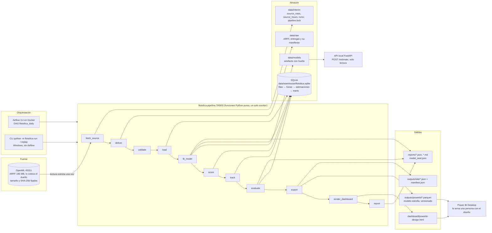

# Plan de implementación: sílice en el concentrado, sin esperar al laboratorio

Fecha: 2026-11-17. Lee primero `requirements.md` (RF, RNF, AC y los criterios C01-C10) y `decisions.md` (D01-D43). Este plan dice cómo construirlo; si un detalle no está aquí ni allí, la decisión vuelve a quien planifica: no se adivina. Las suposiciones se marcan como **[Supuesto]** y lo que hay que comprobar antes de escribir código, como **[Verificar]**.

Convenciones: documentación en español neutro; código, identificadores, tablas y columnas en inglés; medidas DAX, títulos de visuales y textos del sitio en español. Comandos para Windows (PowerShell) y el `.venv` del proyecto; rutas relativas a `05-Mining-Flotation-Silica/`. **El paquete se llama `flotsilica`** (variables de entorno `FLOTSILICA_*`, DAG `flotsilica_daily`, proyecto de Docker Compose `flotsilica-airflow`) y **el alcance de los commits es `flotation`** (por ejemplo `feat(flotation): …`, `test(flotation): …`, `docs(flotation): …`; D35). Cuando este plan dice «como el proyecto 04», el código de referencia es el de `04-Ecommerce-Churn-Risk/` en su último commit corregido (`94843fd` y la documentación de `e324883`), que se adapta y se copia, no se importa.

## 1. Arquitectura



Principios (los de los proyectos 01 a 04, más los de sus evaluaciones):

- Cada tarea es una función `fn(ctx: RunContext) -> dict` sin dependencias de Airflow. El DAG y la CLI recorren la misma tupla `TASKS`.
- Las tareas se pasan estado por archivos y tablas: `data/interim/runs/<run_key>.json` guarda lo que produjo cada tarea.
- **Un solo escritor**: `max_active_runs=1`, `max_active_tasks=1` y, además, todo comando que escribe toma `data/interim/pipeline.lock` antes de su primera escritura (D30).
- Toda salida versionada se escribe a un temporal y se renombra con `os.replace`; los conjuntos de archivos llevan un manifiesto escrito al final.
- **El instante manda**: todo lo que se calcula para un instante de emisión `t` recibe `t` y filtra por él: lecturas de horas `< t` y análisis frescos con `available_at ≤ t`. Una sola función lee el laboratorio conocido en un instante (`lab_known_at`), y los rasgos, la persistencia, B*, la API y las variantes pasan por ella (D24).
- **Solo análisis frescos** como objetivo o como historia del laboratorio (D05). Las filas 2 a n del laboratorio de cada hora no llegan al almacén (D04).
- Los cálculos que terminan en un valor sellado reciben solo la **vista sellada** de la configuración (`SealedConfig`), construida con las claves de la huella (D18).
- La API y el flujo estiman con la misma función, `scoring.score_issue` (D27).
- Toda ruta relativa de la configuración, de `--config` y de `FLOTSILICA_CONFIG` se resuelve contra la carpeta del proyecto (D31).

## 2. Estructura de carpetas

```text
05-Mining-Flotation-Silica/
  README.md
  pyproject.toml              # paquete flotsilica (src layout), pytest, marcas y la suite por defecto
  requirements.txt            # ejecución (flujo y DAG), fijadas con == (D37)
  requirements-api.txt        # -r requirements.txt, fastapi, pydantic, uvicorn (D27); fuera de la imagen de Airflow
  requirements-dev.txt        # -r requirements-api.txt, pytest, httpx
  .gitignore                  # data/raw/, data/interim/, data/warehouse/, data/models/, data/quick/, airflow/logs/, airflow/config/, airflow/plugins/, airflow/.env, reports/validation/history/
  .dockerignore               # solo requirements.txt entra al contexto de la imagen
  config/
    pipeline.toml             # configuración completa (sección 4)
    pipeline.quick.toml       # modo rápido: extends = "pipeline.toml", todo bajo data/quick/
  sql/
    schema/001_core.sql  002_hours.sql  003_model.sql
    staging/stg_hours.sql
    marts/powerbi/
    checks/load/  checks/model/         # chk_*.sql: cada consulta devuelve las filas que violan
  src/flotsilica/
    __init__.py  __main__.py  cli.py  config.py  pipeline.py  lock.py  sysinfo.py  files.py
    schema.py  ingest.py  hours.py  deliveries.py  validate.py  warehouse.py
    split.py  features.py  baselines.py  model.py  intervals.py  sensitivity.py
    registry.py  scoring.py  tracking.py  evaluation.py  variants.py  leakage_demo.py  reporting.py
    export.py  site_export.py  figures.py  docs.py  api.py  texts.py
    dashboard/__init__.py  dashboard/semantic_model.py  dashboard/render.py  dashboard/svg.py
  airflow/
    Dockerfile  docker-compose.yaml  .env.example  init.sh
    dags/flotsilica_daily.py
  research/                              # los diez scripts de research.md (ya versionados)
  dashboard/powerbi-design.html          # generado (versionado)
  outputs/powerbi/*.parquet              # generado (versionado, ≤ 25 MB cada uno)
  outputs/site/*.json, manifest.json     # generado (versionado, ≤ 200 KB sin el manifiesto)
  reports/evaluation_summary.json|.md    # generado (versionado)
  reports/model_seal.json                # sello (versionado; D18)
  reports/validation/latest.json|.md     # generado (versionado); el historial no
  docs/  research.md requirements.md plan.md decisions.md
         data-dictionary.md model-card.md runbook.md paso-a-paso.md review-advisories.md evaluation.md figures/*.png
  tests/
    conftest.py               # accesorios de sesión y el presupuesto de la suite (sección 24)
    fixtures/make_fixture.py  fixtures/hand_cases.py
    unit/  contract/  integration/  e2e/  docs/
  data/raw/  data/interim/  data/warehouse/  data/models/  data/quick/   # nunca versionados
```

Entorno (U01): `py -3.11 -m venv .venv`, `.venv\Scripts\python -m pip install -r requirements-dev.txt`, `pip check`. Las pruebas, el compose y los comandos del README usan `PYTHONPATH=src`, como los proyectos 03 y 04 (instalar el paquete es un pendiente del dueño, sección 29).

Marcas de pytest: `real_data` (el ARFF real en `data/raw/`), `docker` y `slow` (informativa: la llevan las pruebas que la sección 24.1 nombra como lentas; no se excluye). Por defecto: `-m "not real_data and not docker"`.

## 3. Flujo de datos

Un lanzamiento, cuarenta entregas diarias y un cierre componen la historia (D21); una corrida más termina como `no_delivery`. Un **instante de emisión** es el cierre de una hora (la hora siguiente en punto); en el instante `t`, H0 estima la hora `t − 1`, H1 la hora `t` y H2 la hora `t + 1` (D07).

| Entrega | Horas (por hora de la fila) | `as_of` | Instantes en que emite | Qué pasa además |
| --- | --- | --- | --- | --- |
| `L2017-07-31` | 2017-03-10 01:00 a 2017-07-31 23:00 | 2017-08-01 00:00 | 2017-07-31 23:00 y 2017-08-01 00:00 | Elige los 3 modelos en V1, los reajusta con entrenamiento y V1, calibra el rango en V2, elige B* en V1, corre la compuerta de sensibilidades y la demostración de la fuga, sella el lanzamiento |
| `D2017-08-01` … `D2017-09-09` | las 24 horas del día | 00:00 del día siguiente | cada hora del día (de 01:00 a 00:00 del día siguiente) | Sigue cada estimación cuyo análisis llegó |
| `C2017-09-10` | ninguna | 2017-09-10 01:00 (llega el análisis de las 23:00 del 2017-09-09) | ninguno | **Evalúa la prueba una vez**, con las variantes de C10, y la sella |

Las estimaciones de H1 y H2 emitidas en los últimos instantes apuntan a horas fuera de los datos (2017-09-10 00:00 y 01:00): se guardan como censuradas y nunca se evalúan.

1. `fetch_source`: comprueba que `source.path` existe, pesa `accepted_bytes` y tiene `accepted_sha256` (V01; si no, `SourceError`, salida 3, runbook R1). Si falta `data/interim/source_hours.parquet` o su huella de origen no es la del archivo, lee el ARFF (V02-V07), escribe `source_rows.parquet` (sin laboratorio por fila) y `source_hours.parquet` (agregados de sensores, los cuatro valores de la primera fila y las marcas de D05) con su manifiesto de huellas al final. Si ya están, no hace nada.
2. `deliver`: publica la siguiente entrega pendiente en `data/raw/deliveries/<delivery_id>.rows.parquet` y `.hours.parquet` con su período, filas, horas y SHA-256. Sin pendientes: registra la corrida `no_delivery`, refresca lo exportado si existe y corta el flujo.
3. `validate`: reglas V10-V15 y V20-V24 sobre la entrega y lo ya cargado; reporte (y su copia en `reports/validation/history/<run_key>.json`). Con bloqueantes: cuarentena, corrida `rejected`, `ValidationError`.
4. `load`: se niega si la validación de esta corrida no existe o falló, o si otra corrida cargó la entrega; en una transacción agrega las filas a `raw_rows`, las horas a `lab_hours` (con `available_at = hour + latency_hours`) y los agregados a `hour_aggregates`, y corre `sql/checks/load/`. Abre la fila de `pipeline_runs` como `running`.
5. `fit_model`: en el lanzamiento, comprueba los tamaños de los bloques (M06), construye las matrices de entrenamiento, V1 y V2 para los tres horizontes, ajusta las líneas base y los 28 candidatos por horizonte, elige en V1, aplica la trampa M01, reajusta el elegido y los modelos de comparación con entrenamiento y V1, calibra el rango en V2, elige B* en V1, corre la compuerta de sensibilidades (sección 14) y la demostración de la fuga, guarda el artefacto con su huella, lo registra y escribe la parte del lanzamiento del sello. En las demás corridas, comprueba la huella del artefacto (M03) y el estado del sello (M05); no reajusta.
6. `score`: para cada instante de emisión de la corrida, arma las entradas con `inputs_at(conn, t)`, llama a `score_issue` y guarda por horizonte la estimación, el rango y la de cada método de comparación (M02, M04) → `estimates`, `method_estimates` (solo inserción). El cierre no emite.
7. `track`: con lo cargado hasta `as_of`, reconstruye `tracking`: cada estimación cuyo análisis llegó, con su error, el de la persistencia y el de B*, y si el análisis cayó en el rango.
8. `evaluate`: si `as_of ≥ test_last + latency_hours` y la prueba no está evaluada, evalúa la prueba (C01-C10 y las variantes de la sección 16) y escribe la parte de la prueba del sello, o comprueba que reproduce la sellada.
9. `export`: reconstruye los marts de Power BI, corre `sql/checks/model/` y exporta el modelo estrella y los archivos del sitio con su manifiesto (la corrida sigue `running` en la tabla exportada).
10. `render_dashboard`: HTML del diseño desde la especificación y los Parquet exportados.
11. `report`: escribe `reports/evaluation_summary.*` y `reports/validation/latest.*` y cierra la corrida en este orden: SQLite `ok`, `dim_pipeline_run.parquet` reescrita sola, `outputs/site/summary.json` y el manifiesto reescritos, el HTML, y recién entonces la entrega queda `loaded` en el manifiesto de entregas (el orden del proyecto 04).

## 4. Configuración

`config/pipeline.toml`, leído con `tomllib`, con dataclasses congeladas y comprobación clave por clave como el proyecto 04: una sección o clave desconocida, una faltante, un tipo equivocado o un par desordenado son `ValueError` con el nombre de la clave. `FLOTSILICA_CONFIG` elige otro archivo y `FLOTSILICA_HOME` la carpeta del proyecto; una ruta relativa en cualquiera de las dos, o en `--config`, se resuelve contra la carpeta del proyecto.

```toml
[source]                             # D02, D03
path = "data/raw/openml-43311-quality-prediction-mining-process.arff"
accepted_bytes = 185243565
accepted_sha256 = "a25122979ba8c5fb9c12e361db61032efc6892a24b5746cc8309da601d9639b2"
max_bytes = 268435456                # 256 MiB
max_rows = 1000000
max_line_bytes = 4096
relation = "Quality-Prediction-in-a-Mining-Process"
attributes = ["date", "%_Iron_Feed", "%_Silica_Feed", "Starch_Flow", "Amina_Flow", "Ore_Pulp_Flow",
  "Ore_Pulp_pH", "Ore_Pulp_Density", "Flotation_Column_01_Air_Flow", "Flotation_Column_02_Air_Flow",
  "Flotation_Column_03_Air_Flow", "Flotation_Column_04_Air_Flow", "Flotation_Column_05_Air_Flow",
  "Flotation_Column_06_Air_Flow", "Flotation_Column_07_Air_Flow", "Flotation_Column_01_Level",
  "Flotation_Column_02_Level", "Flotation_Column_03_Level", "Flotation_Column_04_Level",
  "Flotation_Column_05_Level", "Flotation_Column_06_Level", "Flotation_Column_07_Level",
  "%_Iron_Concentrate", "%_Silica_Concentrate"]

[hours]                              # D04, D08
rows_per_hour = 180
min_rows_per_hour = 90
first_hour = 2017-03-10T01:00:00
last_hour = 2017-09-09T23:00:00

[lab]                                # D05, D06
latency_hours = 2

[deliveries]                         # D21
launch_last_hour = 2017-07-31T23:00:00
cadence_hours = 24

[split]                              # D10; cada borde exige purge_hours
train_first = 2017-03-10T01:00:00
train_last = 2017-05-31T23:00:00
v1_first = 2017-06-02T00:00:00
v1_last = 2017-06-30T23:00:00
v2_first = 2017-07-02T00:00:00
v2_last = 2017-07-30T23:00:00
test_first = 2017-08-01T00:00:00
test_last = 2017-09-09T23:00:00
purge_hours = 24
min_fresh_hours_per_block = 100      # M06

[features]                           # D12
sets = ["fS", "fL", "fSL", "fSLF"]
lab_last = 3
lab_means = [6, 24]
min_fresh_history = 24

[model]                              # D11, D14
families = ["hgb", "rf"]
targets = ["level", "change"]
hgb_learning_rate = 0.05
hgb_max_iter = 300
hgb_max_leaf_nodes = 15
hgb_min_samples_leaf = [20, 50]
hgb_l2_regularization = 1.0
rf_n_estimators = 300
rf_max_features = 0.33
rf_min_samples_leaf = [5, 20]
random_state = 0
refit_on = ["train", "valid_v1"]
model_version = "v1"

[baselines]                          # D13
rolling_k = [3, 6, 12, 24]
ridge_alpha = 1.0
strongest_candidates = ["b1_persistence", "b2_rolling"]   # en orden de simplicidad, para el desempate

[intervals]                          # D15
coverage = 0.80
calibrate_on = "valid_v2"

[evaluation]                         # D07, D17
horizons = [0, 1, 2]
bootstrap_resamples = 2000
bootstrap_seed = 0

[sensitivity]                        # D20
permutation_repeats = 5
refits = 5
pd_grid_points = 15
pd_low_quantile = 0.05
pd_high_quantile = 0.95
min_importance_mae = 0.01
min_abs_spearman = 0.5
seed = 0

[variants]                           # D06, D11: informadas, nunca usadas para elegir
latencies = [3, 4]
refit_all = true

[criteria]                           # preregistrados (requirements.md 8.1, D16)
c05_coverage_low = 0.75
c05_coverage_high = 0.85
c06_max_bias = 0.10
leak_tripwire_ratio = 0.5            # M01 (D09)

[site]
max_total_bytes = 204800

[api]                                # D27
host = "127.0.0.1"
port = 8000
max_lab_history = 48

[paths]
raw_dir = "data/raw"
interim_dir = "data/interim"
warehouse = "data/warehouse/flotsilica.sqlite"
models_dir = "data/models"
outputs_dir = "outputs/powerbi"
site_dir = "outputs/site"
reports_dir = "reports"
seal = "reports/model_seal.json"
dashboard_html = "dashboard/powerbi-design.html"
readme = "README.md"
figures_dir = "docs/figures"
```

**Qué claves entran en la huella del sello** (D18). `config.py` declara `FINGERPRINT_KEYS` y `UNSEALED_KEYS` con el nombre completo de cada hoja; una prueba exige que cada hoja de `PipelineConfig` esté en exactamente una (AC18).

- `FINGERPRINT_KEYS`: `source.relation`, `source.attributes` y todas las claves de `[hours]`, `[lab]`, `[deliveries]`, `[split]`, `[features]`, `[model]`, `[baselines]`, `[intervals]`, `[evaluation]`, `[sensitivity]`, `[variants]` y `[criteria]`. La huella agrega la huella observada del archivo (`source_sha256`).
- `UNSEALED_KEYS`: el resto de `[source]` (ruta, tamaño y huella aceptados, topes: la huella observada ya entra), `[site]`, `[api]` y `[paths]`. Ninguna cambia un valor sellado: los cálculos sellados reciben `SealedConfig`, y una prueba estática comprueba que `hours.py`, `split.py`, `features.py`, `baselines.py`, `model.py`, `intervals.py`, `sensitivity.py`, `scoring.py`, `evaluation.py` y `variants.py` no reciben `PipelineConfig`.
- Incluir de más es seguro; incluir de menos es el defecto B4 del proyecto 03.

`config/pipeline.quick.toml`: `extends = "pipeline.toml"`; `[source] path = "data/quick/flotation_fixture.arff"`, `accepted_bytes = 0` y `accepted_sha256 = ""` (modo rápido: la primera huella vista se registra en `data/quick/source.lock.json` y las siguientes deben coincidir, como el modo local del proyecto 04); `[hours] rows_per_hour = 12`, `min_rows_per_hour = 6`; `[deliveries] cadence_hours = 240`; `[model]` con `families = ["rf"]`, `rf_n_estimators = 20`, `rf_min_samples_leaf = [20]`; `[features] sets = ["fS", "fL", "fSL"]`; `[evaluation] bootstrap_resamples = 200`; `[sensitivity] refits = 2`, `permutation_repeats = 2`; `[paths]` todas bajo `data/quick/`, incluidos el sello, el README, las figuras y el sitio. `_check` rechaza además: `accepted_sha256` vacía fuera de `data/quick/`; una ruta relativa que sale de la carpeta del proyecto; una hora que no está en punto; un borde de la partición sin su purga (con el nombre del borde); `test_last + latency_hours` después de `last_hour + latency_hours`; una cobertura fuera de (0, 1); un horizonte negativo o repetido; `strongest_candidates` con algo fuera de B1 y B2; `api.host` distinto de `127.0.0.1`.

## 5. Almacenamiento

SQLite con archivos SQL en capas y controles en SQL (D24). Reglas del runner (`warehouse.py`), las del proyecto 04: `connect()` en modo autocommit con `journal_mode=DELETE`, `synchronous=FULL`, `foreign_keys=ON`; transacciones explícitas `BEGIN IMMEDIATE`; **nunca** `executescript()`; sentencias partidas con `sqlite3.complete_statement`; marts con `DROP TABLE IF EXISTS` + `CREATE TABLE AS` dentro de la transacción; parámetros con nombre. Las horas se guardan como texto ISO `YYYY-MM-DD HH:00:00` y como `hour_key` int64.

`sql/schema/001_core.sql` (clave primaria entre paréntesis):

- `raw_rows` (`row_id`): `delivery_id`, `hour`, `row_in_hour` y los 19 sensores (nombres de `schema.SENSORS`). **Sin columnas de laboratorio.**
- `lab_hours` (`hour`): `delivery_id`, `rows`, `is_partial`, `silica_pct`, `iron_conc_pct`, `feed_silica_pct`, `feed_iron_pct`, `lab_state` (`fresh`, `interpolated`, `held`), `feed_silica_age_h`, `feed_iron_age_h`, `available_at`.
- `hour_aggregates` (`hour`): `rows` y `<sensor>_mean`, `<sensor>_std`, `<sensor>_last` de los 19 sensores.
- `deliveries` (`delivery_id`): `kind` (`launch`, `daily`, `close`), `first_hour`, `last_hour`, `as_of`, `rows`, `hours`, `sha256`, `status` (`published`, `loaded`, `rejected`), `run_key`.
- `pipeline_runs` (`run_key`): `started_at`, `finished_at`, `status` (`running`, `ok`, `failed`, `rejected`, `no_delivery`), `delivery_id`, `as_of`, `source_sha256`, `rows_delivery`, `estimates_issued`, `estimates_missing`, `peak_working_set_mb`, `peak_commit_mb`, `memory_counter`, `message`.
- `validation_results` (`run_key`, `rule_id`): `name_es`, `severity`, `scope`, `aggregation` (`source`, `per_run`, `latest`), `passed`, `rows_affected`, `hours_affected`, `examples_json` (horas, nunca filas enteras).

`sql/schema/002_hours.sql`: `stg_hours`, la vista de `lab_hours` unida a `hour_aggregates` con `block` (de `split.block_of`, guardado en `hour_blocks` (`hour`): `block` en `train`, `purge_1`, `valid_v1`, `purge_v`, `valid_v2`, `purge_2`, `test`, `outside`).

`sql/schema/003_model.sql`:

- `model_registry` (`model_version`): `trained_as_of`, `artifact_path`, `artifact_sha256`, `config_sha256`, `models_json` (por horizonte: familia, conjunto, objetivo, hiperparámetros, columnas, semiancho, B* y su k), `selection_json`, `valid_predictions_sha256`.
- `estimates` (`target_hour`, `horizon`): `issue_at`, `run_key`, `model_version`, `status` (`ok`, `missing_inputs`), `reason`, `estimate`, `low`, `high`, `persistence`, `b_star`, `b_star_method`, `block`, `is_censored`. **Solo inserción** con tres disparadores (`BEFORE UPDATE`, `BEFORE DELETE` y un `BEFORE INSERT` que rechaza una clave ya emitida; proyecto 02, D44).
- `method_estimates` (`target_hour`, `horizon`, `method`): `estimate`. Métodos: `model`, `b0_train_mean`, `b1_persistence`, `b2_rolling`, `b3_ridge_sensors`, `best_sensors_only`, `best_lab_only`, `best_with_sensors`. Solo inserción, igual.
- `tracking` (`target_hour`, `horizon`): `as_of`, `actual`, `lab_state`, `abs_error`, `abs_error_persistence`, `abs_error_b_star`, `covered`. Se reconstruye en cada corrida (es derivada).
- `eval_selection` (`horizon`, `candidate`), `eval_baselines` (`horizon`, `method`, `k`), `eval_metrics` (`scope`, `horizon`, `method`, `metric`, `seal_state`), `eval_bootstrap` (`comparison`, `seal_state`), `eval_criteria` (`criterion_id`, `seal_state`), `eval_weekly` (`week`, `horizon`, `method`, `seal_state`), `eval_variants` (`variant`, `horizon`, `method`, `metric`, `seal_state`), `eval_sensitivity` (`sensor`, `scope`), `eval_pd_curve` (`sensor`, `point`), `eval_leakage` (`check`). `scope` en `valid_v1`, `valid_v2`, `test`; `seal_state` en `sealed`, `post_seal`.

`model_registry`, `estimates` y `method_estimates` no se reemplazan nunca; `tracking` y `eval_*` de una fecha se reemplazan al repetir esa fecha, salvo las filas `sealed` de la prueba, que se escriben una vez (sección 15).

## 6. Contrato del ARFF, entregas y validación

`schema.py` es la única fuente de los nombres: `ATTRIBUTES` (los 24 de la configuración con su nombre interno: `date` → `hour`, `%_Iron_Feed` → `feed_iron_pct`, `%_Silica_Feed` → `feed_silica_pct`, `Starch_Flow` → `starch_flow`, `Amina_Flow` → `amina_flow`, `Ore_Pulp_Flow` → `ore_pulp_flow`, `Ore_Pulp_pH` → `ore_pulp_ph`, `Ore_Pulp_Density` → `ore_pulp_density`, `Flotation_Column_0k_Air_Flow` → `air_flow_0k`, `Flotation_Column_0k_Level` → `level_0k`, `%_Iron_Concentrate` → `iron_conc_pct`, `%_Silica_Concentrate` → `silica_pct`), `SENSORS` (los 19), `LAB_COLUMNS` (los cuatro), `FEATURE_COLUMNS` (sección 10), `FORBIDDEN_COLUMNS` (`iron_conc_pct`, `row_id`, `row_in_hour`, `lab_state` y `is_ramp` de la hora del objetivo, cualquier `<lab>_row_<n>`, `hour`, `hour_key`, `month`, `weekday`, `hour_of_day`, `block`) y `TARGET_COLUMNS` (`silica_pct`, `actual`, `abs_error`). Una prueba comprueba que no se solapan.

Reglas. Las de la fuente corren en `fetch_source`, una vez por huella; las de la entrega y de las horas, en `validate`; las del modelo, donde se indica. **Agregación** dice cómo se publica la regla entre corridas en `validation_rules.json`: `source` (una vez), `per_run` (se suma sobre las corridas cargadas) o `latest` (se lee una vez de la última corrida cargada). Cifras de la fuente real entre paréntesis.

| ID | Severidad | Alcance | Agregación | Regla | Acción |
| --- | --- | --- | --- | --- | --- |
| V01 | bloqueante | fuente | source | El archivo existe y tiene el tamaño y la huella aceptados (o la registrada, en modo rápido) | Rechazo; nada cambia; runbook R1 |
| V02 | bloqueante | fuente | source | Cabecera exacta: `@RELATION`, los 24 `@ATTRIBUTE` en orden y todos `STRING`, `@DATA` una vez | Rechazo |
| V03 | bloqueante | fuente | source | UTF-8 estricto, sin byte nulo, líneas ≤ `max_line_bytes`, archivo ≤ `max_bytes`, filas ≤ `max_rows` | Rechazo |
| V04 | bloqueante | fuente | source | Cada fila con 24 campos, cada uno entre apóstrofos o un entero sin apóstrofos (`-?[0-9]+`; el archivo real escribe así 28.124 de las 560.333 filas anteriores a la prueba), y ninguno vacío | Rechazo |
| V05 | bloqueante | fuente | source | Fecha `YYYY-MM-DD HH:00:00`; números `^-?\d+(,\d+)?$` | Rechazo |
| V06 | bloqueante | fuente | source | Fechas no decrecientes | Rechazo |
| V07 | bloqueante | fuente | source | Ninguna hora con más de `rows_per_hour` filas (máximo real: 180) | Rechazo |
| V10 | bloqueante | entrega | per_run | La entrega es la siguiente del plan y su período empieza en la hora siguiente al fin de la anterior | Rechazo |
| V11 | bloqueante | entrega | per_run | Cada hora de la entrega está dentro de su período | Rechazo |
| V12 | bloqueante | entrega | per_run | Ninguna hora ni `row_id` de la entrega está ya en el almacén | Rechazo |
| V13 | bloqueante | entrega | per_run | Filas, horas y SHA-256 son los del manifiesto; solo el cierre puede no tener filas | Rechazo |
| V14 | bloqueante | entrega | per_run | Los agregados de cada hora son los de sus filas (recalculados) | Rechazo |
| V15 | bloqueante | entrega | per_run | Las filas de la entrega no traen columnas de laboratorio (solo la hora trae su primera fila) | Rechazo |
| V20 | advertencia | horas | per_run | Hora incompleta (2 en la fuente: 174 y 179 filas) | Se marca `is_partial` y se usa |
| V21 | advertencia | horas | per_run | Hora con menos de `min_rows_per_hour` filas (0) | No se estima |
| V22 | advertencia | horas | per_run | Análisis interpolado (159 antes de la prueba) | No es objetivo ni rasgo (D05) |
| V23 | advertencia | horas | per_run | Análisis repetido (310 antes de la prueba) | No es objetivo ni rasgo (D05) |
| V24 | advertencia | horas | per_run | Alimentación que cambia dentro de la hora (0) | Se usa la primera fila |
| I01 | informativa | fuente | source | Horas faltantes en la grilla (318) | Solo cuenta |
| I02 | informativa | horas | latest | Horas con la alimentación sin cambio desde hace 24 h o más | Solo cuenta (acumula) |
| I03 | informativa | horas | per_run | Sensor constante dentro de la hora (`air_flow_04`, `air_flow_05`) | Solo cuenta |
| I04 | informativa | modelo | per_run | Estimaciones emitidas | Solo cuenta |
| I05 | informativa | modelo | per_run | Estimaciones `missing_inputs`, con el motivo | Solo cuenta |
| M01 | bloqueante | modelo | latest | Trampa de fuga: MAE en V1 del elegido ≥ `leak_tripwire_ratio` × el de la persistencia | Detiene el lanzamiento: «posible fuga» (D09, R5) |
| M02 | bloqueante | modelo | per_run | Las columnas de la matriz son exactamente las del conjunto; ninguna prohibida | Falla la tarea |
| M03 | bloqueante | modelo | per_run | El artefacto tiene la huella registrada (antes de deserializarlo) | Falla la tarea (D39, R6) |
| M04 | bloqueante | modelo | per_run | Estimación y rango finitos, con `low ≤ estimate ≤ high` | Falla la tarea |
| M05 | advertencia | modelo | latest | La configuración es distinta de la sellada | Todo lo calculado es `post_seal`; la evaluación de la prueba sin sello de prueba se rechaza (D18) |
| M06 | bloqueante | modelo | latest | Entrenamiento, V1 y V2 con al menos `min_fresh_hours_per_block` horas frescas con entradas | `BlockSizeError` antes de ajustar |

Notas de U05 sobre la tabla. **V24** se evalúa sobre las horas de la entrega: como V15 impide que las filas lleven columnas de laboratorio, `source_hours.parquet` (y cada `<id>.hours.parquet`) trae la columna `feed_changes_in_hour` (booleana: alguna de las dos alimentaciones tiene más de un valor entre las filas de la hora), calculada en la lectura canónica junto con las marcas de D05; el manifiesto del interim pasa a la versión 2 y no llega al almacén (`lab_hours` no la guarda). **V13** compara las filas, las horas, el SHA-256 de cada archivo y el de la entrega, que es el SHA-256 de `<sha256 de las filas>
<sha256 de las horas>`. **I02** cuenta las horas con alguna de las dos alimentaciones sin cambio desde hace 24 h o más, sumando las ya cargadas y las de la entrega, y publica además cada cuenta por separado. **I03** cuenta, por sensor, las horas con desviación estándar muestral exactamente 0. Los ejemplos de una regla son horas e identificadores de fila, nunca un valor medido. Las reglas de las horas llevan `rows_affected` (las filas de esas horas) y `hours_affected`.

Las cifras de V22 y V23 son las de la comprobación del planificador (entrenamiento, V1 y V2; requerimientos, sección 4); el total del archivo sale de la corrida real.

`ValidationReport` como el del proyecto 04 (con `not_evaluated` y hasta 5 ejemplos por regla, como horas), con `hours_affected` y `aggregation` en cada `RuleResult`.

Entregas (`deliveries.py`): el plan sale de la configuración: el lanzamiento con todas las horas hasta `launch_last_hour`, entregas de `cadence_hours` horas hasta `last_hour` (40 de 24 h; 4 de 240 h en el modo rápido; la última, más corta si la cadencia no divide lo que queda) y el cierre. Identificadores: `L<fecha de launch_last_hour>`, `D<fecha de su primera hora>` (con la hora, `D2017-08-01T07`, si la cadencia no es de días enteros o la entrega no empieza a medianoche, para que un identificador no se repita) y `C<fecha de la hora siguiente a last_hour>`. Cada entrega son dos archivos, `<id>.rows.parquet` y `<id>.hours.parquet`, con las filas y las horas de su período. La entrega de una fila es la de su hora. Manifiesto `data/raw/deliveries/manifest.json` con versión (`{"version": 1, "entries": [...]}`), escrito a un temporal y renombrado.

## 7. SQL

- `sql/staging/stg_hours.sql`: `lab_hours` unida a `hour_aggregates` y a `hour_blocks`, con las horas `<= :as_of`.
- `sql/checks/load/`: `chk_raw_row_unique`, `chk_rows_per_hour_max`, `chk_aggregates_match_rows` (media y conteo de cada sensor contra `raw_rows`, a 10⁻⁹), `chk_available_at_is_hour_plus_latency`, `chk_delivery_period`, `chk_lab_state_rules` (una hora `interpolated` tiene la anterior en rampa; una `held` repite el valor anterior).
- `sql/marts/powerbi/` y `sql/checks/model/` (corren en `export`): `chk_one_estimate_per_target_and_horizon`, `chk_issue_at_matches_target_and_horizon` (`issue_at = target_hour − horizon + 1 h`), `chk_interval_contains_estimate`, `chk_tracking_only_after_arrival` (`actual` no nulo solo si `available_at ≤ as_of`), `chk_eight_methods_per_estimate`, `chk_fk_*` (una por relación), `chk_star_keys_unique`.

## 8. Horas y frescura del laboratorio (`hours.py`)

```python
def aggregate_rows(rows: pd.DataFrame) -> pd.DataFrame                      # hour, rows y mean/std/last de cada sensor (std con ddof=1; NaN con una fila)
def lab_states(first_rows: pd.DataFrame, is_ramp: pd.Series) -> pd.Series   # fresh, interpolated, held (D05)
def feed_age_hours(first_rows: pd.DataFrame) -> pd.DataFrame              # feed_silica_age_h y feed_iron_age_h: horas desde el último cambio de cada alimentación
```

- `is_ramp(h)`: el objetivo de la hora `h` tiene más de un valor distinto entre sus filas. Se calcula en la lectura, se usa solo para `lab_states` y se descarta: no llega al almacén.
- `interpolated(h) = is_ramp(h) and is_ramp(h − 1 observada contigua)`; `held(h) = silica(h) == silica(h − 1) and not interpolated(h)`, con `h − 1` la hora anterior **contigua** (después del hueco, la primera hora no es `held`); `fresh` lo demás con valor. La hora `h − 1` de la primera hora de una entrega viene de la entrega anterior (la lectura canónica las calcula sobre todo el archivo; la regla solo mira la hora y la anterior).
- Propiedades probadas (AC04): en el accesorio, cada marca plantada sale igual; cambiar cualquier hora posterior a `h` no cambia la marca de `h`; la primera hora de un tramo en rampa es `fresh`; real (`real_data`): 139, 8 y 12 interpoladas y 165, 58 y 87 repetidas en entrenamiento, V1 y V2 (requerimientos, sección 4).

## 9. Partición (`split.py`)

```python
def block_of(hours: pd.DatetimeIndex, view: SealedConfig) -> pd.Series     # train, purge_1, valid_v1, purge_v, valid_v2, purge_2, test, outside
def check_split(view: SealedConfig) -> None                                 # SplitError con el nombre del borde
```

- Bloques por hora del objetivo (D10). `check_split` exige `purge_hours` entre cada par de bloques consecutivos, `train_first ≥ first_hour`, `test_last ≤ last_hour`; la configuración lo comprueba al cargarse y `fit_model` otra vez antes de ajustar.

## 10. Rasgos y fuga (`features.py`)

```python
class LeakageError(RuntimeError): ...
@dataclass(frozen=True)
class IssueInputs: issue_at: datetime; sensors: pd.Series | None; lab_history: pd.DataFrame; feed: pd.Series | None
def lab_known_at(lab: pd.DataFrame, t: datetime) -> pd.DataFrame          # análisis frescos con available_at <= t, en orden de muestra
def inputs_at(conn, t: datetime, view: SealedConfig) -> IssueInputs          # sensores de la hora t - 1, laboratorio y alimentación conocidos en t
def feature_row(inputs: IssueInputs, view: SealedConfig) -> pd.Series      # las 67 columnas de la sección
def build_matrix(rows: pd.DataFrame, feature_set: str) -> pd.DataFrame     # M02 y LeakageError
def design(hours: HourTables, targets: pd.DatetimeIndex, horizon: int, view: SealedConfig) -> pd.DataFrame   # una fila por hora del objetivo, rasgos del instante target - horizon + 1 h
```

| Columna | Definición, en el instante `t` |
| --- | --- |
| `<sensor>_mean`, `_std`, `_last` (57) | media, desviación y último valor de las filas de la hora `t − 1` |
| `lab_last1`, `lab_last2`, `lab_last3` | los tres últimos análisis frescos con `available_at ≤ t`, del más reciente al más viejo |
| `lab_mean6`, `lab_mean24` | media de los últimos 6 y 24 análisis frescos llegados |
| `lab_age_h` | horas entre la muestra del último análisis fresco y `t − latency_hours` |
| `feed_silica_pct`, `feed_iron_pct` | la alimentación de la última hora con análisis llegado (`t − latency_hours`) |
| `feed_silica_age_h`, `feed_iron_age_h` | horas desde el último cambio de cada alimentación, en esa hora |

- Conjuntos (D12): `fS` (57), `fL` (las 6 de laboratorio), `fSL` (63), `fSLF` (63 más `feed_silica_pct`, `feed_iron_pct`, `feed_silica_age_h` y `feed_iron_age_h`: 67). Una hora se estima si tiene todas las entradas de su conjunto y al menos `min_fresh_history` análisis frescos llegados; si no, `missing_inputs` con el motivo (`no_sensor_rows`, `partial_below_minimum`, `short_lab_history`).
- **Guardas** (AC10): `build_matrix` lanza `LeakageError` si recibe o produce una columna de `FORBIDDEN_COLUMNS` o `TARGET_COLUMNS`, o cualquiera fuera de `FEATURE_COLUMNS`; la salida tiene exactamente las columnas del conjunto, en orden (M02). Una prueba estática recorre `features.py`, `scoring.py`, `api.py` y los SQL de rasgos y falla si nombran `iron_conc_pct`, `lab_state` de la hora del objetivo, `is_ramp`, `tracking` o `method_estimates`.
- **Truncamiento** (AC11): los rasgos de un instante calculados desde el almacén con todo cargado son idénticos a los calculados con las filas y las horas truncadas en `t` (lecturas de horas `< t`, análisis con `available_at ≤ t`). **Perturbación**: cambiar cualquier lectura de una hora `≥ t` o cualquier análisis con `available_at > t` no cambia ningún rasgo, estimación ni rango emitido en `t`. **Tamaño de la entrega** (AC12): las estimaciones con `cadence_hours = 24` y `240` son idénticas byte a byte.
- `design` y `feature_row` comparten el cálculo de la secuencia de frescos (`searchsorted` sobre las posiciones de los frescos, como `p04_models.py`), y una prueba compara las dos en cada hora del accesorio chico.

## 11. Líneas base (`baselines.py`)

| ID | Regla | Estimación en el instante `t` | Uso |
| --- | --- | --- | --- |
| B0 | Media del entrenamiento | media de los análisis frescos del entrenamiento | C07 |
| B1 | Persistencia | `lab_last1` | C01; candidata a B* |
| B2 | Media de los últimos k | media de los últimos k análisis frescos llegados, k ∈ `rolling_k` elegido en V1 por horizonte | Candidata a B* |
| B3 | Ridge sobre sensores | `Ridge(alpha)` estandarizado sobre los 57 agregados de la hora `t − 1`, ajustado en el entrenamiento | Referencia de los sensores sin laboratorio |

- **B*_H**: la de menor MAE en V1 entre `strongest_candidates`; en un empate a 10⁻⁶, la primera de la lista (B1). Se elige en el lanzamiento y entra en el sello (RF12). B0 y B3 no se reajustan con V1 (son referencias; D13).
- Pruebas: persistencia y medias exactas en un caso a mano con horas repetidas e interpoladas (la persistencia salta la repetida y la interpolada); cambiar valores de V1, V2 o la prueba no cambia B0 ni B3; cambiar valores de V2 o de la prueba no cambia el k de B2 ni B*.

## 12. Candidatos, selección y reajuste (`model.py`)

```python
@dataclass(frozen=True)
class Candidate: family: str; feature_set: str; target: str; min_samples_leaf: int
def candidates(view: SealedConfig) -> list[Candidate]                       # 28 por horizonte, en orden fijo
def make_estimator(c: Candidate, view: SealedConfig) -> RegressorMixin
def fit_candidate(c, X, y, last1, view) -> FittedCandidate                 # en "change" ajusta y - lab_last1 y devuelve last1 + predicción
def select(results: list[CandidateResult]) -> Candidate                    # menor MAE en V1; desempate de D14
def refit(c: Candidate, X, y, last1, view) -> FittedCandidate              # con entrenamiento y V1
class BlockSizeError(RuntimeError): ...
```

- `hgb`: `HistGradientBoostingRegressor(learning_rate, max_iter, max_leaf_nodes, min_samples_leaf, l2_regularization, early_stopping=False, random_state)`; `rf`: `RandomForestRegressor(n_estimators, max_features, min_samples_leaf, n_jobs=1, random_state)`. Las matrices no tienen nulos (las horas sin entradas no entran; sección 10).
- M06 antes de ajustar; M01 después de elegir: si `MAE_V1(elegido) < leak_tripwire_ratio × MAE_V1(B1)`, `LeakageError` y el lanzamiento se detiene (runbook R5).
- Para C07 y C08 se guardan además, por horizonte, el mejor `fS`, el mejor `fL` y el mejor entre `fSL` y `fSLF`, reajustados igual (D16). Son los «modelos de comparación» del artefacto.
- Medido por el planificador: 0,29 s por ajuste de `hgb` y 1,43 s de `rf` (máximo 2,40 s); los 84 ajustes de la grilla, unos 75 s, más unos 12 reajustes (el elegido y los tres de comparación por horizonte, algunos repetidos) y los 5 de la compuerta **[Supuesto]**.

## 13. Rango (`intervals.py`)

```python
def conformal_half_width(abs_residuals: np.ndarray, coverage: float) -> float   # cuantil "higher" de orden ceil((n + 1) · coverage) / n
def interval(estimate: float, half_width: float) -> tuple[float, float]         # recortado a [0, 100]
```

- Los residuos son los del modelo reajustado (entrenamiento y V1) sobre las horas frescas de V2 con entradas; un semiancho por horizonte; si `ceil((n + 1) · coverage) > n`, `ValueError` (no hay datos para esa cobertura). Caso a mano con diez residuos; propiedad: en V2, la proporción de residuos ≤ q es ≥ `coverage` (AC16).

## 14. Sensibilidades y su compuerta (`sensitivity.py`)

```python
def grouped_permutation(model, X, y, groups: dict[str, list[str]], repeats: int, rng) -> pd.DataFrame   # aumento medio del MAE y su desviación
def partial_dependence_curve(model, X, column: str, points: int, q_low: float, q_high: float) -> pd.DataFrame
def spearman_sign(curve: pd.DataFrame) -> float                              # rangos de pandas; sin SciPy (D36)
def gate(results: SensitivityResults, view: SealedConfig) -> pd.DataFrame   # sensor, importance_v1, importance_v2, rho_min, rho_max, sign_stable, passes
```

- Modelo: el mejor con sensores de H0 (sección 12), reajustado; los reajustes de la compuerta (`refits`) se hacen con días del entrenamiento remuestreados con reposición (semilla `seed`), con la configuración elegida. La dependencia parcial es la de la media horaria del sensor (`<sensor>_mean`), con las demás columnas como están, sobre las horas de V1 y V2.
- Pasa (D20): importancia ≥ `min_importance_mae` en V1 **y** en V2, y en el modelo y cada reajuste `sign(ρ)` igual y `|ρ| ≥ min_abs_spearman`. En la evaluación, para los que pasan, la curva sobre las horas de la prueba y si conserva el signo (C09).
- Textos: `texts.py` es la única fuente de las frases de sensibilidades («asociación del modelo», «sin asociación estable»); `tests/unit/test_texts.py::test_no_generated_text_calls_a_sensitivity_a_cause_or_an_action` busca en los textos generados (resumen, HTML, JSON del sitio) «causa», «provoca», «controla», «ajustar el», «subir el», «bajar el» y falla si aparecen cerca de un sensor.
- Medido por el planificador: ningún sensor pasa en V1 y V2 (requerimientos, sección 4).

## 15. Lanzamiento congelado, emisión y sello (`registry.py`, `scoring.py`)

```python
@dataclass(frozen=True)
class HorizonModel: horizon: int; candidate: Candidate; estimator; columns: tuple[str, ...]; half_width: float; b_star: str; b2_k: int
@dataclass(frozen=True)
class ModelBundle: version: str; horizons: tuple[HorizonModel, ...]; comparisons: dict; b0_mean: float; b3: dict
def save_artifact(bundle: ModelBundle, path: Path) -> str                # pickle protocolo 5
def load_artifact(path: Path, expected_sha256: str) -> ModelBundle       # M03: lee los bytes una vez, compara y recién entonces pickle.loads
def sealed_view(cfg: PipelineConfig, source_sha256: str) -> SealedConfig
def config_fingerprint(view: SealedConfig) -> str                        # SHA-256 del JSON canónico
def seal_state(seal_path: Path, config_sha256: str) -> Literal["none", "match", "post_seal"]
def write_launch_seal(seal_path: Path, launch: dict) -> None             # creación exclusiva; una vez
def write_test_seal(seal_path: Path, test: dict) -> None                 # una vez
def score_issue(bundle: ModelBundle, inputs: IssueInputs, view: SealedConfig) -> list[Estimate]   # la usan el flujo y la API
def score_run(conn, run: RunMeta, bundle, view) -> ScoreResult           # cada instante de (as_of anterior, as_of]
```

- **Sello** (`reports/model_seal.json`, versionado):

  ```json
  {
    "version": 1,
    "launch": {
      "run_key": "...", "as_of": "2017-08-01 00:00:00", "source_sha256": "a251...39b2",
      "config_sha256": "...", "sealed_config": {"lab": {}, "split": {}, "...": "toda la vista sellada"},
      "model_version": "v1", "artifact_sha256": "...",
      "horizons": [{"horizon": 0, "family": "...", "feature_set": "...", "target": "...", "min_samples_leaf": 0,
                    "half_width": 0.0, "b_star": "b1_persistence|b2_rolling", "b2_k": 0, "mae_v1": 0.0}],
      "gate": {"model": "...", "passing": []},
      "valid_predictions_sha256": "..."
    },
    "test": {
      "run_key": "...", "as_of": "2017-09-10 01:00:00", "config_sha256": "...",
      "criteria": [{"id": "C01", "value": 0.0, "baseline_value": 0.0, "ci_low": null, "ci_high": null, "passed": false, "verdict_es": "..."}],
      "metrics": {"h0": {}, "h1": {}, "h2": {}}, "weekly": [], "variants": [], "sensitivity_test": []
    }
  }
  ```

  (los valores son de forma, no resultados). `valid_predictions_sha256` es la huella de las estimaciones de V1 y V2 de los tres modelos redondeadas a 6 decimales y ordenadas por (hora, horizonte).
- Reglas del sello (D18): sin sello, el lanzamiento escribe `launch`; con sello y el mismo `config_sha256`, comprueba `valid_predictions_sha256`, los elegidos, los semianchos, B* y la compuerta (distintos: `SealMismatchError` que nombra cada valor, runbook R7); con otro `config_sha256`, la corrida sigue y todo es `post_seal` (M05), con un aviso que nombra las claves que difieren; **la evaluación de la prueba con otra configuración mientras el sello no tiene `test` se rechaza antes de escribir** (`RunRefusedError`, salida 2, con las claves que difieren; lección D89 del proyecto 04). Ninguna parte se reescribe: creación exclusiva, modo 0o600 donde el modo es el control de acceso; la parte de la prueba se vuelve a leer tras escribirla.
- `score_issue`: arma la fila con `feature_row`, comprueba M02, estima cada horizonte con su modelo (en `change`, `lab_last1 + predicción`), su rango, la persistencia, B*_H y los métodos de comparación, y comprueba M04. `score_run` inserta una fila por (hora del objetivo, horizonte) en `estimates` y ocho en `method_estimates`, leyendo dentro de la transacción qué ya está emitido; una hora sin entradas va como `missing_inputs` sin estimación.

## 16. Evaluación, variantes, criterios y resumen (`evaluation.py`, `variants.py`, `reporting.py`, `leakage_demo.py`)

Cohorte, definiciones y umbrales: `requirements.md`, sección 8.1. **Lo que se evalúa es lo que se emitió**: las cifras de la prueba salen de `estimates` y `method_estimates`, no de una predicción nueva.

- `evaluate_test(conn, view) -> EvaluationResult`: para cada horizonte y cada método, sobre las horas de la prueba con análisis fresco: MAE, RMSE, sesgo, horas; cobertura del rango del modelo; MAE por semana de la prueba (semanas de 7 días desde el 2017-08-01; la última de 5 días); lo mismo en V1 y V2 desde las predicciones del lanzamiento (rotuladas como validación).
- `day_bootstrap(err_a, err_b, days, n, seed) -> Bootstrap`: `rng = np.random.default_rng(seed)`; días con reposición, todas sus horas; diferencia de MAE como cociente de sumas; percentiles 2,5 y 97,5 (D17).
- `evaluate_criteria(result, view)` y `criteria_from_seal(seal)` comparten `_criteria_of`: `criterion_id`, `value`, `baseline_value`, `ci_low`, `ci_high`, `threshold_es`, `passed`, `seen_by_research`, `seen_by_planner`, `verdict_es` de plantillas fijas de `texts.py`, por ejemplo «El modelo no supera a la persistencia en la hora que cerró: MAE 0,54 frente a 0,53; la diferencia va de −0,02 a 0,03.» C10 no tiene `passed`. Un criterio que no se puede calcular queda `passed = false` con el motivo.
- `variants.run(conn, bundle, view)` (solo dentro de la evaluación, después de escrita la parte del lanzamiento del sello): `latency_3` y `latency_4` (la configuración elegida de H0 reajustada con entrenamiento y V1 con los rasgos de esa latencia, y la persistencia de esa latencia, sobre las horas de la prueba, con el intervalo de la diferencia); `refit_all` (los tres elegidos reajustados con entrenamiento, V1 y V2); `all_hours` (M_0 y la persistencia sobre todas las horas de la prueba con valor, frescas o no). Una prueba estática exige que `model.select`, `model.refit`, `baselines.strongest` e `intervals` no lean `eval_variants` ni importen `variants`.
- `leakage_table(conn, view)` (en el lanzamiento; su módulo no puede escribir en `model_registry`, `estimates` ni `method_estimates`): el MAE y el R² del elegido de H0 con una partición aleatoria 80/20 (semilla 0) de entrenamiento, V1 y V2 frente a los de entrenar y medir en bloques; y el MAE en V2 del elegido de H0 con `iron_conc_pct` de la hora del objetivo agregado, frente al sellado. research.md midió R² 0,565 frente a −0,511 con la primera mirada.
- `write_summary(...)` escribe `reports/evaluation_summary.{json,md}`: cada celda de la tabla de criterios escapa `|`, y cada veredicto dice dónde el modelo cumple y dónde no en palabras (las correcciones A4 y A5 del proyecto 04). `docs-sync` copia el Markdown entre `<!-- results:start -->` y `<!-- results:end -->` del README.
- Antes del cierre, el resumen dice «La prueba se evalúa con el cierre del 2017-09-10» y los criterios quedan `pending`; las cifras de V1 y V2 sí se muestran, rotuladas como validación.
- **Después del sello** (D19): `load_summary` lee el sello; si tiene `test` y el almacén no tiene C01 sellado, C01-C09 y las cifras de la prueba salen de `criteria_from_seal`, cada uno debe devolver su entrada a 6 decimales o el sello no se toma (`SealError`), y el análisis de la corrida se muestra debajo como posterior al sello.

## 17. Seguimiento (`tracking.py`)

`tracking_at(conn, as_of, view) -> pd.DataFrame`: por cada estimación `ok` cuya hora del objetivo tiene `available_at ≤ as_of`: `actual` (el análisis si es fresco; nulo con su `lab_state` si no), `abs_error`, `abs_error_persistence`, `abs_error_b_star` y `covered`. Es lo que vería la sala de control: la estimación de cada hora y, dos horas después, el análisis. No cambia el modelo, el rango ni B* (D22).

## 18. API de estimación (`api.py`)

```python
app = FastAPI(title="flotsilica", docs_url=None, redoc_url=None)
class Reading(BaseModel): starch_flow: float; amina_flow: float; ...                 # los 19, finitos
class LabAnalysis(BaseModel): sample_hour: datetime; silica_pct: float = Field(ge=0, le=100); state: Literal["fresh"] = "fresh"
class EstimateRequest(BaseModel):
    issue_at: datetime                                                                 # en punto
    readings: list[Reading] = Field(min_length=1, max_length=ROWS_PER_HOUR)           # la hora issue_at - 1, en orden
    lab_history: list[LabAnalysis] = Field(min_length=1, max_length=MAX_LAB_HISTORY)
    feed: FeedLab | None = None
class EstimateResponse(BaseModel): model_version: str; config_sha256: str; issue_at: datetime; estimates: list[HorizonEstimate]; persistence: float; inputs: InputsUsed
def create_app(cfg: PipelineConfig) -> FastAPI                                       # carga el artefacto con load_artifact y la huella del registro
```

- `GET /health`: `model_version`, `config_sha256`, estado del sello y semianchos. `POST /estimate`: convierte el cuerpo en `IssueInputs` (los agregados con `hours.aggregate_rows`, la historia con la misma regla de frescos y de llegada) y llama a `score_issue`. Un análisis con `sample_hour + latency_hours > issue_at`, una hora que no está en punto, una lista fuera de sus topes o un número no finito dan 422 sin estimar; una historia con menos de `min_fresh_history` análisis da 422 con `short_lab_history`.
- Sin escrituras: la aplicación no recibe rutas de salida; una prueba corre 50 pedidos y comprueba que ningún archivo del proyecto cambió.
- `python -m flotsilica serve [--config RUTA] [--port N]` corre `uvicorn.run(app, host=cfg.api.host, port=...)`; `--host` con otro valor que `127.0.0.1` sale con 2 antes de cargar nada.
- **Paridad** (AC28): para cada hora de la prueba del accesorio sellado, el cuerpo armado desde el almacén con `inputs_at` y enviado a `POST /estimate` da exactamente la estimación y el rango guardados (igualdad de `float`).

## 19. Salidas: modelo estrella

Parquet, uno por tabla, con esquema Arrow tomado de la especificación y metadatos `flotsilica.run_key`, `flotsilica.as_of`, `flotsilica.source_sha256`, `flotsilica.attribution`. Todo va a `outputs/powerbi/` (versionado).

Dimensiones (clave en negrita):

| Tabla | Columnas |
| --- | --- |
| `dim_date` | **`date_key`** int32 (AAAAMMDD), `date`, `year`, `month`, `month_name_es`, `weekday_es`, `test_week` (1-6 o nulo) |
| `dim_hour` | **`hour_key`** int64 (AAAAMMDDHH), `hour`, `date`, `hour_of_day`, `block`, `block_es`, `lab_state`, `lab_state_es`, `is_partial`, `rows` |
| `dim_horizon` | **`horizon_key`** int8 (0, 1, 2), `horizon_es` («La hora que cerró», «La hora siguiente», «Dentro de dos horas»), `hours_ahead` |
| `dim_method` | **`method_key`** string (los ocho de la sección 5), `method_es`, `kind_es` («modelo», «regla», «comparación») |
| `dim_sensor` | **`sensor_key`** string, `column`, `name_es`, `group_es` (reactivos, pulpa, aire, nivel), `unit_es` («sin unidad en la fuente») |
| `dim_model` | **`model_key`** string (`v1-h0`…), `model_version`, `horizon_key`, `family`, `feature_set`, `target_es`, `min_samples_leaf`, `half_width`, `b_star`, `b2_k`, `trained_on_es`, `config_sha256`, `seal_state` |
| `dim_pipeline_run` | **`run_key`** y las columnas de `pipeline_runs` |

Hechos:

| Tabla | Grano | Columnas |
| --- | --- | --- |
| `fact_hour_process` | hora × sensor | `hour_key`, `sensor_key`, `mean`, `std`, `last` |
| `fact_hour_lab` | hora | `hour_key`, `silica_pct`, `iron_conc_pct`, `feed_silica_pct`, `feed_iron_pct`, `lab_state`, `feed_silica_age_h`, `feed_iron_age_h`, `available_at` |
| `fact_estimate` | hora del objetivo × horizonte | `hour_key`, `horizon_key`, `model_key`, `issue_at`, `status`, `estimate`, `low`, `high`, `persistence`, `b_star`, `actual`, `abs_error`, `abs_error_persistence`, `abs_error_b_star`, `covered`, `is_censored`, `run_key` |
| `fact_method_metrics` | alcance × horizonte × método | `scope`, `horizon_key`, `method_key`, `mae`, `rmse`, `bias`, `hours`, `coverage`, `is_b_star`, `ci_low_vs_b_star`, `ci_high_vs_b_star`, `seal_state` |
| `fact_weekly_mae` | semana × horizonte × método | `test_week`, `horizon_key`, `method_key`, `mae`, `hours`, `seal_state` |
| `fact_evaluation_summary` | criterio | `criterion_id`, `name_es`, `value`, `baseline_value`, `ci_low`, `ci_high`, `threshold_es`, `passed`, `seen_by_research`, `seen_by_planner`, `verdict_es`, `seal_state` |
| `fact_selection` | horizonte × candidato | `horizon_key`, `family`, `feature_set`, `target`, `min_samples_leaf`, `mae_v1`, `chosen` |
| `fact_sensitivity` | sensor | `sensor_key`, `importance_v1`, `importance_v2`, `rho_min`, `rho_max`, `sign_stable`, `pd_range`, `passes`, `test_sign_kept`, `label_es` |
| `fact_pd_curve` | sensor × punto | `sensor_key`, `point`, `grid_value`, `mean_estimate` |
| `fact_variants` | variante × horizonte × método | `variant`, `variant_es`, `horizon_key`, `method_key`, `mae`, `hours`, `ci_low`, `ci_high` |
| `fact_leakage` | comprobación | `check`, `check_es`, `mae`, `r2`, `note_es` |
| `fact_data_quality` | día | `date_key`, `hours`, `missing_hours`, `partial_hours`, `fresh`, `interpolated`, `held`, `stuck_sensor_hours`, `feed_unchanged_24h` |
| `fact_validation` | corrida × regla | `run_key`, `rule_id`, `name_es`, `severity`, `scope`, `aggregation`, `status`, `rows_affected`, `hours_affected` |

Relaciones: uno a varios, filtro unidireccional de la dimensión al hecho, todas activas; los hechos de evaluación sin clave de hora no tienen relación con `dim_hour` (alimentan sus visuales).

| ID | Dimensión (1) | Hecho (*) |
| --- | --- | --- |
| R01-R03 | `dim_hour[hour_key]` | `fact_hour_process`, `fact_hour_lab`, `fact_estimate` |
| R04 | `dim_date[date_key]` | `fact_data_quality` |
| R05-R08 | `dim_horizon[horizon_key]` | `fact_estimate`, `fact_method_metrics`, `fact_weekly_mae`, `fact_selection` |
| R09-R10 | `dim_method[method_key]` | `fact_method_metrics`, `fact_weekly_mae` |
| R11-R13 | `dim_sensor[sensor_key]` | `fact_hour_process`, `fact_sensitivity`, `fact_pd_curve` |
| R14 | `dim_model[model_key]` | `fact_estimate` |
| R15 | `dim_pipeline_run[run_key]` | `fact_validation` |

Tamaño: el hecho más grande es `fact_hour_process` (4.097 × 19 = 77.843 filas), del orden de 2 MB **[Supuesto; U13 lo mide]**.

## 20. Diseño del tablero (HTML)

`dashboard/semantic_model.py` es la única fuente: tablas, columnas (tipo, descripción, unidad), relaciones, medidas y páginas; de ahí salen los esquemas Arrow, las tablas del diccionario y el HTML. `render.py` y `svg.py` se adaptan de los del proyecto 04 sin el enmascarado (D43): autocontenido, CSS y SVG en línea, sin recursos externos ni scripts; todo texto con `html.escape`. Cada segmentador declara qué visuales filtra y por qué relación (la corrección A10 del proyecto 04: una prueba exige que el camino exista).

Medidas (en `_Medidas`):

```dax
Horas con análisis = CALCULATE ( COUNTROWS ( fact_estimate ), NOT ISBLANK ( fact_estimate[actual] ) )
MAE del modelo = CALCULATE ( AVERAGE ( fact_estimate[abs_error] ), NOT ISBLANK ( fact_estimate[actual] ) )
MAE de la persistencia = CALCULATE ( AVERAGE ( fact_estimate[abs_error_persistence] ), NOT ISBLANK ( fact_estimate[actual] ) )
MAE de la base más fuerte = CALCULATE ( AVERAGE ( fact_estimate[abs_error_b_star] ), NOT ISBLANK ( fact_estimate[actual] ) )
Modelo menos persistencia = [MAE del modelo] - [MAE de la persistencia]
Sesgo del modelo = CALCULATE ( AVERAGEX ( fact_estimate, fact_estimate[estimate] - fact_estimate[actual] ), NOT ISBLANK ( fact_estimate[actual] ) )
Cobertura del rango = DIVIDE ( CALCULATE ( COUNTROWS ( fact_estimate ), fact_estimate[covered] = TRUE () ), [Horas con análisis] )
Última estimación = VAR h = CALCULATE ( MAX ( fact_estimate[hour_key] ), fact_estimate[status] = "ok", fact_estimate[horizon_key] = 0 )
    RETURN CALCULATE ( SELECTEDVALUE ( fact_estimate[estimate] ), fact_estimate[hour_key] = h, fact_estimate[horizon_key] = 0 )
Último análisis llegado = VAR h = CALCULATE ( MAX ( fact_hour_lab[hour_key] ), NOT ISBLANK ( fact_hour_lab[silica_pct] ), fact_hour_lab[lab_state] = "fresh" )
    RETURN CALCULATE ( SELECTEDVALUE ( fact_hour_lab[silica_pct] ), fact_hour_lab[hour_key] = h )
Horas sin estimación = CALCULATE ( COUNTROWS ( fact_estimate ), fact_estimate[status] = "missing_inputs" )
Análisis frescos (%) = DIVIDE ( CALCULATE ( COUNTROWS ( fact_hour_lab ), fact_hour_lab[lab_state] = "fresh" ), CALCULATE ( COUNTROWS ( fact_hour_lab ), NOT ISBLANK ( fact_hour_lab[silica_pct] ) ) )
Horas interpoladas = SUM ( fact_data_quality[interpolated] )
Horas repetidas = SUM ( fact_data_quality[held] )
Media del sensor = AVERAGE ( fact_hour_process[mean] )
MAE en la prueba = CALCULATE ( SELECTEDVALUE ( fact_method_metrics[mae] ), fact_method_metrics[scope] = "test" )
Es la base más fuerte = CALCULATE ( SELECTEDVALUE ( fact_method_metrics[is_b_star] ), fact_method_metrics[scope] = "test" )
Sensores con asociación estable = CALCULATE ( COUNTROWS ( fact_sensitivity ), fact_sensitivity[passes] = TRUE () )
Veredicto = SELECTEDVALUE ( fact_evaluation_summary[verdict_es] )
Semiancho del rango = SELECTEDVALUE ( dim_model[half_width] )
Última fecha de cálculo = CALCULATE ( MAX ( dim_pipeline_run[as_of] ), dim_pipeline_run[status] = "ok" )
Reglas bloqueantes fallidas = CALCULATE ( COUNTROWS ( fact_validation ), fact_validation[severity] = "bloqueante", fact_validation[status] = "falla" )
```

**[Verificar en U14]** que `Última estimación` y `Último análisis llegado` respetan el segmentador de fecha; ninguna medida se ejecuta en el proyecto (no hay Power BI): el HTML lo dice, como en el proyecto 04, y por eso U14 es de riesgo alto (ítem 6).

Páginas (grilla de 12 por 9, como el proyecto 04):

1. **Sílice estimada y laboratorio**. Segmentadores: fecha (`dim_hour[date]`), horizonte. Línea por hora: la estimación con su rango sombreado, el análisis cuando llegó (puntos; los repetidos e interpolados en gris, rotulados «sin análisis nuevo») y la persistencia. Tarjetas: Última estimación, Último análisis llegado, MAE del modelo, MAE de la persistencia, Cobertura del rango, Horas sin estimación.
2. **Horizontes y reglas**. MAE por horizonte del modelo, la persistencia, la media de los últimos k y los modelos de comparación, en V1, V2 y la prueba, con el intervalo contra B*; MAE por semana de la prueba.
3. **Variables de la planta**. Segmentadores: fecha, sensor. Pequeños múltiplos de las medias horarias de los sensores del día; la tabla de la compuerta (importancias en V1 y V2, signo, «asociación del modelo» o «sin asociación estable»); las curvas de dependencia parcial, tituladas «Asociación del modelo, no una causa».
4. **Validación del modelo**. Tabla C01-C10 con su número, umbral, lo visto y el veredicto; la grilla de candidatos; latencias; refit con toda la validación; la demostración de la fuga (partición aleatoria frente a bloques, el hierro del concentrado).
5. **Calidad de datos y corridas**. Tarjetas: Análisis frescos (%), Horas interpoladas, Horas repetidas, Reglas bloqueantes fallidas, Última fecha de cálculo. Barras por día de frescas, repetidas e interpoladas; el hueco de marzo; la tabla de reglas y la de corridas.

## 21. Exportación para el sitio (`site_export.py`)

Cinco archivos en `outputs/site/` y al final `manifest.json`; JSON con claves en inglés y textos en español, `json.dumps(obj, ensure_ascii=False, sort_keys=True, indent=1)` y un salto de línea final, números redondeados a lo que muestra el sitio. Las series largas van en columnas (listas paralelas), no en objetos por fila.

**Envoltorio común**: `schema_version` (1), `run_key`, `as_of`, `source_sha256`, `attribution` (la cita de RNF09 y «CC0»).

**`summary.json`** (lo reescribe `report` al cerrar):

| Campo | Tipo | Redondeo y origen |
| --- | --- | --- |
| `status`, `evaluation_status` | string | estado de la corrida; `pending`, `sealed` o `post_seal` |
| `headline.rows`, `.hours`, `.missing_hours`, `.partial_hours`, `.period_start`, `.period_end` | int, string | lectura canónica |
| `headline.fresh_share`, `.interpolated_hours`, `.held_hours` | float 3, int | `lab_hours` |
| `headline.latency_hours`, `.test_hours`, `.test_fresh_hours` | int | configuración y prueba |
| `headline.mae` | objeto `{h0, h1, h2}` de `{model, persistence, b_star}` | float 3, o `null` hasta el sello |
| `headline.b_star`, `.chosen` | objeto por horizonte | registro |
| `headline.coverage_h0`, `.bias_h0`, `.sensors_passing_gate` | float 3, int | o `null` hasta el sello |
| `criteria[]` | lista de 10, en orden | `id`, `name_es`, `passed`, `value`, `baseline_value`, `ci_low`, `ci_high` (float 4 o `null`), `threshold_es`, `seen_by_research`, `seen_by_planner`, `verdict_es` |
| `seal` | objeto | `config_sha256`, `launch_run_key`, `test_run_key`, `test_as_of` |
| `sealed_from` | string o ausente | solo cuando los criterios salen del sello |

**`data.json`** (la sección Datasets: qué trae el archivo y qué no):

| Campo | Tipo | Origen |
| --- | --- | --- |
| `sampling` | objeto | `rows_per_hour`, `sensors`, `lab_columns`, `seconds_per_row` (20) |
| `states_by_block[]` | lista | `block`, `label_es`, `fresh`, `held`, `interpolated`, `missing` (int) |
| `interpolated_run` | objeto | el tramo interpolado más largo del entrenamiento (regla fija): `hours` (lista), `values` (float 2), `start_value`, `end_value`, `slope_per_hour` (float 4) |
| `held_runs` | objeto | `longest_hours`, `runs_3h_or_more`, `hours_in_them` (del entrenamiento y la validación) |
| `gap` | objeto | `first`, `last`, `hours` |
| `feed` | objeto | `median_unchanged_hours`, `max_unchanged_hours` |
| `target` | objeto | `mean`, `sd`, `p05`, `p50`, `p95` (float 2) del entrenamiento; `acf` (lista de `{lag, r}`, float 3, de entrenamiento y validación) |
| `split[]` | lista | `block`, `label_es`, `first`, `last`, `hours`, `fresh` |

**`algorithms.json`** (Algoritmos como una historia: la regla del operador, el modelo, los horizontes, la latencia, las sensibilidades):

| Campo | Tipo | Origen |
| --- | --- | --- |
| `horizons[]` | lista de 3 | `horizon`, `label_es`, `chosen` (`family`, `feature_set`, `target`), `b_star`, `b2_k`, `methods[]` (`method`, `label_es`, `mae_v1`, `mae_v2`, `mae_test` (float 3 o `null`), `ci_low_vs_b_star`, `ci_high_vs_b_star` (float 3 o `null`)) |
| `selection[]` | lista de 84 | `horizon`, `family`, `feature_set`, `target`, `min_samples_leaf`, `mae_v1` (float 4), `chosen` |
| `latency[]` | lista | `latency_hours`, `mae_model`, `mae_persistence`, `ci_low`, `ci_high` (de la prueba; `null` hasta el sello) |
| `leakage` | objeto | `random_split_r2`, `block_r2`, `random_split_mae`, `block_mae`, `iron_control_mae_v2`, `sealed_mae_v2` (float 3) |
| `sensitivity[]` | lista de 19 | `sensor`, `name_es`, `importance_v1`, `importance_v2` (float 4), `sign_stable`, `passes`, `test_sign_kept` (o `null`), `label_es` |
| `pd_curves[]` | lista de 19 | `sensor`, `grid` y `estimate` (listas de 15, float 3) |
| `interval` | objeto | `coverage_target`, `half_width` (`{h0, h1, h2}`, float 3), `coverage_test` (float 3 o `null`) |

**`operation.json`** (Producto final: lo que vería la sala de control en la prueba):

| Campo | Tipo | Origen |
| --- | --- | --- |
| `test_hours` | objeto de columnas, 960 de largo | `hour`, `estimate`, `low`, `high`, `persistence` (float 2), `actual` (float 2 o `null`), `state` (`fresh`, `held`, `interpolated`), de H0; vacío hasta el cierre |
| `daily[]` | lista de 40 | `date`, `mae_model`, `mae_persistence` (float 3), `fresh_hours` |
| `weekly[]` | lista | `week`, `horizon`, `mae_model`, `mae_persistence`, `mae_b_star` (float 3) |
| `example_days` | objeto | regla fija: el día de mediana inferior del MAE de H0 del modelo, el peor y el mejor (`date` de cada uno) |
| `api` | objeto | `endpoint` (`POST /estimate`), `inputs_es`, `outputs_es` (textos de `texts.py`) |

**`validation_rules.json`**: `rules[]` en el orden de la sección 6 (`rule_id`, `name_es`, `severity` en inglés, `scope`, `aggregation`, `status` (`pass`, `fail`, `warn`, `not_evaluated`), `rows`, `hours`), agregadas según su columna; `totals` (`rows`, `hours`, `missing_hours`, `deliveries_loaded`, `deliveries_rejected`).

**`manifest.json`**: el envoltorio común más `files` (nombre, `bytes`, `sha256` de cada uno de los cinco), escrito al final; `read_site` y `verify_site` comprueban los bytes contra él; una exportación se niega a escribir sobre una carpeta que no es una misma exportación; `figures.py` lee a través de `read_site`.

Contrato: `tests/contract/test_site_export.py` valida el esquema con dataclasses propias, el tamaño total, el manifiesto, la agregación de cada regla, que ninguna ruta absoluta aparezca en los bytes, y que cada cifra sea igual a la de los Parquet o del resumen de la misma corrida. El sitio (marca-personal) copia estos archivos; cambiar su forma después de publicada es de riesgo alto (ítem 3).

## 22. Orquestación

```python
TASKS: tuple[TaskSpec, ...] = (
    TaskSpec("fetch_source", fetch_source, 0, 0, 10),
    TaskSpec("deliver", deliver, 0, 0, 5, short_circuit=True),
    TaskSpec("validate", validate, 0, 0, 10),
    TaskSpec("load", load, 1, 5, 20),
    TaskSpec("fit_model", fit_model, 1, 5, 30),
    TaskSpec("score", score, 1, 5, 10),
    TaskSpec("track", track, 1, 5, 10),
    TaskSpec("evaluate", evaluate, 1, 5, 30),
    TaskSpec("export", export, 1, 5, 10),
    TaskSpec("render_dashboard", render_dashboard, 1, 5, 10),
    TaskSpec("report", report, 1, 5, 5),
)
```

**Estado, cierre y rechazos** (el diseño del proyecto 04; D29): `data/interim/runs/<run_key>.json` con el inicio, la entrega, el estado y el resultado de cada tarea (filas, segundos, `peak_working_set_mb`, `peak_commit_mb`, `memory_counter` y la traza completa si falla). La corrida queda `running` hasta que `report` la cierra en el orden de la sección 3; si una tarea falla después de `load`, el envoltorio la marca `failed` y reescribe `dim_pipeline_run.parquet`, `summary.json` y el HTML si existen; el manejador de fallas intenta cada escritura por separado y relanza el error de la tarea. Rechazos antes de escribir (`RunRefusedError`, salida 2, el DAG sin reintentos), en este orden: una tarea de una corrida `ok` o `no_delivery`; `deliver` en una corrida que ya tiene otra entrega; `load` si otra corrida cargó la entrega, y toda tarea posterior a `load` si esta corrida no cargó su propia entrega; `load` si `reports/validation/history/<run_key>.json` no existe o tiene una regla bloqueante que falla; `fit_model`, `score`, `track` y `evaluate` si la entrega de la corrida no es la última cargada; `evaluate` con otra configuración mientras el sello no tiene `test` (sección 15). `_close_sqlite` nunca crea la fila de una corrida. `sysinfo.peak_memory() -> MemoryPeaks` como el del proyecto 04.

**Un solo escritor** (`lock.py`, D30): el del proyecto 04 tal cual, con `FLOTSILICA_*`: `O_CREAT | O_EXCL` antes del archivo de estado; el archivo dice el proceso, su hora de inicio, el equipo, el comando, la corrida, la hora y una ficha aleatoria; un segundo escritor recibe `RunLockedError` (salida 2) con el estado del dueño; solo el dueño lo borra; soltar nunca levanta (reintentos de 2 s, aviso con la traza que nombra el runbook R8); la toma anidada del mismo proceso y del mismo hilo reescribe y devuelve el registro de afuera; otro hilo se rechaza. Un `replay` sin entregas pendientes no toma el bloqueo. La API no toma el bloqueo: no escribe.

**DAG** `airflow/dags/flotsilica_daily.py` (Airflow 3: `from airflow.sdk import DAG, task`): `dag_id="flotsilica_daily"`, `schedule="0 1 * * *"`, `start_date` 2026-11-01 UTC, `catchup=False`, `max_active_runs=1`, `max_active_tasks=1`, `tags=["flotsilica"]`; una tarea por `TaskSpec`, `@task.short_circuit` para `deliver`. Cada tarea llama a `pipeline.run_task(task_id, run_id)`; un `ValidationError`, un `SourceError`, un `LeakageError` y un `RunRefusedError` fallan con `AirflowFailException`, sin reintentos.

**Docker** (`airflow/`, D28): `Dockerfile` `FROM apache/airflow:3.4.0@sha256:<el resumen que fijó el proyecto 04>` **[Verificar en U20 en `04-Ecommerce-Churn-Risk/airflow/Dockerfile`]**, `COPY requirements.txt`, `RUN pip install --no-cache-dir "apache-airflow==${AIRFLOW_VERSION}" -r /requirements.txt` (sin `requirements-api.txt`); contexto = la carpeta del proyecto con `.dockerignore`. `docker-compose.yaml` copiado del corregido del proyecto 04 y adaptado (montaje en `/opt/flotsilica`, `PYTHONPATH=/opt/flotsilica/src`, `FLOTSILICA_CONFIG`, `FLOTSILICA_HOME=/opt/flotsilica`, imagen `flotsilica-airflow:3.4.0`, `name: flotsilica-airflow`), con las cuatro claves del proyecto 04 con el prefijo `FLOTSILICA_`; `data/raw/` montado en solo lectura (el ARFF lo pone el dueño). `.env.example` lista las claves vacías y cómo generarlas; lo escribe quien construye U20.

Prueba `tests/e2e/test_airflow_docker.py` (marca `docker`): genera las claves de usar y tirar, escribe el accesorio en `data/quick/`, construye, corre `pip check` dentro de la imagen y `airflow dags test flotsilica_daily` dos veces con `FLOTSILICA_CONFIG=/opt/flotsilica/config/pipeline.quick.toml` (el lanzamiento y la primera entrega de 10 días); comprueba que el artefacto y el sello no cambiaron entre las dos y que hay estimaciones de las horas de la primera entrega; baja los servicios con `--volumes` y borra la imagen, los volúmenes y las redes que creó (la corrección A13 del proyecto 04).

**CLI** (`cli.py`, `__main__.py`):

```text
python -m flotsilica run [--config RUTA] [--only TAREA ...] [--from TAREA] [--run-key CLAVE] [-v]
python -m flotsilica replay [--config RUTA] [--until ENTREGA] [-v]
python -m flotsilica task TAREA [--config RUTA] [--run-key CLAVE] [-v]
python -m flotsilica make-fixture SALIDA.arff [--rows-per-hour 12] [--seed 0] [--signal none|sensor_signal|lab_only] [--weeks N]
python -m flotsilica serve [--config RUTA] [--host 127.0.0.1] [--port 8000]
python -m flotsilica figures [--config RUTA]
python -m flotsilica docs-sync [--config RUTA]
```

Códigos de salida: 0 (también `no_delivery` y un `replay` sin pendientes), 1 falla de una tarea, 2 uso, configuración, corrida rechazada por su estado, bloqueo tomado o `serve` con otra interfaz, 3 entrega o fuente rechazada. Salen con 2 antes de escribir: `--only` con `--from`; `--run-key` sin `--only` ni `--from`; una selección que no empieza por `fetch_source` sin `--run-key`; `--until` que no es una entrega del plan o es anterior a la siguiente pendiente; una tarea desconocida; `docs-sync` sin README en la configuración. `serve` importa `api` solo dentro de su rama (la CLI no necesita fastapi para lo demás). `cli.main(argv) -> int` es la entrada que usan las pruebas, en el mismo proceso.

## 23. Módulos y funciones públicas

Las firmas son el contrato con las pruebas; los detalles internos quedan a criterio de quien programa. Las de horas, partición, rasgos, bases, modelo, rango, sensibilidades, sello, emisión, evaluación y API están en las secciones 8 a 18.

```python
# config.py
@dataclass(frozen=True)
class PipelineConfig: source; hours; lab; deliveries; split; features; model; baselines; intervals; evaluation; sensitivity; variants; criteria; site; api; paths; project_root: Path
@dataclass(frozen=True)
class SealedConfig: ...                                     # solo las claves de FINGERPRINT_KEYS y source_sha256
FINGERPRINT_KEYS: tuple[str, ...]; UNSEALED_KEYS: tuple[str, ...]
def load_config(path: Path | None = None) -> PipelineConfig

# ingest.py
class SourceError(RuntimeError): ...
def check_source(cfg: PipelineConfig) -> str                                  # V01; devuelve la huella
def read_arff(path: Path, cfg: PipelineConfig) -> tuple[pd.DataFrame, ValidationReport]   # V02-V07; nunca ejecuta nada del archivo
def canonical(rows: pd.DataFrame, cfg) -> tuple[pd.DataFrame, pd.DataFrame]   # source_rows (sin laboratorio) y source_hours
def fetch_source(ctx: RunContext) -> dict

# deliveries.py
@dataclass(frozen=True)
class DeliverySpec: delivery_id: str; kind: str; first_hour: datetime | None; last_hour: datetime | None; as_of: datetime
def delivery_plan(view: SealedConfig) -> list[DeliverySpec]
def next_pending(manifest: Path, plan: list[DeliverySpec]) -> DeliverySpec | None
def publish(spec: DeliverySpec, rows: pd.DataFrame, hours: pd.DataFrame, out_dir: Path) -> ManifestEntry   # rows y hours son las tablas canónicas: el período se elige adentro

# validate.py
class Severity(StrEnum): BLOCKING = "blocking"; WARNING = "warning"; INFO = "info"
class Aggregation(StrEnum): SOURCE = "source"; PER_RUN = "per_run"; LATEST = "latest"
def validate_delivery(rows, hours, spec, conn, view, *, entry, out_dir, run_key) -> ValidationReport   # entry y out_dir: el manifiesto y la carpeta de los archivos que V13 compara
class ValidationError(RuntimeError): ...

# warehouse.py
def connect(path: Path) -> sqlite3.Connection
def apply_schema(conn) -> None
def load_delivery(conn, rows, hours, spec, run_key: str, view) -> LoadResult
def run_checks(conn, group: Literal["load", "model"]) -> list[CheckResult]

# tracking.py, reporting.py, export.py, site_export.py, dashboard, figures.py, texts.py
def tracking_at(conn, as_of: datetime, view: SealedConfig) -> pd.DataFrame
def write_summary(criteria, result, reports_dir: Path, seal_path: Path) -> tuple[Path, Path]
def sync_block(path: Path, start_marker: str, end_marker: str, content: str) -> bool
def export_star_schema(conn, out_dir: Path, model: SemanticModel, run_meta: RunMeta) -> list[Path]
def export_site(conn, out_dir: Path, run_meta: RunMeta, cfg) -> list[Path]
def read_site(out_dir: Path) -> SiteFiles; def verify_site(out_dir: Path) -> list[str]
MODEL: SemanticModel
def render_design(model: SemanticModel, parquet_dir: Path, html_path: Path, run_meta: RunMeta) -> Path
def write_figures(site_dir: Path, out_dir: Path) -> list[Path]

# pipeline.py, lock.py, sysinfo.py
@dataclass(frozen=True)
class RunContext: cfg: PipelineConfig; run_key: str; started_at: datetime; state_path: Path
def run_task(task_id: str, run_id: str | None = None, cfg: PipelineConfig | None = None) -> dict
def run_all(cfg, only=None, start=None, run_key=None) -> list[dict]
def replay(cfg, until: str | None = None) -> list[list[dict]]
class UsageError(ValueError): ...; class RunStateError(RuntimeError): ...; class RunRefusedError(RunStateError): ...
class RunLockedError(RunRefusedError): ...
@contextmanager
def sole_writer(interim_dir: Path, command: str, run_key: str | None) -> Iterator[None]
def peak_memory() -> MemoryPeaks
```

## 24. Estrategia de pruebas

La prueba primero en cada unidad: se escribe la prueba de la unidad (la «RED» de la sección 27), se corre y se ve fallar por la razón esperada (no por un error de importación), se escribe el código, se ve pasar y se corre la suite. Cada prueba afirma todos los efectos observables de la regla (salida, código de salida, filas persistidas) y pasa por la interfaz pública. Para cada comando u opción existente que una unidad toque, una prueba prueba que su comportamiento anterior sigue igual. El estado temporal de las pruebas (`tmp_path`, `HOME`, `TMPDIR`) queda fuera del árbol de trabajo.

- **Accesorio sintético** (`tests/fixtures/make_fixture.py`; D40): `make_fixture(path, rows_per_hour=12, seed=0, signal="none", weeks=None) -> FixtureTruth` escribe un ARFF con la cabecera real (los comentarios `%`, `@RELATION`, los 24 `@ATTRIBUTE STRING`), el calendario real (2017-03-10 01:00 a 2017-09-09 23:00, el hueco de 318 h en su lugar, dos horas incompletas) y la coma decimal. El objetivo horario es un proceso conocido (autorregresivo de orden 1 alrededor de un nivel que baja de 2,6 a 2,0, con dos decimales); sobre él se plantan tramos interpolados de 2 a 6 h con su rampa por fila, rampas de una hora, tramos repetidos de 2 a 10 h, la alimentación sin cambio durante días, `air_flow_04` constante dentro de algunas horas y `% Iron Concentrate` con correlación −0,8. `signal="sensor_signal"`: la sílice de la hora suma `β × amina_flow` de la misma hora (control positivo); `signal="lab_only"`: los sensores son ruido independiente (control negativo). `weeks=N` corta el archivo a las primeras N semanas (accesorio chico). `FixtureTruth` guarda los recuentos esperados de cada regla, la marca de cada hora y el signo plantado. `make_malformed(base, kind, out)` con `kind` en `wrong_hash`, `bad_relation`, `missing_attribute`, `extra_attribute`, `renamed_attribute`, `numeric_attribute`, `field_count`, `empty_field`, `bad_date`, `minute_not_zero`, `dot_decimal`, `text_number`, `unsorted`, `hour_over_limit`, `long_line`, `nul_byte`, `bad_utf8`, `oversize`.
- **Casos a mano** (`tests/fixtures/hand_cases.py`): marcos pequeños con el resultado escrito a mano para la frescura (doce horas con un tramo interpolado y una repetición), la persistencia y las medias, los rasgos de un instante con la llegada del laboratorio, el cuantil conformal, las métricas (doce horas), el remuestreo por días y el seguimiento.
- **Mutaciones**: cada unidad con una regla de negocio deja escrita una comprobación de mutación (cambiar la regla y ver fallar su prueba con nombre).
- **Diferencial**: cuando una unidad cambia código compartido (el runner de SQL, la CLI, el envoltorio de tareas, el bloqueo, `score_issue`), corre el comando afectado contra una copia del commit anterior en una carpeta de `mktemp -d` y compara salida, errores y código de salida.
- **Real** (`real_data`): recuentos de AC03 y AC04 (solo entrenamiento y validación antes de U21) y la repetición completa con tiempos (AC36) en U21. Antes de U21, ninguna prueba `real_data` pasa de `replay --until L2017-07-31` ni calcula nada sobre las horas de la prueba (D18).

### 24.1 El tiempo de la suite rápida, planificado desde el principio (D33)

El proyecto 04 terminó en 109 s contra su límite de 120 s, después de pasarlo con las correcciones (122,34 s y 123,43 s en `969f2b4`) y de una unidad de velocidad (L56). Aquí:

- **Límite**: la suite por defecto termina en ≤ **120 s** en este equipo (AC40). **Presupuesto de trabajo**: **90 s**. Después de cada unidad, quien la construye corre la suite por defecto una vez y anota en el registro «N pasaron en X s»; si X pasa de 90 s, la unidad siguiente es una unidad de velocidad antes de cualquier otra; una unidad que suma más de 8 s dice por qué en su decisión.
- **Una sesión que pasa el límite falla**: `tests/conftest.py` mide la sesión; si la selección es la por defecto completa y tardó más de `FAST_SUITE_LIMIT_S = 120`, pone el estado de salida en falla e imprime «La suite rápida tardó X s, Y s por encima del límite de 120 s» (`tests/unit/test_suite_budget.py::test_a_full_default_session_over_the_limit_fails_and_says_by_how_much`, con `pytester` en el mismo proceso). Además imprime las diez pruebas más lentas de la sesión, para el registro.
- **Accesorios de sesión** (en `tests/conftest.py` desde U03; cada unidad posterior usa estos y no construye su propia copia de un estado caro): `fixture_truth` y `fixture_arff` (estándar, 12 filas por hora: unas 49.000 filas), `small_truth` y `small_arff` (`weeks=3`), `signal_arff(kind)` (los controles, una vez cada uno), `malformed(kind)` (cada variante una vez, derivada del chico), `canonical` (el accesorio leído una vez), `loaded_masters(upto)` (almacenes con las primeras entregas, copiados del más grande ya construido), `launched` (el lanzamiento rápido, una vez), `sealed_history` (la repetición rápida hasta el sello, una vez), `site_files`, `rendered_html` y `figures_written` (una vez por módulo). Cada prueba que escribe trabaja sobre su copia en `tmp_path`.
- **Pruebas lentas, con nombre y marca `slow`** (estimación de lo que cuesta cada una con el modo rápido; U03 mide la primera, las demás sus unidades): `sealed_history` (lanzamiento con 5 candidatos de 20 árboles por horizonte, 4 entregas y el cierre: unos 12 s una vez); `tests/integration/test_controls.py::test_positive_control_beats_persistence_and_the_gate_finds_amina_flow` y `::test_negative_control_finds_no_sensor_and_sensors_add_nothing` (un lanzamiento cada una: unos 5 s); `tests/integration/test_no_leak.py::test_estimates_are_identical_with_daily_and_ten_day_deliveries` (dos repeticiones del accesorio chico: unos 6 s); `tests/e2e/test_quick_mode.py::test_quick_replay_from_other_cwd_touches_only_data_quick` (una repetición propia: unos 12 s); `tests/integration/test_api.py::test_estimate_matches_the_pipeline_for_every_test_hour` (sobre `sealed_history`: unos 3 s); `tests/e2e/test_cli.py::test_module_entry_point_runs_from_another_directory` (el único proceso aparte: unos 3 s). Suma prevista de la suite: unos 60 s **[Supuesto]**.
- **Fuera de la suite por defecto**: `tests/e2e/test_real.py` (`real_data`: recuentos y, en U21, la repetición real) y `tests/e2e/test_airflow_docker.py` (`docker`).
- **Nada por proceso aparte cuando la sesión lo tiene**: la CLI y el modo rápido se prueban con `cli.main(argv)` en el mismo proceso y `monkeypatch.chdir`; la API, con el cliente de FastAPI en el mismo proceso. `test_stated_test_count_matches_the_session_collection` usa `request.session.items` cuando la sesión recogió la selección por defecto completa.
- **Sin esperas que no se miden**: ninguna prueba duerme salvo las del bloqueo (reintentos de 0,05 s).
- **`pytest-xdist` no se fija** (D34).

### 24.2 Clases de defecto con su prueba con nombre

Las de los proyectos 01 a 04 que aplican aquí (el plan del proyecto 04, sección 24.2, y su evaluación), más las nuevas (D32):

| Clase de defecto | Origen | Prueba que la fija | AC |
| --- | --- | --- | --- |
| Información posterior al instante de emisión | 01 B1; research.md | `tests/integration/test_no_leak.py::test_features_at_an_instant_equal_those_from_data_truncated_at_that_instant`, `::test_readings_from_the_issue_hour_on_change_nothing_issued_at_that_instant` | AC11 |
| Un análisis usado antes de su llegada | planificador (D06) | `tests/integration/test_no_leak.py::test_an_analysis_not_yet_arrived_changes_no_estimate` | AC11 |
| Un valor interpolado o repetido tomado como medición | planificador (D05) | `tests/unit/test_hours.py::test_interpolated_and_held_hours_are_marked_and_never_fresh`, `::test_a_lab_state_depends_only_on_its_hour_and_the_previous_one`, `tests/unit/test_baselines.py::test_persistence_uses_the_last_fresh_analysis_not_a_held_or_interpolated_one` | AC04, AC14 |
| Una estimación que depende del tamaño de la entrega | planificador (D21) | `tests/integration/test_no_leak.py::test_estimates_are_identical_with_daily_and_ten_day_deliveries` | AC12 |
| Filas del laboratorio dentro de la hora o `% Iron Concentrate` en la matriz | research.md | `tests/unit/test_features.py::test_forbidden_columns_cannot_reach_the_matrix`, `::test_feature_code_never_reads_iron_concentrate_lab_rows_or_ramp_marks`, `tests/contract/test_source.py::test_source_rows_carry_no_lab_column` | AC03, AC10 |
| Un rasgo que mira el objetivo pasa sin alarma | research.md; 04 D41 | `tests/integration/test_model.py::test_a_target_looking_control_feature_trips_m01_and_stops_the_launch` | AC13 |
| Partición aleatoria o bloques sin purga | research.md | `tests/unit/test_split.py::test_every_block_boundary_has_its_purge_and_purge_hours_belong_to_no_block` | AC09 |
| Horas vecinas tratadas como independientes en el intervalo | research.md | `tests/unit/test_evaluation.py::test_bootstrap_resamples_whole_days_and_is_seeded` | AC22 |
| Un bloque con muy pocas horas que da cifras en silencio | 03 H3 | `tests/unit/test_model.py::test_a_block_with_too_few_fresh_hours_is_its_own_error_before_any_fit` | AC22 |
| Un modelo que nunca podría superar a la persistencia, sin que nadie lo note | planificador (D40) | `tests/integration/test_controls.py::test_positive_control_beats_persistence_and_the_gate_finds_amina_flow`, `::test_negative_control_finds_no_sensor_and_sensors_add_nothing` | AC15 |
| Un rango calibrado donde se eligió | planificador (D15) | `tests/unit/test_intervals.py::test_the_half_width_comes_only_from_v2_residuals_of_the_refit_model` | AC16 |
| Una variante usada para elegir | 04 D10 | `tests/unit/test_variants.py::test_no_choosing_function_reads_a_variant_table`, `tests/integration/test_variants.py::test_variants_run_after_the_launch_seal_and_land_in_the_test_part` | AC23 |
| Una sensibilidad publicada como causa o sin su compuerta | research.md (D20) | `tests/unit/test_sensitivity.py::test_the_gate_applies_its_three_conditions`, `tests/unit/test_texts.py::test_no_generated_text_calls_a_sensitivity_a_cause_or_an_action` | AC24 |
| La API difiere del flujo | planificador (D27) | `tests/integration/test_api.py::test_estimate_matches_the_pipeline_for_every_test_hour` | AC28 |
| La API acepta una entrada del futuro o fuera de sus topes, escucha afuera o escribe | planificador (D27) | `tests/integration/test_api.py::test_an_analysis_after_the_issue_instant_is_refused_with_422`, `::test_lists_over_their_limits_are_refused_with_422`, `::test_the_api_writes_no_file`, `tests/e2e/test_cli.py::test_serve_refuses_a_host_other_than_loopback_before_loading` | AC28 |
| Una opción explícita ignorada en silencio | 01 B2, 02 B1 | `tests/e2e/test_cli.py::test_every_documented_option_changes_the_result`, `::test_incompatible_options_exit_2_before_writing`, `tests/unit/test_config.py::test_unknown_key_is_rejected_with_its_name` | AC32 |
| Una ruta relativa resuelta contra el directorio de trabajo | 01 L14, 03 A2 | `tests/unit/test_config.py::test_relative_paths_resolve_against_project_root_from_another_cwd`, `::test_a_relative_flotsilica_config_is_taken_from_the_project_folder` | AC33 |
| El modo rápido escribe en salidas versionadas | 01 B3 | `tests/e2e/test_quick_mode.py::test_quick_replay_from_other_cwd_touches_only_data_quick` | AC33 |
| Una corrida cerrada reanudada pisa su propia historia | 02 B1 | `tests/integration/test_pipeline.py::test_closed_run_refuses_every_task_and_keeps_its_records` | AC30 |
| Tareas de una corrida que no cargó su propia entrega | 03 B1 | `tests/integration/test_pipeline.py::test_a_task_of_a_run_that_did_not_load_its_own_delivery_is_refused_and_writes_nothing`, `::test_closing_never_creates_a_run_row` | AC30 |
| Carga sin validación | 03 | `tests/integration/test_pipeline.py::test_load_is_refused_without_a_passed_validation_of_this_run` | AC30 |
| El manejador de fallas tapa el error de la tarea | 02 A5, 03 H7 | `tests/integration/test_pipeline.py::test_failure_handler_write_errors_do_not_mask_the_task_error` | AC29 |
| Un bloqueo cuya liberación levanta, una toma anidada que lo deja atrás, un número de proceso reusado, otro hilo | 03 B2 y su revisión | `tests/unit/test_lock.py::test_a_release_while_another_process_holds_the_file_open_never_raises_and_keeps_the_task_result`, `::test_a_nested_take_whose_rewrite_fails_never_leaves_the_lock_behind`, `::test_a_reused_pid_with_another_start_time_is_not_the_owner`, `::test_another_thread_of_the_same_process_is_refused`, `::test_a_second_writer_is_refused_with_exit_2_and_writes_nothing` | AC31 |
| La prueba tocada más de una vez | 02, 03 | `tests/integration/test_seal.py::test_another_config_after_the_seal_is_post_seal_and_the_seal_stays` | AC18 |
| La prueba evaluada con otra configuración antes de sellarla | 04 A1 (D89) | `tests/integration/test_seal.py::test_evaluating_the_test_under_another_config_before_the_test_seal_is_refused` | AC18 |
| La huella del sello no cubre una clave | 03 B4 | `tests/unit/test_config.py::test_every_config_key_is_fingerprinted_or_declared_unsealed`, `tests/unit/test_seal.py::test_changing_any_fingerprinted_key_changes_config_sha256`, `::test_sealed_calculations_receive_only_the_sealed_view` | AC18 |
| El resumen después del sello dice pendiente lo sellado | 03 B3 | `tests/integration/test_summary_after_seal.py::test_a_warehouse_without_sealed_rows_takes_the_sealed_result_from_the_seal`, `::test_a_seal_entry_that_does_not_rebuild_is_refused`, `tests/unit/test_reporting.py::test_the_pending_summary_says_why_the_test_is_not_evaluated` | AC19 |
| Una celda del resumen que parte la fila, o un veredicto que se lee al revés | 04 A4, A5 | `tests/unit/test_reporting.py::test_criterion_cells_escape_pipes_and_every_row_has_the_header_width`, `::test_each_verdict_says_where_the_model_passes_and_where_it_fails` | AC22 |
| Un segmentador que no filtra lo que dice | 04 A10 | `tests/unit/test_semantic_model.py::test_every_slicer_reaches_the_visuals_of_its_page_through_a_relationship`, `::test_every_dax_reference_exists` | AC25, AC26 |
| Una regla acumulada sumada sobre las corridas en el sitio | 03 D94 | `tests/contract/test_site_export.py::test_cumulative_rules_are_read_once_from_the_latest_loaded_run`, `tests/contract/test_validate.py::test_every_rule_declares_how_it_aggregates_over_runs` | AC06, AC27 |
| Un conjunto de archivos mezclado tras una falla a mitad de la escritura | 03, revisión de U20 | `tests/contract/test_site_export.py::test_a_failure_in_the_middle_of_the_writes_leaves_a_set_that_is_refused` | AC27 |
| Una ruta local del equipo en lo publicado | planificador (D43) | `tests/integration/test_published_bytes.py::test_published_files_carry_no_local_path` | AC27 |
| Un compose con una contraseña literal, o una inicialización que sigue tras fallar | 02 A6, 03 | `tests/unit/test_compose.py::test_no_literal_secret_including_the_metadata_db_password`, `::test_the_init_script_stops_at_the_first_failure` | AC35 |
| La prueba de Docker deja su imagen | 04 A13 | `tests/e2e/test_airflow_docker.py::test_dags_test_twice_in_quick_mode_and_leaves_nothing_behind` | AC34 |
| Una dependencia directa documentada como transitiva, o en el archivo equivocado | 03 B6; planificador (D27) | `tests/unit/test_dependencies.py::test_every_direct_import_is_a_pinned_requirement_in_its_file_and_documented` | AC38 |
| Un artefacto deserializado sin comprobar su huella | 03 D30 | `tests/unit/test_registry.py::test_artifact_with_other_hash_is_refused_before_loading` | AC20 |
| Documentación sin sincronizar después de la última corrección | 02 B3, 03 B5, 04 B1 | `tests/docs/test_docs.py::test_stated_test_count_matches_the_session_collection`, `::test_results_block_matches_summary`, `::test_open_advisories_match_review_file`, `::test_every_test_named_in_the_plan_exists` | AC39 |
| Una cifra de memoria sin su contador | 02 A3, 03 | `tests/docs/test_docs.py::test_every_memory_figure_names_its_counter`, `tests/unit/test_sysinfo.py::test_every_task_records_its_peak_with_its_counter` | AC39 |
| Decisiones sin todos sus campos | 02 B2 | `tests/docs/test_docs.py::test_every_decision_has_seven_fields` | AC39 |
| Una función auxiliar recogida como prueba | 04 A14 | `tests/unit/test_suite_budget.py::test_no_helper_outside_the_test_files_is_collected` | AC40 |
| La suite rápida que crece sin aviso hasta su límite | 03 A1, 04 A18 | `tests/unit/test_suite_budget.py::test_a_full_default_session_over_the_limit_fails_and_says_by_how_much` | AC40 |

`test_every_test_named_in_the_plan_exists` lee esta tabla, la lista de la sección 24.1 y la columna RED de la sección 27, y exige que cada prueba nombrada exista en la colección.

## 25. Documentación

README con estos títulos de segundo nivel y en este orden (AC39), como los proyectos 01 a 04:

```text
# Sílice en el concentrado, sin esperar al laboratorio
## El problema
## La solución
## Los resultados          (bloque generado entre <!-- results:start --> y <!-- results:end -->)
## En qué consiste
## Los datos
## Los algoritmos
## El producto
## La documentación
## Con IA, de punta a punta
## Para qué sirve
## Cómo correrlo de punta a punta
## Paso a paso
## Fuente y licencia
```

«Los datos» cuenta lo que el archivo trae y lo que no (un análisis por hora que no siempre es nuevo, la rampa interpolada, la alimentación congelada, el hueco), con la figura del tramo interpolado. «Cómo correrlo de punta a punta» empieza por obtener el ARFF de OpenML (runbook R1) y sigue con las pruebas, el modo rápido, la corrida real, la API y las figuras.

En `docs/`: `data-dictionary.md` (las 24 columnas de origen con su uso, las 67 columnas de rasgos con su definición, y una tabla por Parquet generada desde la especificación con `docs-sync`), `model-card.md` (uso previsto: una estimación con rango antes del análisis, para una sala de control; uso no previsto: decidir acciones de control con las sensibilidades; datos; la frescura y por qué las cifras difieren de research.md; latencia supuesta; horizontes; partición; métodos; selección y reajuste; rango; criterios y resultados del resumen; sensibilidades y su compuerta; limitaciones: seis meses de una planta, una latencia supuesta, un archivo convertido por OpenML y no comparado con el CSV de Kaggle, unidades de los sensores no declaradas, evaluación única; tiempos y memoria con el contador nombrado; la suite y su límite), `decisions.md`, `runbook.md` (R1 el ARFF falta o no tiene el tamaño o la huella: de dónde bajarlo y dónde ponerlo; R2 una regla de lectura falló; R3 entrega rechazada, o `load` rechazado por la validación; R4 entregas fuera de orden o faltantes; R5 la trampa de fuga detuvo el lanzamiento; R6 el artefacto no coincide con su huella; R7 la evaluación no reproduce el sello; R8 el bloqueo de un solo escritor y `database is locked`; R9 empezar un análisis nuevo: otra latencia, otros horizontes, borrar el sello; R10 Airflow no arranca; R11 reconstruir desde cero con el sello y una carpeta del sitio que no verifica; R12 la API no arranca, o rechaza la interfaz o el pedido), `paso-a-paso.md` (cronología real desde el registro y `git log`), `review-advisories.md`, `evaluation.md` (la evaluación independiente, con su «Comprobación») y `figures/` (`lab_states_by_block.png`, `interpolated_run.png`, `horizons_mae.png`, `test_day_example.png`, `weekly_mae.png`, `latency.png`, `sensitivity_gate.png`, con matplotlib desde los archivos del sitio verificados).

## 26. «Con IA, de punta a punta», contado como fue

El README cuenta el proceso real desde el registro del documento de seguimiento (`odd/tasks/portfolio-projects.md`, desde L58) y `git log`, sin afirmar herramientas, revisiones ni resultados que no figuren ahí (RNF14). Lo que el registro ya dice y lo que el README tendrá que contar cuando ocurra:

- **Datos** (L58, L59): sin cuenta de Kaggle en el equipo, el dueño eligió la copia de OpenML y la bajó a mano; el agente comprobó que es un ARFF válido, su tamaño, su SHA-256, sus 24 atributos y sus 737.453 filas, y lo movió a `data/raw/`.
- **Investigación** (L60): un agente de Claude Code con Haiku perfiló el archivo (muestreo, rampas, hueco, alimentación congelada), midió la fuga de la partición aleatoria, las líneas base y una primera mirada que no supera a la persistencia, y escribió `research.md` sin calcular nada sobre la prueba.
- **Requerimientos y plan** (esta entrega): un agente con Opus leyó la investigación y los documentos del proyecto 04 y su evaluación, y repitió parte de la medición **leyendo el archivo solo hasta antes del 2017-07-31**: encontró que las horas interiores de los tramos en rampa son una interpolación entre dos análisis y que una de cada diez horas repite el valor anterior, de modo que la persistencia de research.md estaba ayudada por horas sin análisis nuevo; midió los tres horizontes, el bosque aleatorio, el reajuste, el rango, la latencia y la compuerta de sensibilidades; fijó C01-C10 y escribió que el modelo probablemente no supere a la persistencia; todo se confirmó en Git antes de la primera línea de código.
- **Programación** (por hacer): agentes con Opus o Sonnet, unidad por unidad, con la prueba primero y una mutación por regla.
- **Revisión** (por hacer): la revisión nativa de Gentle AI en cada unidad de riesgo alto, con el consentimiento aceptado de forma automática (S11).
- **Evaluación** (por hacer): un agente con Opus que no construyó el proyecto, sus correcciones, la comprobación y la sincronización de la documentación con la última corrección.
- **Memoria y contexto**: Engram guarda el contexto entre sesiones; el documento de seguimiento guarda las palabras del dueño tal cual.

## 27. Unidades de trabajo

Cada unidad termina con su prueba RED observada, sus pruebas en verde (`.venv\Scripts\python -m pytest -m "not real_data and not docker"`), el tiempo de la suite anotado (sección 24.1), su documentación y un commit convencional con el alcance `flotation`. Las líneas son estimaciones de lo escrito a mano (código, pruebas, SQL y Markdown; sin lo generado), con unas 400 por unidad como guía, no como tope. Requisito previo de cada unidad: leer `requirements.md`, este plan y `decisions.md` hasta el final. Ítems de riesgo alto: 1 datos que no se pueden rehacer, 2 seguridad, 3 contratos que otros consumen, 4 orden y concurrencia, 5 entrega, entorno y dependencias, 6 ninguna prueba atraparía una regresión.

| Unidad | Qué entrega | RED (la primera prueba que debe fallar) | Criterios | Líneas | Riesgo alto |
| --- | --- | --- | --- | --- | --- |
| U01 Entorno y dependencias | `.venv`, `requirements.txt`, `requirements-api.txt` (vacío de directas hasta U19, con `-r requirements.txt`), `requirements-dev.txt` (D37), `pyproject.toml` con las marcas, `.gitignore`, `.dockerignore`, `src/flotsilica/__init__.py`, la prueba de dependencias | `tests/unit/test_dependencies.py::test_every_direct_import_is_a_pinned_requirement_in_its_file_and_documented` (contra un módulo de prueba que importa `pyarrow` sin el pin) y `::test_every_pin_is_exact_and_python_dateutil_is_below_3` | AC38, RNF01 | ~250 | **Ítem 5**: commit solo |
| U02 Configuración y clasificación de claves | `config.py` (`PipelineConfig`, `SealedConfig`, `FINGERPRINT_KEYS`, `UNSEALED_KEYS`), `config/*.toml`, rutas contra la carpeta del proyecto, `_check` | `tests/unit/test_config.py::test_relative_paths_resolve_against_project_root_from_another_cwd`, `::test_every_config_key_is_fingerprinted_or_declared_unsealed` | RNF04, parte de AC18, AC32, AC33 | ~380 | — |
| U03 Accesorio sintético, casos a mano, accesorios de sesión y presupuesto | `make_fixture.py`, `FixtureTruth`, `make_malformed`, `hand_cases.py`, `conftest.py` con los accesorios de sesión, el control del límite y las diez más lentas | `tests/unit/test_fixture.py::test_truth_counts_match_the_arff_and_every_planted_state_is_where_the_truth_says` y `tests/unit/test_suite_budget.py::test_a_full_default_session_over_the_limit_fails_and_says_by_how_much` | base de AC02-AC06, AC15, AC40 | ~500 | — |
| U04 Ingesta: huella, lectura estricta, filas y horas canónicas, frescura | `ingest.py` (V01-V07), `schema.py`, `hours.py` (`aggregate_rows`, `lab_states`, `feed_age_hours`), `source_rows.parquet` y `source_hours.parquet` con manifiesto, `fetch_source` | `tests/contract/test_source.py::test_each_malformed_variant_fails_its_rule_and_writes_nothing`, `::test_source_rows_carry_no_lab_column` y `tests/unit/test_hours.py::test_interpolated_and_held_hours_are_marked_and_never_fresh` | AC01-AC04 | ~480 | **Ítem 2** (archivo no confiable): commit solo |
| U05 Entregas y validación | `deliveries.py` (plan, siguiente pendiente, publicación por hora, manifiesto), `validate.py` (V10-V24, I01-I05, la interfaz de M01-M06) | `tests/unit/test_deliveries.py::test_launch_forty_daily_deliveries_and_the_close_come_from_the_config` y `tests/contract/test_validate.py::test_every_rule_declares_how_it_aggregates_over_runs` | AC05, AC06 | ~420 | — |
| U06 Almacén: runner, esquema, carga y llegada | `warehouse.py` (el runner del proyecto 04), `sql/schema/001_core.sql`, `002_hours.sql`, `stg_hours.sql`, `load_delivery`, controles de carga, `available_at` | `tests/integration/test_load.py::test_failed_check_rolls_back_a_first_load` y `::test_every_analysis_arrives_latency_hours_after_its_hour` | AC07, AC08 | ~400 | — (esquema nuevo, sin datos previos) |
| U07 Rasgos en el instante de emisión y guardas de fuga | `features.py` (`lab_known_at`, `inputs_at`, `feature_row`, `design`, `build_matrix`, `LeakageError`), la prueba estática, el truncamiento y la perturbación | `tests/integration/test_no_leak.py::test_features_at_an_instant_equal_those_from_data_truncated_at_that_instant`, `::test_an_analysis_not_yet_arrived_changes_no_estimate` y `tests/unit/test_features.py::test_forbidden_columns_cannot_reach_the_matrix` | AC10, AC11 | ~420 | — (sin ítem; la sonda de fuga es la primera que repite la evaluación) |
| U08 Partición, líneas base, métricas y remuestreo por días | `split.py`, `baselines.py` (B0-B3, B*), las métricas y `day_bootstrap` de `evaluation.py` | `tests/unit/test_split.py::test_every_block_boundary_has_its_purge_and_purge_hours_belong_to_no_block`, `tests/unit/test_baselines.py::test_persistence_uses_the_last_fresh_analysis_not_a_held_or_interpolated_one` y `tests/unit/test_evaluation.py::test_bootstrap_resamples_whole_days_and_is_seeded` | AC09, AC14, AC17, parte de AC22 | ~380 | — |
| U09 Candidatos, selección, reajuste, rango y artefacto | `model.py` (grilla, `select`, M01, M06, `refit`, modelos de comparación), `intervals.py`, `save_artifact` y `load_artifact` con M03 | `tests/integration/test_controls.py::test_positive_control_beats_persistence_and_the_gate_finds_amina_flow` (la parte del modelo; la compuerta llega en U12), `tests/unit/test_intervals.py::test_the_half_width_comes_only_from_v2_residuals_of_the_refit_model` y `tests/unit/test_registry.py::test_artifact_with_other_hash_is_refused_before_loading` | AC13, AC15 (parte), AC16, AC20 (parte) | ~450 | **Ítem 2** (deserializar un artefacto solo con su huella): commit solo |
| U10 Lanzamiento congelado, emisión hora por hora y sello | tarea `fit_model`, `score_issue`, `score_run`, `estimates` y `method_estimates` de solo inserción, `003_model.sql`, `sealed_view`, `config_fingerprint`, `write_launch_seal`, `write_test_seal`, `seal_state`, M05 y el rechazo de la evaluación con otra configuración | `tests/unit/test_seal.py::test_changing_any_fingerprinted_key_changes_config_sha256`, `tests/integration/test_seal.py::test_evaluating_the_test_under_another_config_before_the_test_seal_is_refused` y `tests/integration/test_scoring.py::test_estimates_never_change_in_later_runs` | AC12, AC18, AC20, AC21 (parte) | ~450 | **Ítem 1** (el sello y las estimaciones persistidas no se pueden rehacer): commit solo |
| U11 Evaluación de la prueba, criterios, variantes, demostración de la fuga y resumen | `evaluation.py` (el resto), `variants.py`, `leakage_demo.py`, `reporting.py` (con el resumen desde el sello), `texts.py` (veredictos), `docs-sync` del bloque de resultados | `tests/unit/test_evaluation.py::test_twelve_hour_hand_case`, `tests/unit/test_reporting.py::test_unfavourable_summary_says_no_supera`, `::test_criterion_cells_escape_pipes_and_every_row_has_the_header_width` y `tests/integration/test_summary_after_seal.py::test_a_warehouse_without_sealed_rows_takes_the_sealed_result_from_the_seal` | AC19, AC22, AC23 | ~450 | — (lee el sello, no lo escribe) |
| U12 Sensibilidades y su compuerta | `sensitivity.py`, los textos de sensibilidades en `texts.py`, la compuerta en el lanzamiento y la comprobación del signo en la evaluación | `tests/unit/test_sensitivity.py::test_the_gate_applies_its_three_conditions`, `tests/unit/test_texts.py::test_no_generated_text_calls_a_sensitivity_a_cause_or_an_action` y `tests/integration/test_controls.py::test_negative_control_finds_no_sensor_and_sensors_add_nothing` | AC15, AC24 | ~320 | — |
| U13 Seguimiento y modelo estrella | `tracking.py`, tarea `track`, `semantic_model.py` (tablas y relaciones), `sql/marts/powerbi/*`, `sql/checks/model/*`, `export.py` | `tests/contract/test_star_schema.py::test_every_relationship_is_one_to_many_single_and_keys_exist` y `tests/unit/test_tracking.py::test_an_error_is_joined_only_once_its_analysis_has_arrived` | AC21, AC25 | ~450 | **Ítem 3** (contrato que lee Power BI): commit solo |
| U14 Medidas, páginas y diseño del tablero en HTML | medidas y páginas en `semantic_model.py`, `render.py`, `svg.py` (adaptados del proyecto 04, sin enmascarado) | `tests/unit/test_semantic_model.py::test_every_dax_reference_exists`, `::test_every_slicer_reaches_the_visuals_of_its_page_through_a_relationship` y `tests/unit/test_render.py::test_html_has_every_page_and_escapes_data_text` | AC25, AC26 | ~450 | **Ítem 6** (las medidas DAX no se ejecutan en ninguna prueba): commit solo |
| U15 Exportación para el sitio y figuras | `site_export.py` (contrato de la sección 21, manifiesto, agregación por regla), `figures.py` desde los archivos verificados, la prueba de rutas locales | `tests/contract/test_site_export.py::test_cumulative_rules_are_read_once_from_the_latest_loaded_run`, `::test_a_failure_in_the_middle_of_the_writes_leaves_a_set_that_is_refused`, `tests/integration/test_published_bytes.py::test_published_files_carry_no_local_path` y `tests/unit/test_figures.py::test_figures_are_drawn_only_from_the_verified_site_files` | AC27 | ~420 | **Ítem 3** (contrato que consume marca-personal): commit solo |
| U16 Un solo escritor | `lock.py` (el del proyecto 04, con `FLOTSILICA_*`) | `tests/unit/test_lock.py::test_a_release_while_another_process_holds_the_file_open_never_raises_and_keeps_the_task_result`, `::test_a_nested_take_whose_rewrite_fails_never_leaves_the_lock_behind` y `::test_a_second_writer_is_refused_with_exit_2_and_writes_nothing` | AC31 | ~350 | **Ítem 4** (concurrencia entre procesos): commit solo |
| U17 Tareas, estado, cierre y rechazos | `pipeline.py`, `sysinfo.py`, envoltorio de tareas con el bloqueo, cierre ordenado, rechazos | `tests/integration/test_pipeline.py::test_closed_run_refuses_every_task_and_keeps_its_records`, `::test_a_task_of_a_run_that_did_not_load_its_own_delivery_is_refused_and_writes_nothing`, `::test_load_is_refused_without_a_passed_validation_of_this_run` y `::test_failure_handler_write_errors_do_not_mask_the_task_error` | AC07, AC29, AC30, AC37 | ~420 | **Ítem 4** (orden de las escrituras de cierre y de los rechazos): commit solo |
| U18 CLI y modo rápido aislado | `cli.py`, `__main__.py`, `replay`, `make-fixture`, `figures`, `docs-sync` | `tests/e2e/test_cli.py::test_every_documented_option_changes_the_result` y `tests/e2e/test_quick_mode.py::test_quick_replay_from_other_cwd_touches_only_data_quick` | AC32, AC33 | ~350 | — |
| U19 API de estimación | `api.py`, `serve` en la CLI, `requirements-api.txt` y `requirements-dev.txt` con fastapi, pydantic, uvicorn y httpx fijados **[Verificar las versiones]**, las filas de `LANDING-EXPANSION.md` (D36) | `tests/integration/test_api.py::test_estimate_matches_the_pipeline_for_every_test_hour`, `::test_an_analysis_after_the_issue_instant_is_refused_with_422` y `tests/e2e/test_cli.py::test_serve_refuses_a_host_other_than_loopback_before_loading` | AC28, AC38 | ~350 | **Ítems 2 y 5** (un servicio que recibe datos y dependencias nuevas): commit solo |
| U20 Airflow y Docker | DAG, `Dockerfile`, compose con todos los secretos del entorno, `init.sh` con `set -e`, `.env.example`, pruebas estáticas y de Docker | `tests/unit/test_compose.py::test_no_literal_secret_including_the_metadata_db_password`, `::test_the_init_script_stops_at_the_first_failure` y `tests/unit/test_dag.py::test_tasks_match_cli_order` | AC34, AC35 | ~400 | **Ítems 5 y 2** (imagen, compose y secretos): commit solo |
| U21 Corrida real completa | `replay` sobre el ARFF real; Parquet, HTML, JSON del sitio, reportes, figuras y el sello; tiempos y memoria contra RNF02 y RNF03; `-m docker` una vez | `tests/e2e/test_real.py::test_real_counts_seal_and_summary_consistency` (`real_data`; falla sin salidas) | AC03, AC04, AC36, AC40 (medición) | ~200 + generados | **Ítem 1** (la primera evaluación real escribe el sello): commit solo |
| U22 README y ficha del modelo | `README.md`, `docs/model-card.md`, resultados en `decisions.md` | `tests/docs/test_docs.py::test_readme_headings_in_order_and_results_block_matches_summary` | AC22, AC39 | ~420 | — |
| U23 Diccionario, runbook, paso a paso, advertencias, filas de la raíz y coherencia | `docs/data-dictionary.md`, `docs/runbook.md`, `docs/paso-a-paso.md`, `docs/review-advisories.md`, las filas del proyecto 05 en `SITE-UPDATES.md` (sección 30) | `tests/docs/test_docs.py::test_every_decision_has_seven_fields`, `::test_stated_test_count_matches_the_session_collection`, `::test_every_memory_figure_names_its_counter` y `::test_every_test_named_in_the_plan_exists` | AC39 | ~420 | — |

**Pronóstico**: unas 9.100 líneas escritas a mano en 23 unidades (≈ 4.300 de código y SQL, ≈ 3.900 de pruebas, ≈ 900 de Markdown), más lo generado (Parquet, el HTML y menos de 200 KB de JSON) **[Supuesto]**. Son 8 unidades y unas 3.300 líneas menos que el proyecto 04: aquí no hay descarga (su U04), neteo (U06), BG/NBD (U12), SHAP (U14), umbral por costo (U15) ni capa de privacidad (partes de U20, U22 y U23, y su prueba de privacidad), y la configuración, la validación y el almacén son más chicos (un archivo, sin anulaciones ni clientes); se suman la frescura del laboratorio, los horizontes, el rango, la compuerta de sensibilidades y la API. Calibración honesta: el proyecto 01 pronosticó unas 5.500 y terminó con unas 19.000; el 02, 11.100 con un rango de 11.000 a 16.000; el 03, 10.700 con un rango de 10.500 a 16.000; el 04, 12.400 con un rango de 12.000 a 18.000. El rango realista de este es de 9.000 a 14.000.

**Orden**: U01 → U02 → … → U23, en ese orden. U05 y U06 dependen de U04; U12 y U13 de U11, con superficies disjuntas, pero cada una pesa menos de lo que justifica lanzar escritores aparte (regla de escritores del documento de seguimiento). U16 va antes que U17 porque el envoltorio de tareas toma el bloqueo; U19 después de U18 porque `serve` es un subcomando. U21 va después de todo el código: es la primera vez que se mira la prueba real.

**Riesgo por unidad, para quien orquesta**: U01 (dependencias) es ítem 5; U04 (archivo no confiable) y U09 (artefacto) son ítem 2; U10 y U21 son ítem 1; U13 y U15 son ítem 3; U14 es ítem 6; U16 y U17 son ítem 4; U19 es ítems 2 y 5; U20 es ítems 5 y 2. Cada una va en su propio commit para que la revisión nativa la tome sola; si una revisión supera el presupuesto de contexto, se parte como en L56 del documento de seguimiento. U07 no tiene ítem de la lista, pero su sonda de fuga es la primera que repite la evaluación independiente.

## 28. Después de U23

1. **Evaluación final independiente**: un agente con Opus que no construyó el proyecto, en solo lectura y en un clon aparte, como en los proyectos 01 a 04. Recalcula cada cifra del resumen con un lector independiente del ARFF, su propia frescura, sus propios rasgos en cada instante, persistencia, medias, B*, MAE, sesgo, cobertura y remuestreo por días; compara cada especificación (S1-S12) y cada AC con lo que hace el código; y sondea **cada clase de defecto de la sección 24.2**: la fuga (truncar y perturbar desde un instante, adelantar un análisis antes de su llegada), una hora interpolada o repetida usada como objetivo o como rasgo, el tamaño de la entrega, la trampa, el rango calibrado fuera de V2, las variantes fuera de la elección, la compuerta y los textos de sensibilidades, la API contra el flujo y con entradas del futuro, cada opción de la CLI, cada clave de la configuración contra la huella del sello, el resumen después del sello, la evaluación con otra configuración antes de sellar la prueba, las tareas de una corrida que no cargó su entrega, la carga sin validación, el bloqueo, el modo rápido en varias copias, las corridas cerradas, el manejador de fallas, el compose sin las claves, las reglas acumuladas del sitio, las rutas locales en lo publicado, las cifras de memoria y su contador, el tiempo de la suite en reposo dos veces, y la documentación contra el registro y el último commit. Corre `pytest -m docker` y una repetición real completa.
2. **Correcciones**: un agente con Opus, con la prueba primero (la RED reproduce el hallazgo); cada corrección que nombre un ítem de riesgo alto va en su propio commit; las decisiones nuevas, con sus siete campos; si la suite pasa el presupuesto de 90 s, una unidad de velocidad antes de aceptar.
3. **Comprobación**: otro agente con Opus rehace los bloqueantes en copias del commit evaluado y del corregido, limitada a esos bloqueantes y a que las correcciones no rompan nada (con un diferencial de la CLI y de la API).
4. **Documentación sincronizada con la última corrección**: después del último commit de corrección, `tests/docs/` corre en ese commit; el número de pruebas, los tiempos de la suite (medidos en ese commit, en reposo, dos veces), las cifras de memoria con su contador, las advertencias abiertas, `docs/evaluation.md` (con su «Comprobación»), `docs/paso-a-paso.md`, `docs/review-advisories.md` y las filas de `SITE-UPDATES.md` dicen lo del último commit **y lo que ya consta en el registro** (la clase B1 del proyecto 04: el registro se escribe antes que los documentos que lo citan). Si una corrección cambia una salida versionada, se repite la corrida real y se vuelve a versionar; si no, se dice que se comprobó que no cambió.
5. **La página del sitio** con la estructura del proyecto 01 (S10), en marca-personal, para `flotation-silica` (`src/i18n/projects/flotation-silica.ts`, español e inglés):
   - **Título (h1)** que nombra el problema: la calidad del concentrado llega cuando el proceso ya cambió (texto final del dueño; sección 30, fila 1).
   - **Lede** que cuenta el problema y lo que los resultados permiten anticipar, con los veredictos reales, también los «no supera»: por ejemplo, que repetir el último análisis estima la hora que cerró tan bien como el modelo, que los sensores no agregan nada que el laboratorio no diga y que ninguna variable mueve la estimación de forma estable, si así sale.
   - **Resumen en cinco líneas**: Problema (el análisis llega horas después y no siempre es nuevo); Solución (una estimación con rango de la hora que cerró y de las dos siguientes, al cierre de cada hora, y la API que la da); Algoritmos (bosque aleatorio y gradient boosting frente a repetir el último análisis y promediar los últimos); Resultados (de `outputs/site/summary.json`: C01-C10 con sus «no supera»); Automatización (el flujo diario en Airflow, con la corrida real por la línea de comandos).
   - **Datasets**, con `data.json`: el muestreo, los estados del laboratorio por bloque, el tramo interpolado dibujado como una recta entre dos análisis, los tramos repetidos, el hueco de marzo, la alimentación congelada y la partición; cita a Kaggle y a OpenML.
   - **Algoritmos**, contado como una historia con una visualización, con `algorithms.json`: la regla del operador (persistencia y media de los últimos), el modelo por horizonte contra ella con su intervalo, la latencia, la demostración de la fuga y la compuerta de sensibilidades (las 19 barras de importancia contra la línea de 0,01, rotuladas «asociación del modelo»).
   - **Producto final**, como una narrativa con figuras e interactividad, con `operation.json` y `validation_rules.json`: un selector de los 40 días de la prueba que dibuja la estimación con su rango, el análisis cuando llegó y la persistencia (con los tres días de la regla fija marcados), el error por semana y horizonte, la API (qué recibe y qué devuelve), las reglas de validación y la **captura de la primera página** de `dashboard/powerbi-design.html` (con `scripts/capture-project-dashboard.mjs`, sin `--mask`: no hay identificadores), y el **botón del `.pbix` deshabilitado**.
   - **Sin sección de repositorio.**
   - **Datos de la página** con `scripts/export-flotation-silica.py` (copiado del de churn-risk y adaptado): verifica `outputs/site/manifest.json` (cada archivo con sus bytes y su SHA-256, el mismo envoltorio en los cinco) y que la prueba esté sellada, y si no, no escribe nada; deja `src/features/projects/data/flotation-silica-{summary,data,algorithms,operation,validation}.json` con su procedencia. `SITE-UPDATES.md` registra la página como aplicada.

## 29. Pendientes del dueño

Ninguno bloquea la construcción; cada uno tiene un valor por defecto decidido.

1. **La latencia real del laboratorio** (supuesto L = 2 h; D06). Si se conoce, cambiarla antes de U21; después, es un análisis posterior al sello que no reemplaza el sellado. Las latencias de 3 y 4 h se informan de todos modos.
2. **Los horizontes y el nivel del rango** (H0-H2 y 80 %; D07, D15). Igual que la latencia: antes de U21.
3. **La regla de frescura** (una hora igual a la anterior a dos decimales es una repetición; D05). Si prefiere aceptar las repeticiones cortas como análisis, es un cambio antes de U21.
4. **Una descarga por programa** desde OpenML, con su comparación byte a byte con este archivo, o la comparación con el CSV de Kaggle con una cuenta (D02).
5. **El texto del sitio** (sección 30), incluido cómo decir el resultado contra la persistencia y la frescura del laboratorio.
6. **Publicar la API** fuera del equipo (D27): necesitaría autenticación y un despliegue que nadie pidió.
7. **El `.pbix`**, armado en Power BI Desktop siguiendo el HTML.
8. **`pytest-xdist`** (D34), solo si la suite se acerca al límite.
9. **Instalar el paquete en la `.venv` en vez de `PYTHONPATH=src`** (abierto desde el proyecto 03).
10. **pydantic, uvicorn y httpx en el landing** (D36): quedan anotados en `LANDING-EXPANSION.md`.
11. **Las unidades de los sensores**, que la fuente no declara: si las conoce, el diccionario y el tablero las muestran.
12. **Leer la partición de Pural (2023) y la discusión de Kaggle** antes de citar sus cifras (research.md, preguntas abiertas 10 y 11).
13. **Estrategia de entrega**: el total supera con mucho las 400 líneas de una revisión; con `ask-on-risk` hay que elegir `stacked-to-main` o `feature-branch-chain` antes de un PR. Este repositorio no tiene remoto (L59); publicar en GitHub no está pedido; si se publica, la historia usa `hola@mauroturner.com` como autor, como los proyectos 01 a 04.

## 30. Filas para `SITE-UPDATES.md`

El texto vive en marca-personal, `src/i18n/projects/flotation-silica.ts`; cada fila vale para el español y para el inglés. U23 las escribe con las cifras reales de U21 y la evaluación las confirma (sección 28.4); las que dependen del resultado lo dicen. Las filas 1 a 12 salen de la tabla «Contradicciones con el sitio» de research.md, que además confirma sin cambios los «seis meses de datos reales», las «318 h sin datos, en marzo de 2017», «20 s: la mayoría de las variables», el hierro del concentrado fuera del modelo y la comparación con repetir el último análisis; las filas 13 a 17 salen de este plan.

| # | Dónde | Hoy dice | Propuesta | Motivo |
| --- | --- | --- | --- | --- |
| 1 | Problema (`problem`) y título | «La calidad del concentrado llega una hora tarde.» | «La calidad del concentrado llega cuando el proceso ya cambió.» (el análisis tarda unas 2 horas según la única fuente, y no todas las horas trae uno nuevo) | D05, D06 |
| 2 | Introducción (`lede`) | «…con aire, pulpa y reactivos cada 20 segundos…» | «…con aire, pulpa y reactivos cada 20 segundos y un análisis de laboratorio por hora, que no siempre es nuevo…»; el final dice los veredictos de U21 | research.md; D05 |
| 3 | Datos, cifra «1 h» | «1 h · la sílice del concentrado» | Mantener y agregar una cifra: «N % · horas sin análisis nuevo» (repetidas o interpoladas), con el número de la corrida real | D05; 15,3 % en entrenamiento y validación |
| 4 | Fuente | «Eduardo Magalhães Oliveira, en Kaggle» | Mantener y agregar «copia de OpenML, dataset 43311» | D02; research.md |
| 5 | Algoritmos 1, nombre | «Gradient boosting o random forest» | «Bosque aleatorio y gradient boosting», con el elegido de cada horizonte | D14 |
| 6 | Algoritmos 1, texto | «…que sale del mismo análisis y delata la respuesta.» | «…que se mide en la misma hora que el objetivo y delata la respuesta.» | research.md |
| 7 | Algoritmos 2 | «…una referencia difícil de superar en este proceso.» | Mantener y agregar el veredicto de C01-C04 | D16 |
| 8 | Algoritmos 3 | «Muestra cuánto se mueve la estimación cuando cambian el aire o los reactivos…» | «Mide cuánto se mueve la estimación cuando cambian el aire o los reactivos y publica solo las asociaciones que pasan una prueba de estabilidad»; con el resultado de C09 (si ninguna pasa: «ninguna variable la mueve de forma estable») | D20 |
| 9 | Producto, «Automatización» | «Las lecturas del proceso se alinean con los análisis de laboratorio, y los huecos se marcan en lugar de rellenarse.» | «Cada día un flujo en Airflow carga las lecturas, las valida, reconstruye qué análisis había llegado en cada hora y marca los huecos y los análisis repetidos o interpolados en lugar de rellenarlos; como el archivo es histórico, repite agosto y septiembre de 2017 día por día.» | D05, D21 |
| 10 | Producto, «Modelo en uso» | «Una API recibe las variables del momento y devuelve la sílice estimada de las próximas horas.» | «Una API local recibe las lecturas de la última hora y los últimos análisis y devuelve la sílice estimada de la hora que cerró y de las dos siguientes, con un rango del 80 %.» | D07, D15, D27 |
| 11 | Producto, «Tablero» | «La estimación junto a las variables de la planta, con las que más la mueven marcadas.» | «La estimación con su rango junto al análisis y a las variables de la planta; las sensibilidades se muestran como asociaciones del modelo, con su prueba de estabilidad. Se entregan las tablas y el diseño completo del tablero; el `.pbix` se arma a mano.» | D20, D25; S4 |
| 12 | Resumen (`summary`) | «…estima la sílice del concentrado antes de que llegue el laboratorio.» | «…estima la sílice del concentrado antes de que llegue el análisis (suponiendo que tarda 2 horas)…», con el veredicto | D06 |
| 13 | Después (`after`, `afterLine`) | «La sílice estimada antes que el laboratorio.» / «Un sensor virtual que estima la calidad del concentrado con las variables del momento.» | Según U21: si se cumple lo esperable, «Un sensor virtual que da la sílice con su rango antes que el laboratorio, y la compara con repetir el último análisis.» | D16 |
| 14 | Descripción para buscadores (`seo.description`) | «…un sensor virtual que estima la calidad del concentrado en el momento.» | «…un sensor virtual en Python con scikit-learn, Airflow, FastAPI y el diseño de un tablero de Power BI.» | D14, D25, D27, D28 |
| 15 | Resultados (lede, Resumen y Algoritmos) | Sin resultados | Los veredictos de U21 tal como salgan; si se cumple lo esperado (requerimientos, sección 8.1): «repetir el último análisis estima la hora que cerró tan bien como el modelo; los sensores dicen algo de la sílice, pero nada que el laboratorio no diga ya» | D16 |
| 16 | Datos, `data.fields` | «% de sílice del concentrado, el objetivo» | «% de sílice del concentrado, el objetivo: solo las horas con un análisis nuevo» | D05 |
| 17 | Datasets (sección nueva de la página) | — | La recta de un tramo interpolado y la proporción de horas repetidas, como el hallazgo de datos del proyecto | D05; `data.json` |
